---
revision:
    "2022-11-03": "(A, mos) First release."
---
Responsive website with header, navbar and footer
===========================

This example builds up a webpage with a structure of a header, navbar and a footer section and it adds responsive properties to the website.

The text below shows how you can create your own similair example, step by step. You can also review all the example code in the directory where this README resides.

[[_TOC_]]

This is how it can look like when we are done with this exercise. Still, it is the code behind it that is important.

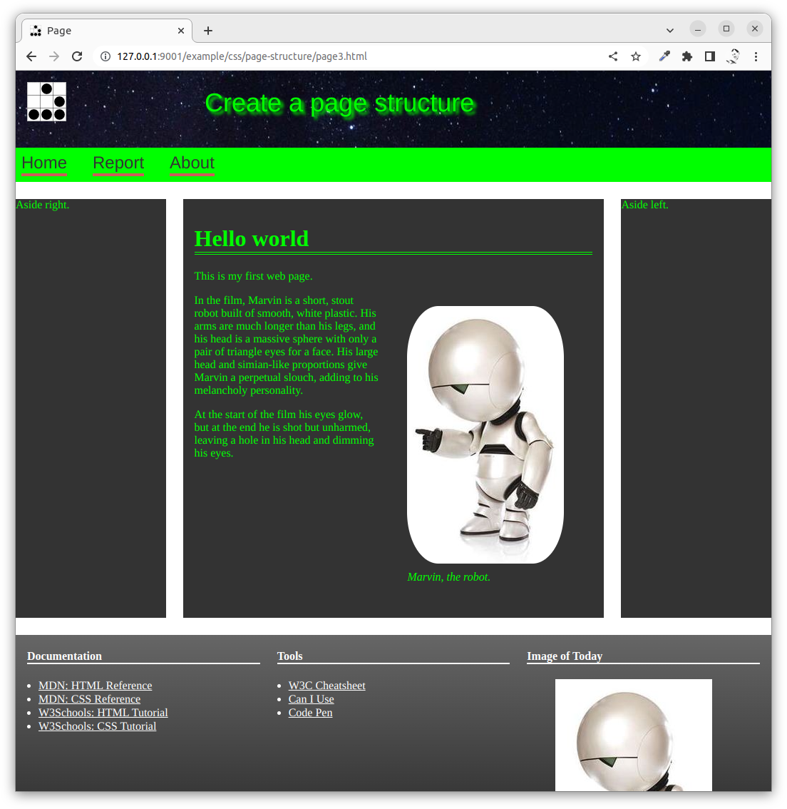


Prepare
---------------------------

Before doing this exercise you should have done the exercise '[A "Hello World" example with a webpage](../../html/hello-world)' or have equal knowledge of the basics of HTML and CSS.


Directory structure
---------------------------

The directory structure for this exercise, when it is done, looks like this.

```text
$ tree .                      
.                             
├── README.md                 
├── css                       
│   ├── base.css              
│   ├── footer.css            
│   ├── header.css            
│   ├── main.css              
│   ├── navbar.css            
│   ├── responsive.css        
│   ├── style copy.css        
│   ├── style.css             
│   ├── three_col.css         
│   └── two_col.css           
├── img                       
│   ├── glider.png            
│   ├── marvin.jpg            
│   └── starry-night.jpg      
├── page.html                 
├── page2.html                
└── page3.html                
                              
2 directories, 17 files       
```

Do create a directory, for example `public/example/css/page-structure` where you can work in.


Create a webpage `page.html`
---------------------------

Create a webpage that provides a general structure with a header, navbar, main and footer. The idea is that the header is the site header and it is the same for all the pages on the site. The same applies to the navbar and the footer. The thing that differs between the pages are the content in the main part.

The basic structure of the HTML page can look like this.

```html
<!doctype html>
<html>
<head>
</head>

<body>
  <header>
    Header
  </header>

  <nav>
    Navbar
  </nav>

  <main>
    <h1>Main h1</h1>
    <p>Main p.</p>
  </main>

  <footer>
    Footer
  </footer>
</body>
</html>
```

Open the file and it will look something like this.

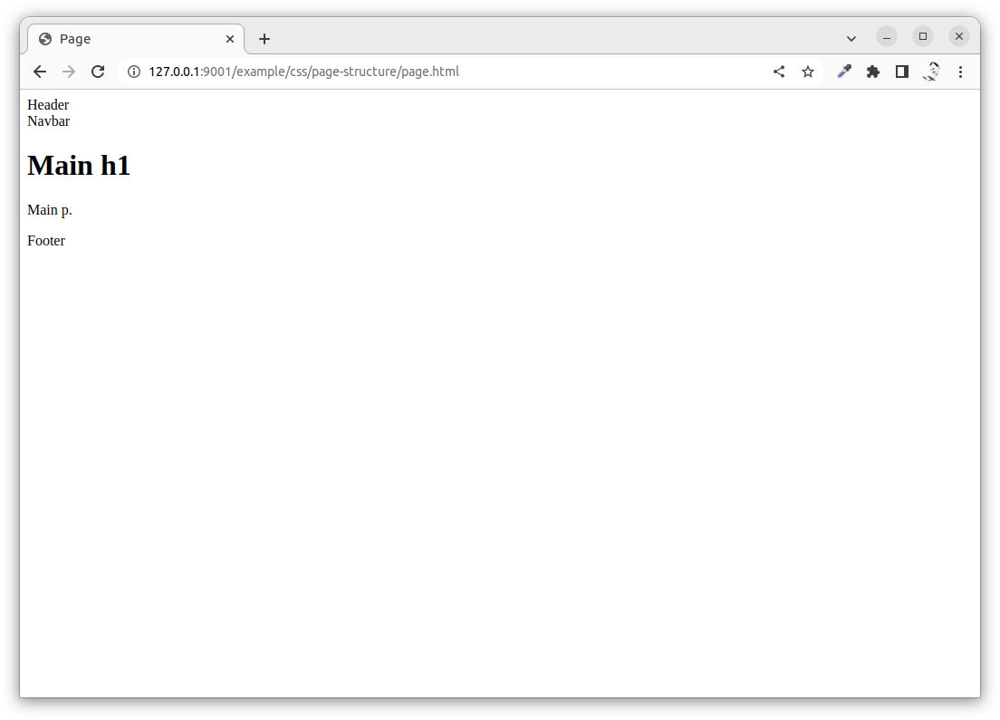

Verify that htmlhint passes.

By the way, do add a title and a favicon to the page.


Add content to main
---------------------------

Take some content and add it to main, add text and an image. I will use the content I had in the "Hello World" exercise.

First I add the content to the main, without any style.

```html
<main>
    <h1>Hello world</h1>
    <p>This is my first web page.</p>
    <figure class="right">
        
        <figcaption>Marvin, the robot.</figcaption>
    </figure>
    <p>In the film, Marvin is a short, stout robot built of smooth, white plastic. His arms are much longer than his legs, and his head is a massive sphere with only a pair of triangle eyes for a face. His large head and simian-like proportions give Marvin a perpetual slouch, adding to his melancholy personality.</p>
    <p>At the start of the film his eyes glow, but at the end he is shot but unharmed, leaving a hole in his head and dimming his eyes.</p>
</main>
```

You may add any content you feel like. We just want to have some content to work with.

The page now looks like this.

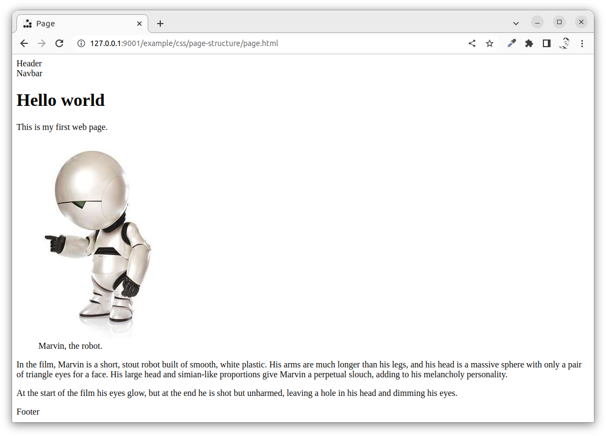


Link to a stylesheet `css/style.css`
---------------------------

Lets add a stylesheet `css/style.css` that imports another stylesheet called `css/main.css`. Separating the code into different stylesheets might make it easier to separate what code applies to what section. That will at least be valid during this exercise.

This is how to create the `css/style.css`.

```css
@import url("main.css");
```

In the file `css/main.css` you add the stylesheet to style the main part of the page. I will use the same style that was applied in the "Hello world" exercise.

Do not forget to link the webpage to the stylesheet, but only link to `css/style.css`.

The page now looks like this.

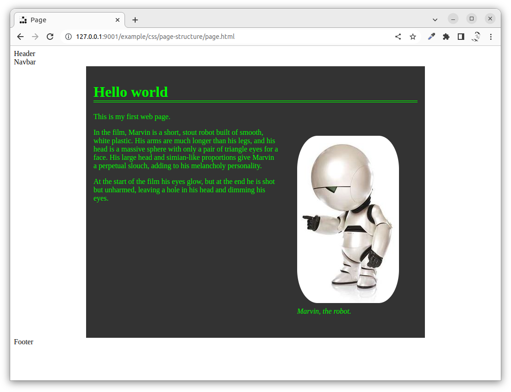

You could now try to open the source code for the page (in the browser -> view source code) and navigate to the stylesheet. It looks like this.

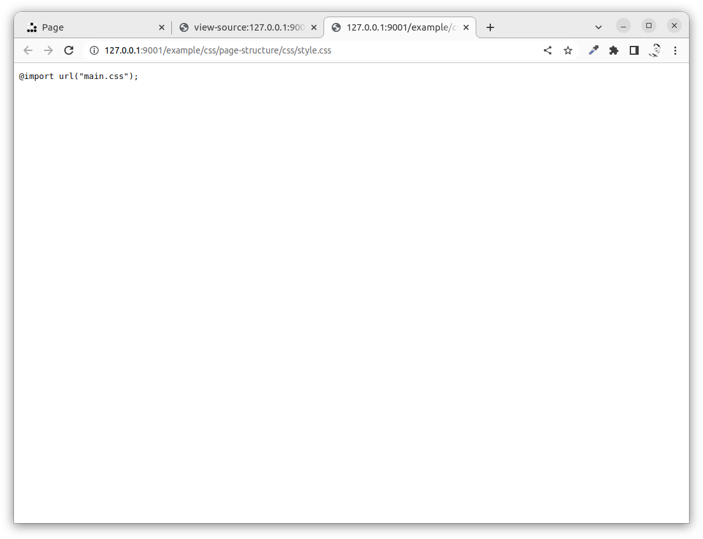

It is good to know about this possibility. You can also edit the url ant change `style.css` to `main.css` to verify the source code the browser will recieve.

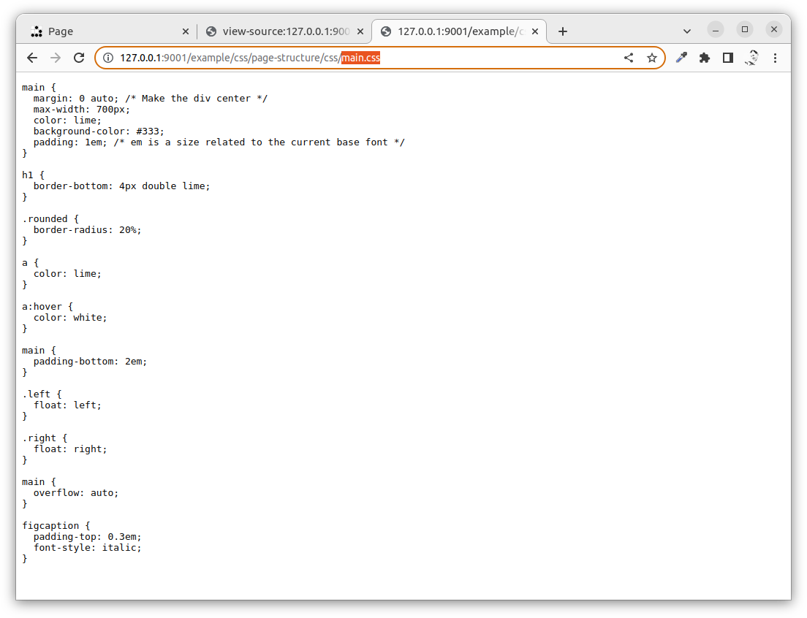

Ensure that you code passes the linters.


Add content to the footer
---------------------------

Lets start with the footer and add some content to it. Lets create three divs that has lists of links and at the bottom we create a paragraph with a copyright message.

The html structure is like this. I will add a class `sitefooter` to the footer element since it is best practice to style classes and not directly on the elements.

```html
<footer class="sitefooter">
    <div class="row">
        <div class="col3 box">
            Some content...
        </div>

        <div class="col3 box">
            Some content...
        </div>

        <div class="col3 box">
            Some content...
        </div>
    </div>

    <div class="row">
        <div class="col1 final">
            Some content...
        </div>
    </div>
</footer>
```

The structure I have choosen contains a set of divs called "row" and some divs called "columns". This will help me with styling the footer later on. The structure is choosen to make it easier to style the way I want to have it.

The page now looks like this.


Before styling, lets add some content into the footer. I will add the following into each part.

Links to the docs.

```html
<h4>Documentation</h4>
<ul>
    <li><a href="https://developer.mozilla.org/en-US/docs/Web/HTML/Reference">MDN: HTML Reference</a></li>
    <li><a href="https://developer.mozilla.org/en-US/docs/Web/CSS/Reference">MDN: CSS Reference</a></li>
    <li><a href="https://www.w3schools.com/html/">W3Schools: HTML Tutorial</a></li>
    <li><a href="https://www.w3schools.com/css/">W3Schools: CSS Tutorial</a></li>
</ul>
```

Links to some tools.

```html
<h4>Tools</h4>
<ul>
    <li><a href="https://www.w3.org/2009/cheatsheet/">W3C Cheatsheet</a></li>
    <li><a href="hthttps://caniuse.com/">Can I Use</a></li>
    <li><a href="https://codepen.io/">Code Pen</a></li>
</ul>
```

Some random picture.

```html
<h4>Image of Today</h4>
<figure class="small">
    
</figure>
```

The final copyright notice.

```html
<p>Copyright © by Mikael</p>
```

The page now looks like this.

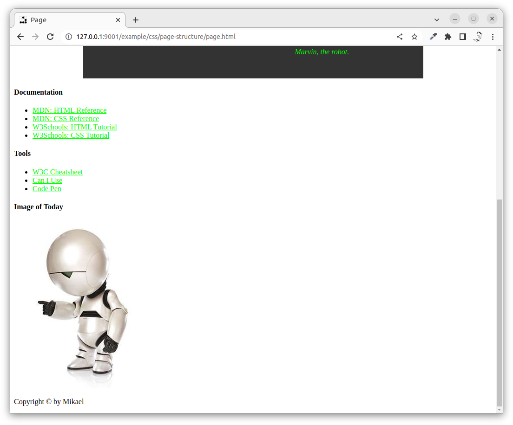

Verify that the linters pass.


Style the footer
---------------------------

Wh shall now style the footer so we get one row with three columns for the docs, tools and picture. The copyright message should be at the bottom of its own row.

I will go with white on black for the footer.

There exists techniques like float, flex and grid to style the rows and columns using CSS. I will use flex for this.

To learn more on flex you can read the article "[A Complete Guide to Flexbox](https://css-tricks.com/snippets/css/a-guide-to-flexbox/)" or checkout [MDN: Flexbox](https://developer.mozilla.org/en-US/docs/Learn/CSS/CSS_layout/Flexbox).

I will put all the style code into `style/footer.css` and import it in the `css/style.css`.

This is how ``css/style.css` will look like.

```css
@import url("main.css");
@import url("footer.css");
```

We start with styling the footer div as a whole, with colors, backgrounds and links.

```css
/*
 * Set colors and size.
 */
 .sitefooter {
  background: linear-gradient(to bottom, #666, #000);
  color: #FFF;
  padding: 0 1em;
}

/*
* Style the links.
*/
.sitefooter a {
  color: #FFF;
}

.sitefooter a:hover {
  color: lime;
  text-decoration: none;
}
```

The page now looks like this.

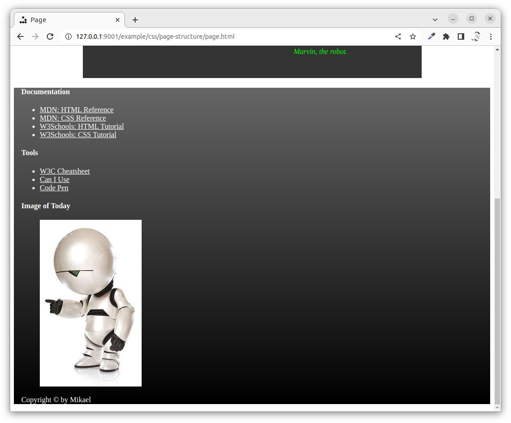

Now lets style the rows and columns using flex.

```css
/*
* Style the rows and columns.
*/
.sitefooter .row {
  display: flex;
  flex-direction: row;
  justify-content: space-between;
  gap: 24px;
}

.sitefooter .row > .col3 {
  width: calc(100% / 3);
}

.sitefooter .row > .col1 {
  width: 100%;
}
```

The idea is to have the `row` to contain `columns` and the row is displayed as flex and all its children (the columns) will then be displayed as flex in the row direction with a small gap between them.

Each column `col1` and `col3` is then setup to have a defined width there the col1 spans the whole width and the col3 spans one third of the available width.

Flex provides many configuration options and is a straight forward way to layout content to the page.

The page now looks like this.

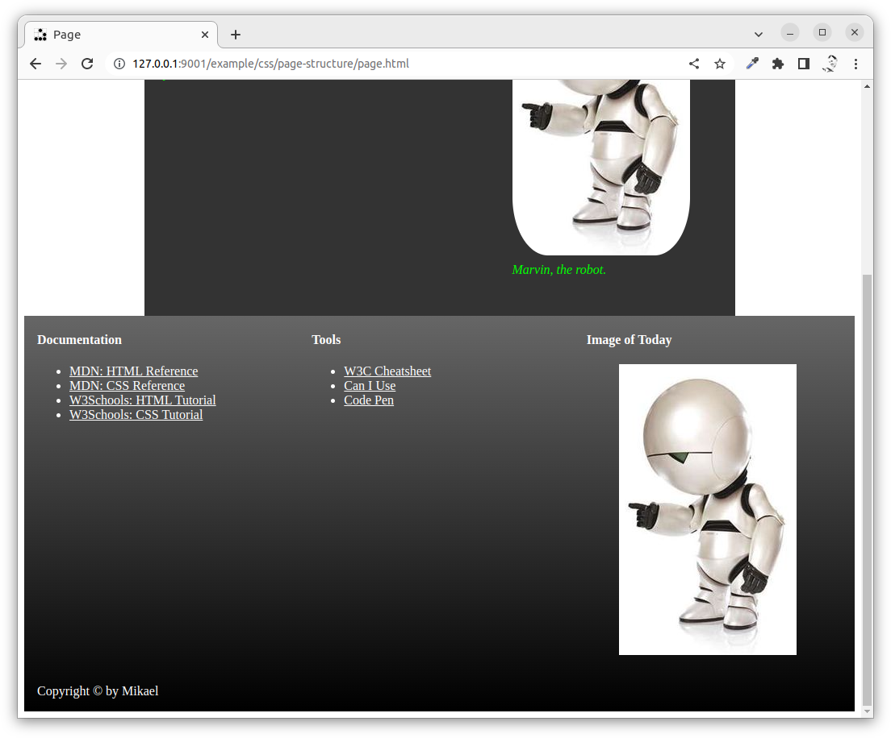

Now you can try to apply some more personal style to finish up the footer.

I am satisfied with this for now.

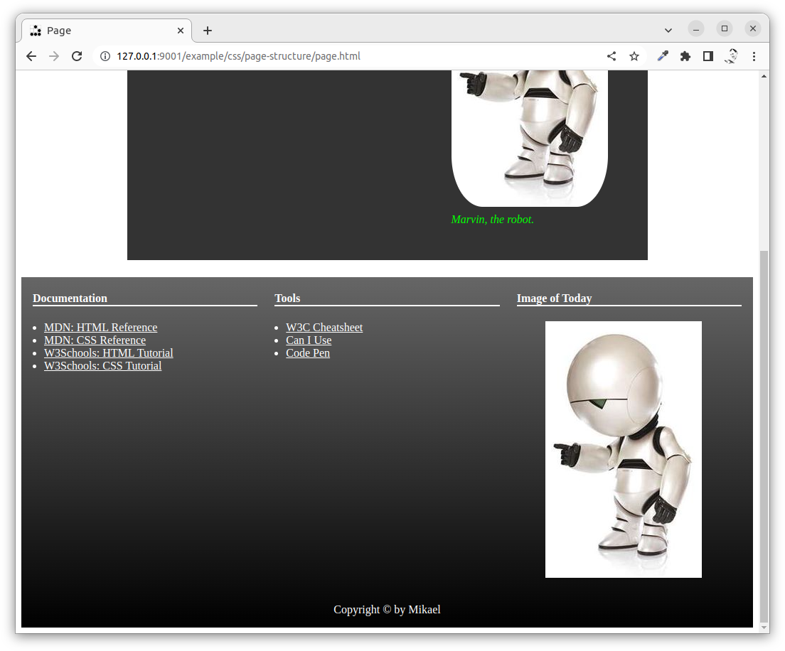


Box layout model
---------------------------

Each element can have a margin, border, padding, widht and height and this is called the CSS box model which you can read about in the article "[Introduction to the CSS basic box model](https://developer.mozilla.org/en-US/docs/Web/CSS/CSS_Box_Model/Introduction_to_the_CSS_box_model)".

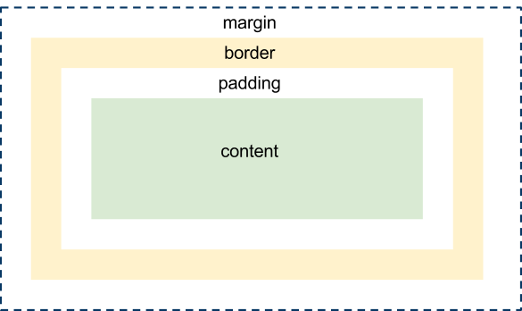

Nowmore, the common best practice is to use the "box-sizing: border-box" to ease understanding how the padding affects the width of the content box. You can read on the solution in the link below.

```css
/**
 * Apply a natural box layout model to all elements, but allowing components
 * to change.
 * https://www.paulirish.com/2012/box-sizing-border-box-ftw/
 */
html {
      box-sizing: border-box;
}
*, *:before, *:after {
      box-sizing: inherit;
}
```

You can also read on [MDN: box-sizing](https://developer.mozilla.org/en-US/docs/Web/CSS/box-sizing) about how the width is calculated and affected.

This stylesheet code we add in a file `css/base.css` which we import first of all stylesheets.

```css
@import url("base.css");
@import url("main.css");
@import url("footer.css");
```

When you apply the style and reload the page you might see some parts changing their width, that will be with respect to how the border-box model works.


The header
---------------------------

Lets style the header using a background image, a logo and a site title. We could use float to do this, or grid, or css positioning. I will however stick with the flex styling model to layout the bases for the header.

The html structure will look like this for the header.

```html
<header class="siteheader">
    <div class="row">
        <div class="logo">
            Logo
        </div>
        <div class="title">
            Site title
        </div>
    </div>
</header>
```

The page now looks like this.

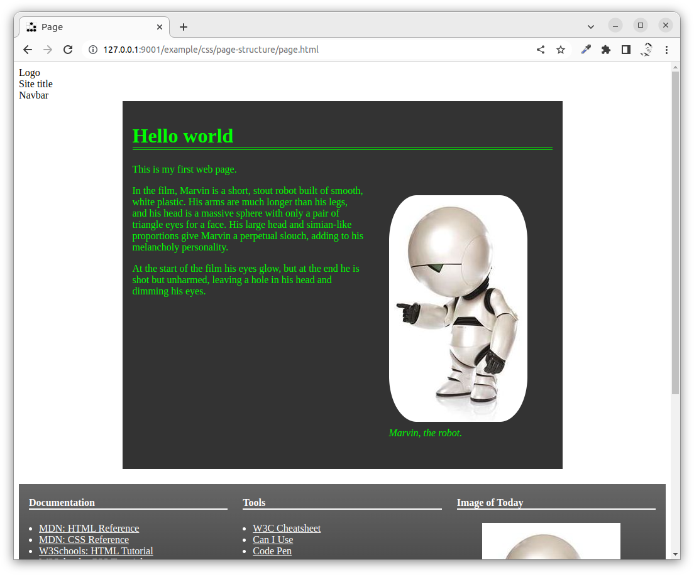

I will then apply some content to the header for the logo and the site title. I add some css classes to make it easier to style.

```html
<div class="logo">
    
</div>

<div class="title">
    <span>Create a page structure</span>
</div>
```

The background image I will add using css, like this. I will add it to `css/header.css`.

```css
.siteheader {
  background-image: url("../img/starry-night.jpg");
  background-repeat: no-repeat;
  background-position: center;
  background-size: cover;
}
```

I need to change the color of the site title, otherwise it will be black on top of a starry night.

```css
.siteheader .title {
  color: lime;
}
```

The page now looks like this.

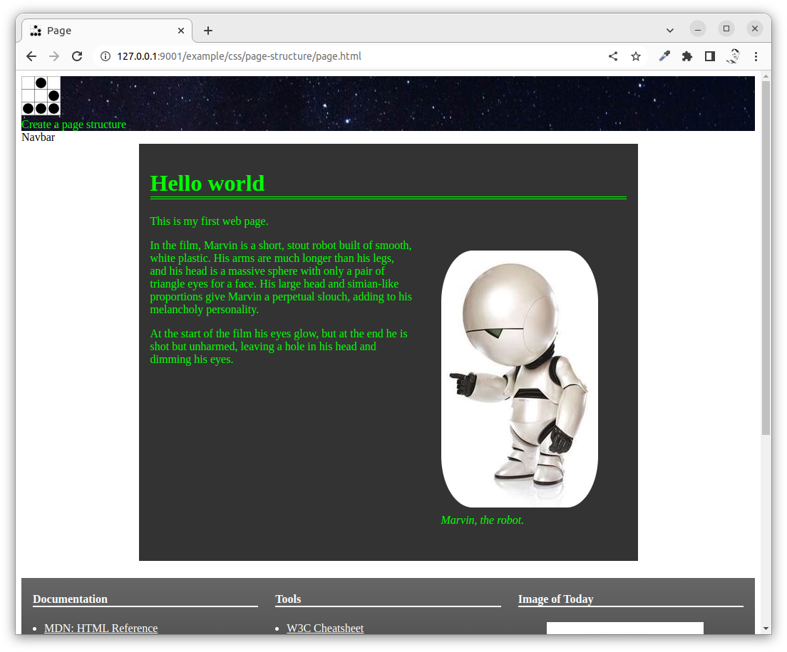

I add some style for the flex part, so that the logo and the title gets the bases for their position. The basics here are the same as for the footer so we apply the display flex for the row div and each of its children gets a defined width.

```css
.siteheader .row {
  display: flex;
  flex-direction: row;
}

.siteheader .row > .logo {
  width: calc(100% * 1 / 4);
}

.siteheader .row > .title {
  width: calc(100% * 3 / 4);
}
```

The page now looks like this.

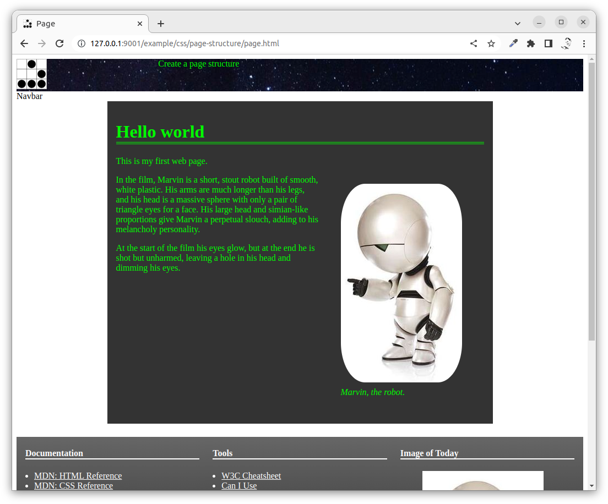

I can then add some css styling, to make the header a bit more appealing, to end up with the final header for the site.

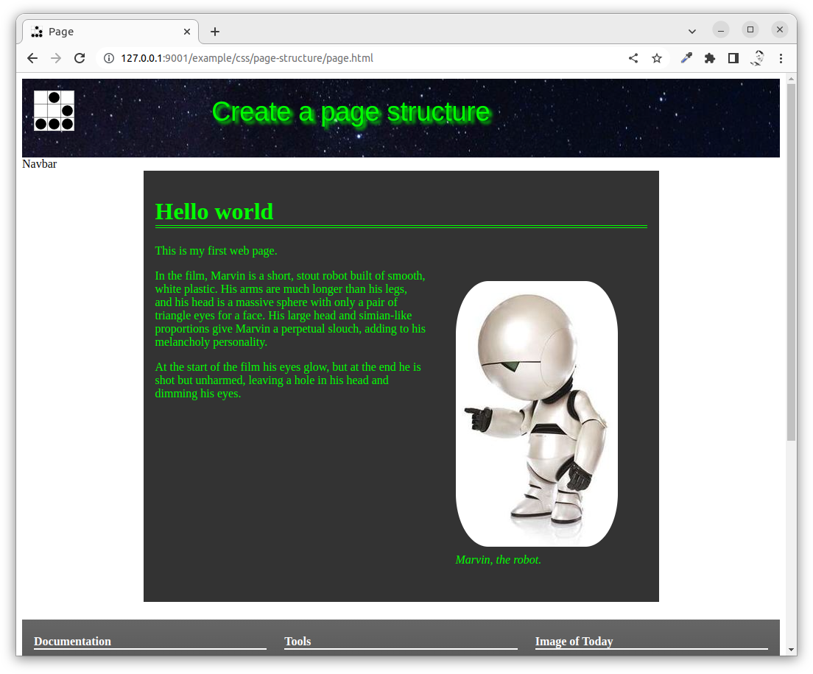

As always, run the linters to fix any issues.


The navbar
---------------------------

Now we can add a navbar and I will put it below the header, but feel free to put it over the header if you please.

A navbar is to navigate between the main pages on the site. The html structure could look like this.

```html
<nav>
    <a href="">Home</a> 
    <a href="">Report</a> 
    <a href="">About</a> 
</nav>
```

I will however use ul/li to structure the list since I feel it provides me with added possibilities to style the navbar.

```html
<nav class="navbar">
    <ul>
        <li><a href="">Home</a></li>
        <li><a href="">Report</a></li>
        <li><a href="">About</a></li>
    </ul>
</nav>
```

Since I only have one page in this example I will skip adding an actual href to the example.

The page now looks like this.

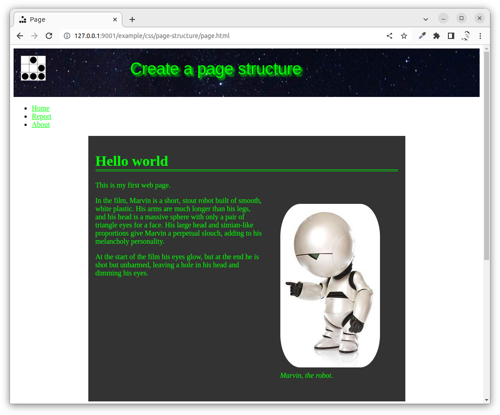

I think I will go with black on green this time and the links will have red-ish when the user hover it.

```css
.navbar {
  background-color: lime;
}

.navbar a {
  color: #333;
  text-decoration: none;
}

.navbar a:hover {
  color: indianred;
  text-decoration: none;
}
```

The page now looks like this.

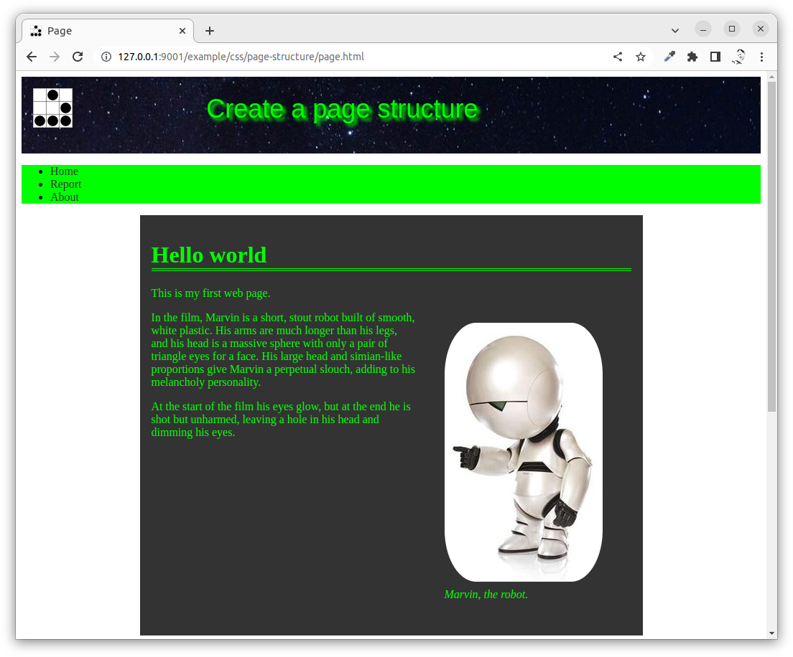

To start styling the navbar we need to remove the list styling, like this.

```css
.navbar ul {
  list-style-type: none;
  margin: 0;
  padding: 0;
}
```

We then make the list items "inline-block" instead of "block" which makes them appear on one row.

```css
.navbar li {
  display: inline-block;
  margin-right: 16px;
}
```

The page now looks like this.

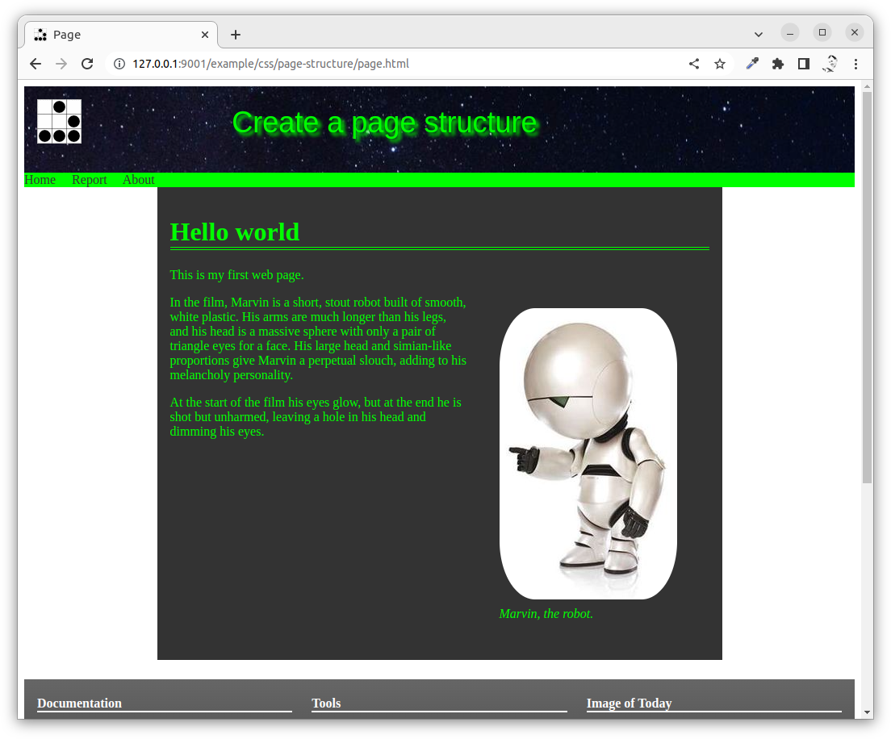

Now we have the structure in place and can start styling the navbar so it looks nicer.

The main parts to style now is the anchor through the a and a:hover. YOu can give it som margin to make the whole clickable area appear larger.

When I was satisfied the page looks like this.

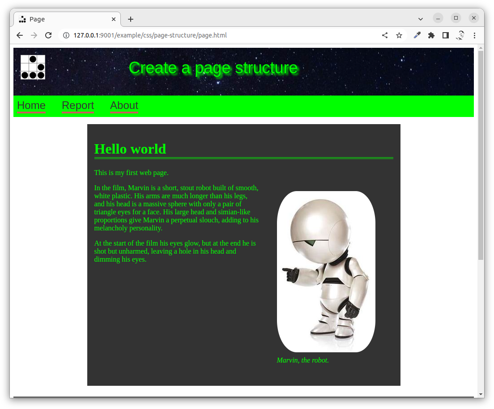


Reset the body margin
---------------------------

If you look real close you can see a margin of 8px between the body and the browser. It is the body element that has a default margin of 8px.

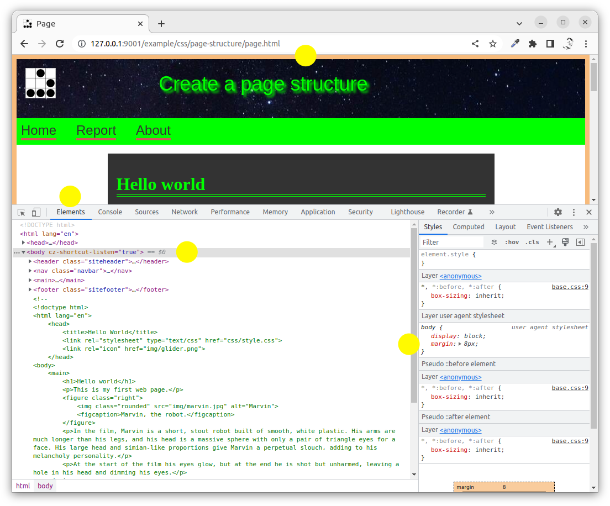

We can remove that to make all parts of the page stretch all to the border of the browser windows. Put the code in the `css/base.css`.

```css
body {
  margin: 0;
}
```

Now the page looks like this, you can see the outcome using the dev tools.

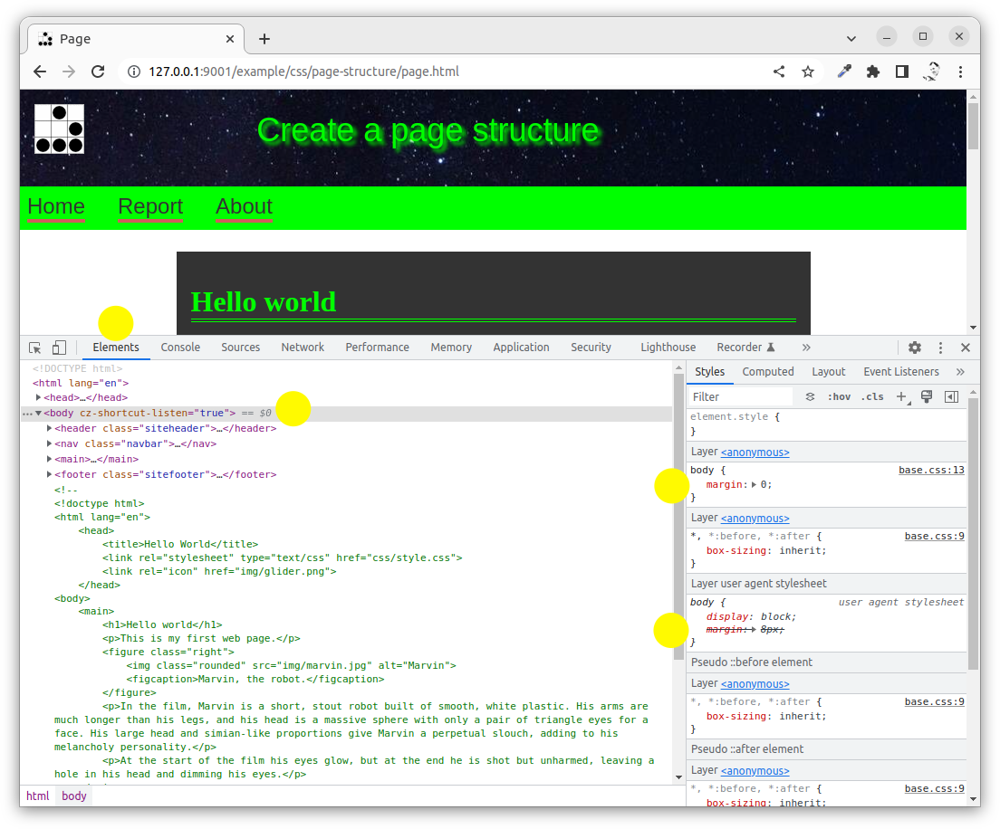


Main with aside - two columns
---------------------------

Lets focus on the main part and add a two column layout by adding an aside right next to the main element. 

To do this we copy the `page.html` and saves it as `page2.html`. Do also update the navbar so you can navigate between the two pages.

The basic structure is like this.

```html
<div class="two-col">

  <main>
    Main.
  </main>

  <aside>
    Aside.
  </aside>

</div>
```

We can use flex to layout the two columns beside each other. I will add this to the file `css/two_col.css`. The row-wrapper-class is here called `two-col`.

```css
.two-col {
  display: flex;
  flex-direction: row;
  gap: 24px;
  max-width:1100px;
}

.two-col main {
  width: calc(100% * 16 / 24);
}

.two-col aside {
  width: calc(100% *  8 / 24);
}
```

I gave the wrapper class a max-width to solve the relad wide screens.

The idea with `16/24` and `8/24` is to divide the page in 24 equal width columns and that all content is applied with a width related to this. This is tha basis for thinking as a column grid when sizing and layout out content to the page.

When I then apply some color to the aside, it might look like this.

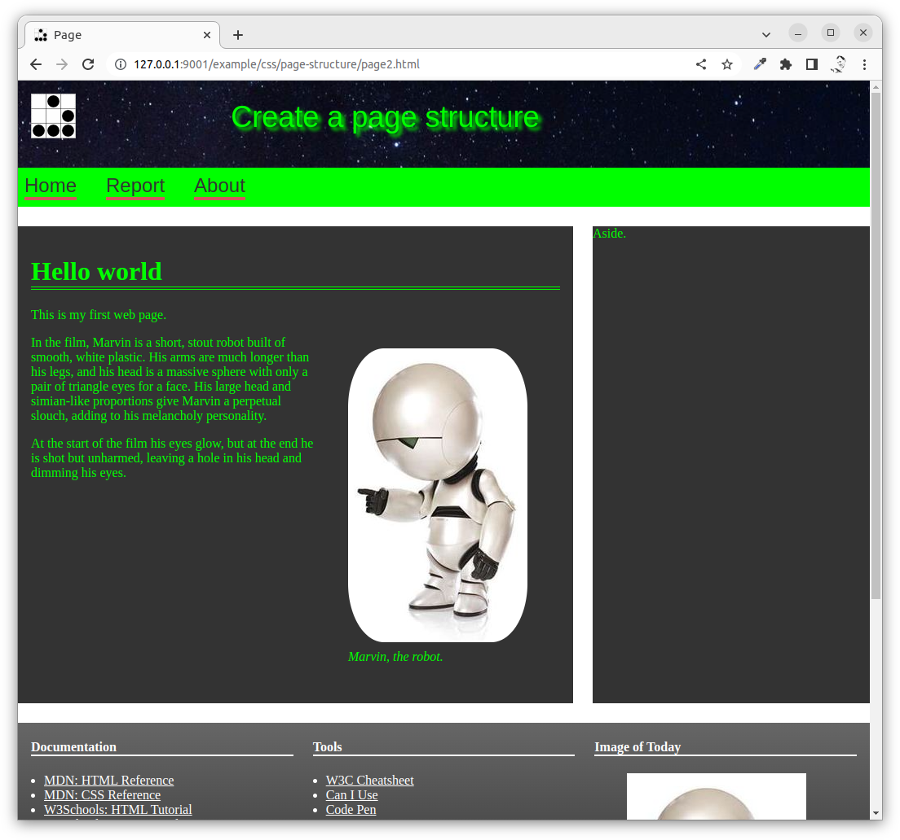

A "fun thing" with flex is that it is real easy to swap the main and the aside making the aside to appear to the left of the main instead. You can see how it is done using `order: 2` on the main element in the below image.

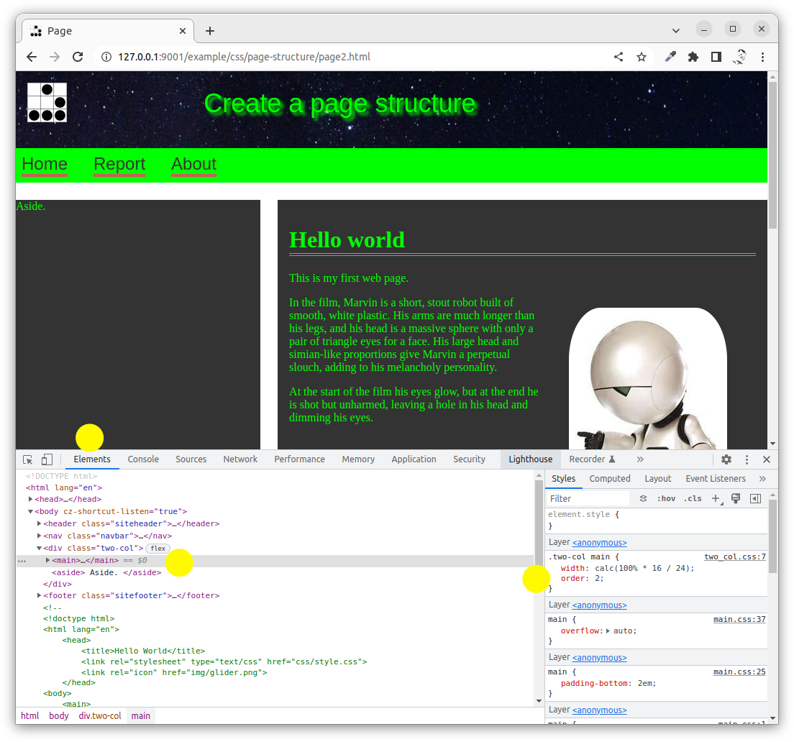


Main with aside - three columns
---------------------------

Building on the two column layout we can add a third column using another aside.

To do this we copy the `page2.html` and saves it as `page3.html`. Do also update the navbar so you can navigate between all the pages.

The basic structure looks like this for a three column layout.

```html
<div class="three-col">

  <main>
    Main.
  </main>

  <aside class="left">
    Aside left.
  </aside>

  <aside class="right">
    Aside right.
  </aside>

</div>
```

We now know that I can order the columns as I wish, so no need to put them in the right order from the beginning.

Add the flex styling to create the three column setup.

```css
.three-col {
  display: flex;
  flex-direction: row;
  gap: 24px;
  max-width:1100px;
}

.three-col main {
  width: calc(100% * 14 / 24);
}

.three-col aside {
  width: calc(100% *  5 / 24);
}
```

At first it will look like this.

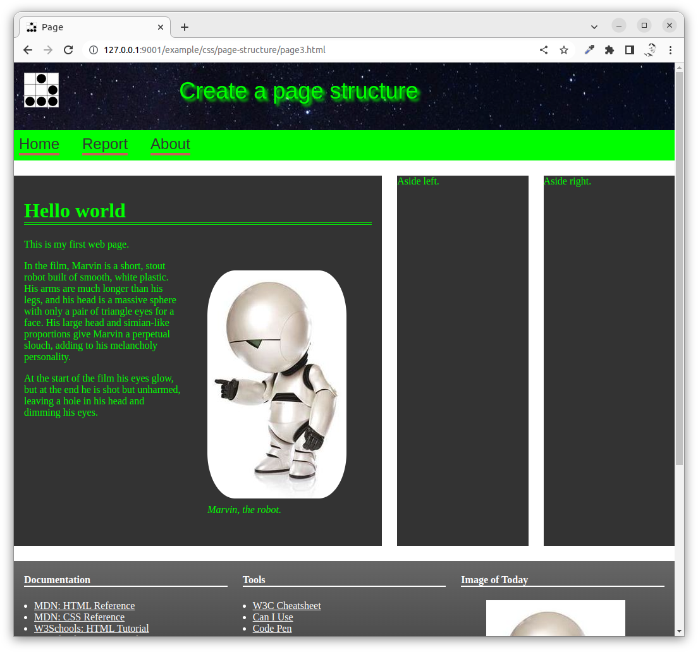

Then, applying `order: -1` to the aside right will change the order the flexboxes are rendered.

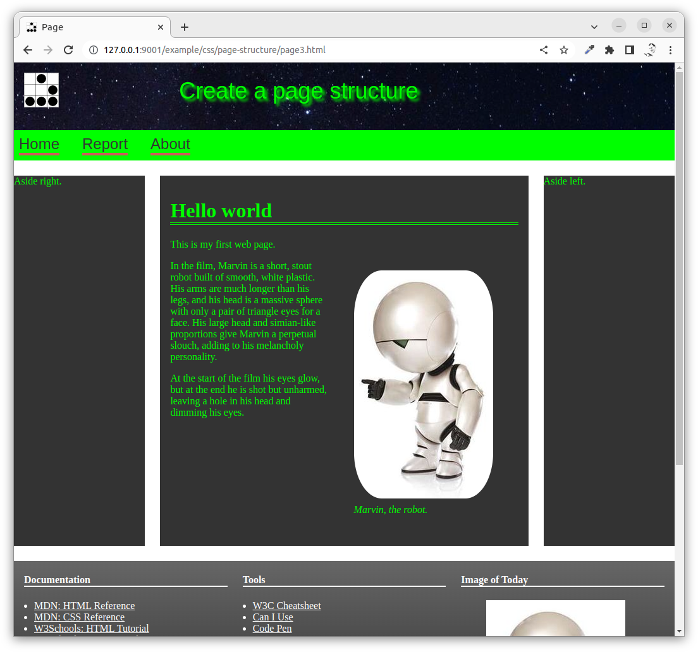

Perhaps I should have applied `order: -1` to the aside.left instead, that would make a bit more sense.

Now you have the basics for a column layout of the main part of the webpage.


Responsive website
---------------------------

A responsive website means that it changes its content layout depending on the width of the browser. This results in a website that can be displayed well on mobile browser (portrait/landscape), tablets (portrait/landscape), portable computers, desktop computers and really wide screens.

To prepare the page for a responsive layout we add the following setup to the head element of the page.

```html
<head>
  <meta name="viewport" content="width=device-width, initial-scale=1">
</head>
```

You can read about this setting in the article [MDN: Viewport meta tag](https://developer.mozilla.org/en-US/docs/Web/HTML/Viewport_meta_tag).

Now, lets proceed to analyse the current layout using the devtools and the mobile viewer. The footer, as an example, looks like this when we have a wide enough display.

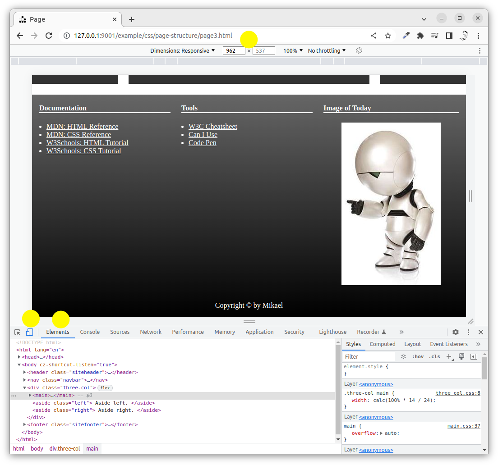

Looking at the image we can see that the width is currently above 900px and all looks fine, but what it the site were to be displayed on a media where the width were 400px?

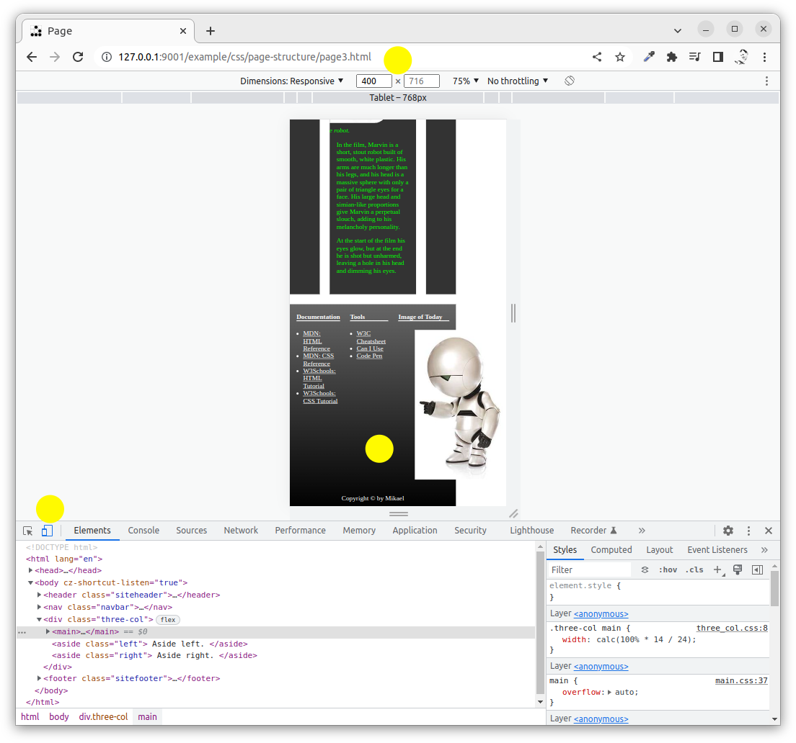

The image takes more width than its column and the three columns gets all harder to read since they are smaller and smaller.

This is how the footer looks like on a mobile device.

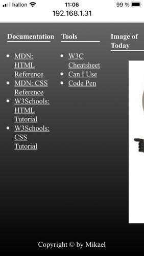

Lets fix this by adding some responsive aspects.


Responsive images
---------------------------

The way to make images responsive is to make them take up max 100% of its surrounding content box. They can not be allowed to be wider. I will add this to a `css.responsive.css` and it is imported as the last stylesheet in `css/style.css`.

```css
img {
  max-width: 100%;
}
```

Now we can reload the site and see that the image fits to its surrounding content box. This is the first and easy way to work with responsive images.

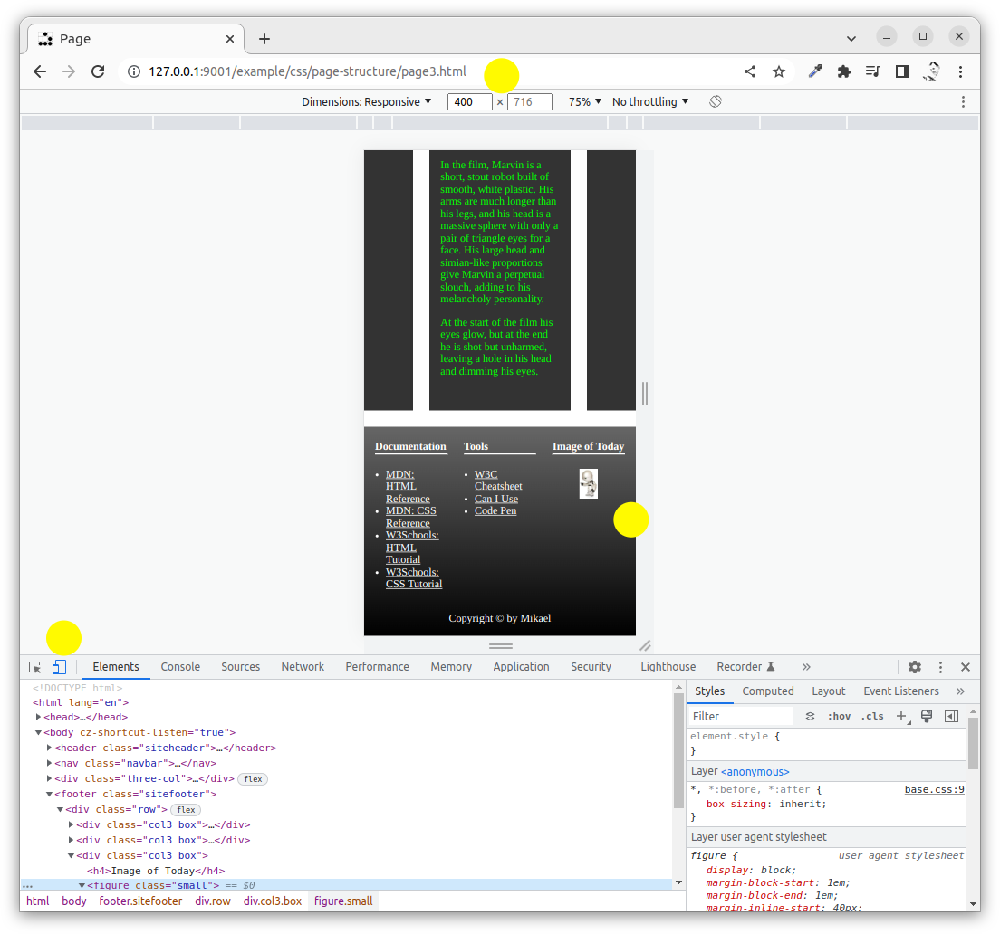

There are more advanced ways of working with different images for different layouts and widths with the picture element, read more on [MDN: The Picture element](https://developer.mozilla.org/en-US/docs/Web/HTML/Element/picture).

Using the image max-width is however good enough for now.


Media query for the footer
---------------------------

Looking at the site in the mobile browser one can see that the content divided into three columns makes it hard to read. The usual way to solve this is to stack the column on top of each other.

To do this we select a breakpoint, when the width is smaller than this breakpoint we stack the footer columns ontop of each other.

The breakpoint is solved with a media query which has a general layout like this.

```css
@media (max-width: 600px) {
  /* Style to be applied when width is less than the breakpoint */
}
```

To stack the footer column we can use the width of the flexboxes and set it to 100% and make them wrap instead of being on one row.

```css
@media (max-width: 600px) {
  .sitefooter .row {
    flex-wrap: wrap;
  }

  .sitefooter .row > .col3 {
    /* width: calc(100% / 3); */
    width: 100%;
  }
}
```

This is how it will look like.

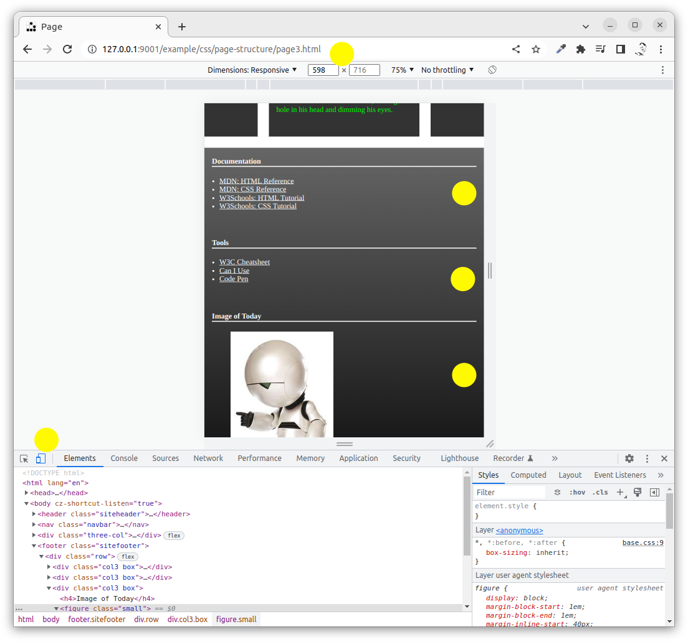

We now have a stacking strategy for the responsive website, at least for the footer part.


Media query for the main and aside
---------------------------

We can use the same stacking strategy for the main and aside having 1/2/3 column layout.

The 1 column layout should be pretty straight forward, perhaps that will work even without a breakpoint.

The 2 column layout need to stack when the width gets to narrow to display both columns side by side.

The 3 column layout could first stack one aside and move to a 2 column layout and when that gets to narrow to display the content it can stack all thre columns on top. We can decide the order of how we stack the columns, the princip might be to show the most important content first, which is usually the main part.

Checking how the current layout works in a responsive way shows that I feel alright with the current 1 column layout. Even the images seems okey so I will leave it as it is.

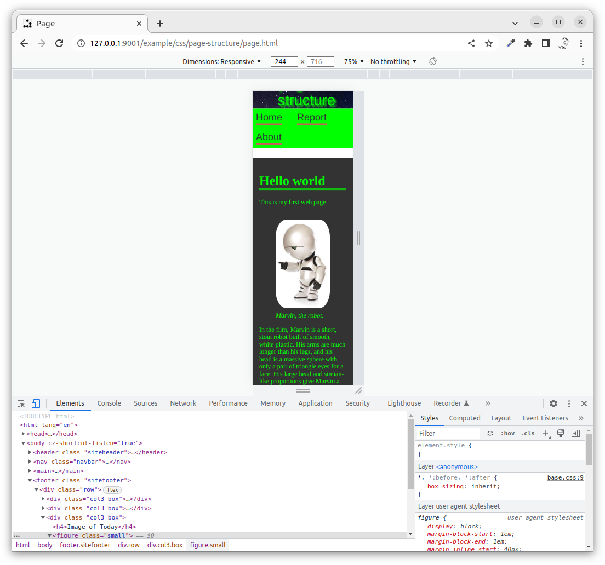

For the 2 column layout a breakpoint could be around 700px, but it partly depends on what content is displayed in the aside. This is how I do it.

```css
@media (max-width: 700px) {
  .two-col {
    flex-wrap: wrap;
  }
  
  .two-col main {
    width: 100%;
  }
  
  .two-col aside {
    width: 100%;
  }
}
```

This is how it looks like when stacked.

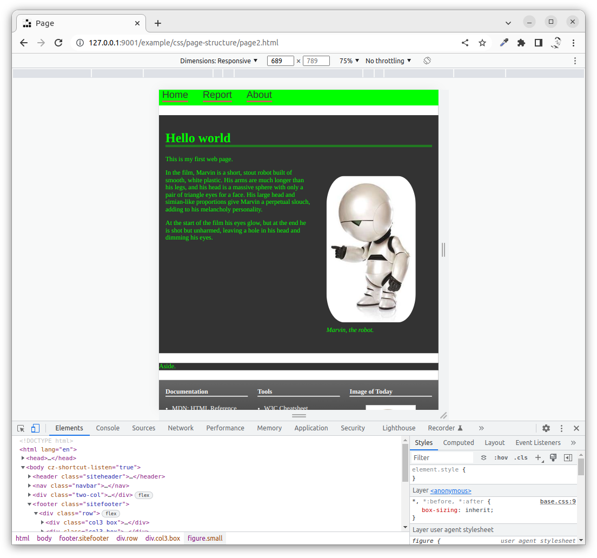

I assume you know how to proceed with the 3 column layout?

First find the breakpoints, then apply the style, reload the page and check the behaviour at each breakpoint, modify as needed.

For my example I choose the first breakpoint at 900px where the left columns get stacked to the bottom and a breakpoint on 700px as above to further stack the remaining 2 column layout.

First the breakpoint at 900px.

```css
@media (max-width: 900px) {
  .three-col {
    flex-wrap: wrap;
    gap: 0;
  }
  
  .three-col main {
    width: calc(100% * 16 / 24);
    order: 1;
    margin: 0;
  }
  
  .three-col aside.right {
    width: calc(100% *  8 / 24);
    order: 2;
  }

  .three-col aside.left {
    width: 100%;
    order: 3;
  }
}
```

Then the breakpoint at 700px.

```css
@media (max-width: 700px) {
  .three-col main {
    width: 100%;
  }
  
  .three-col aside.right {
    width: 100%;
  }
}
```

This is how tha page looks at the different breakpoints.

Wider than 900px.

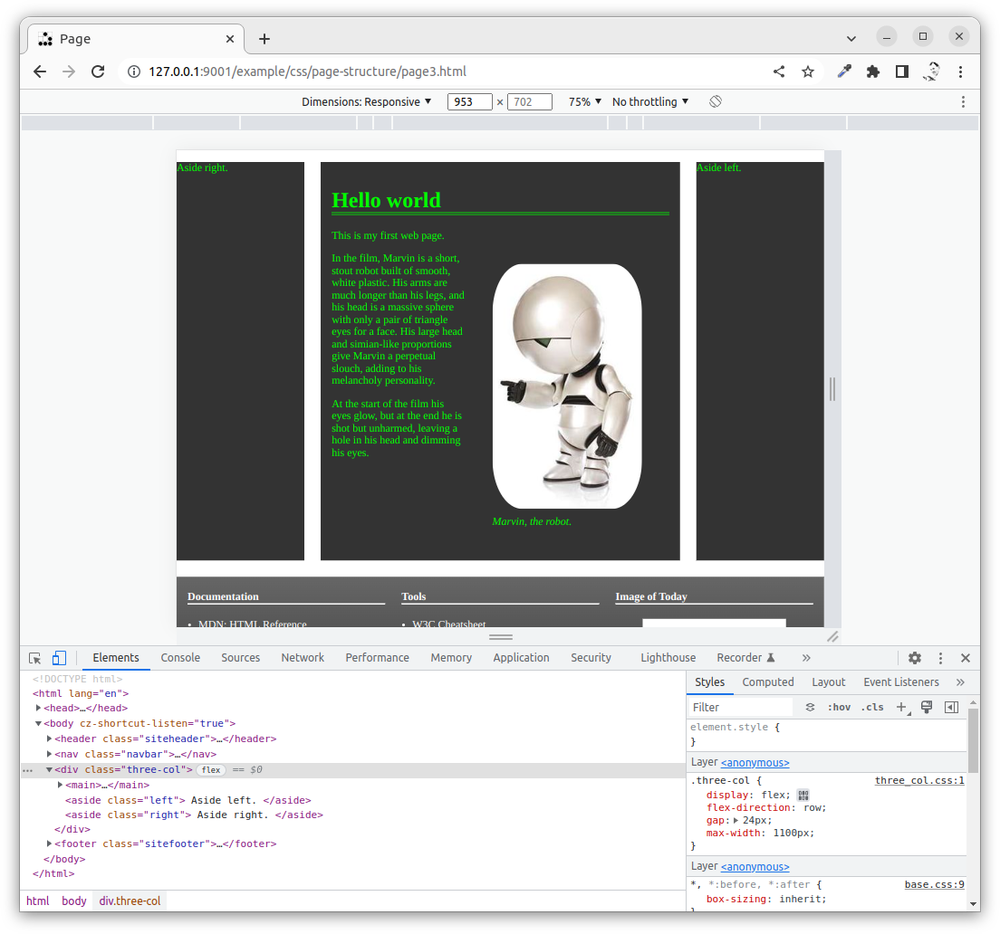

Less than 900px.

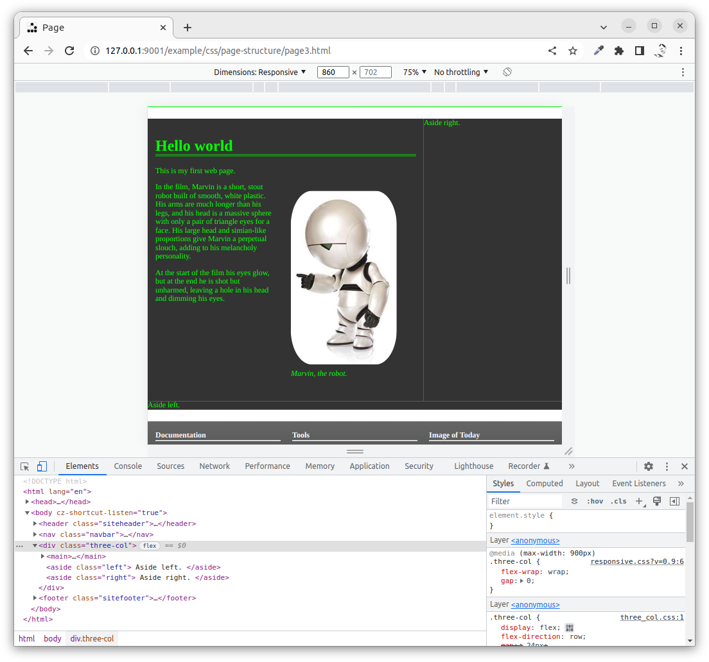

Less than 700px.

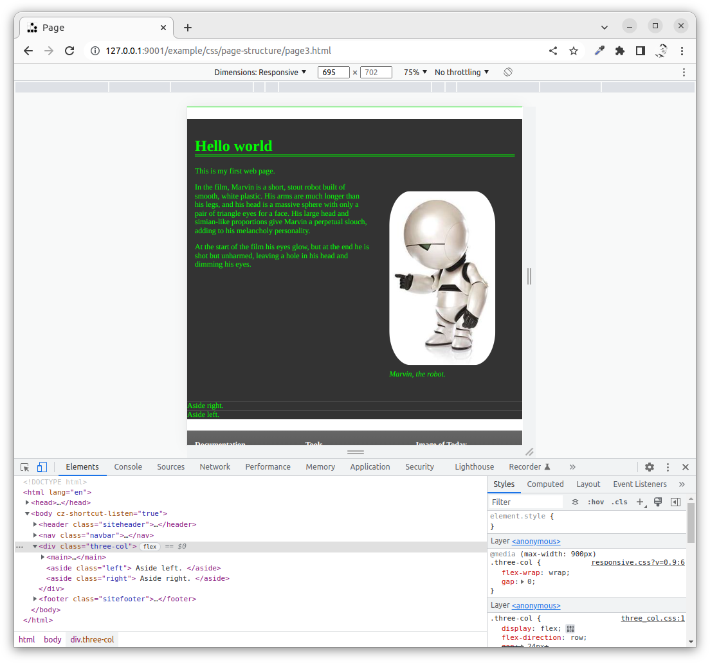

The technique for stacking the columns on top of each other is rather straight forward and this is perhaps one of the most important part of a responsive website.

A note on hiding information from the viewer - that could also be a variant, but hiding information on one screen that is available on another screen might confuse and irritate the user so the default way is to not hide content, but stack it.

<!--
One important thing might be to always have the most important css code at the bottom, so the higher breakpoints go on the top in the code and the more narrow breakpoints go to the bottom of the code. It is unsure it that makes any difference, but it provides a good overview of the breakpoints and in what order hey come.
-->


Really wide screen
---------------------------

Our focus currently was to design the site for a standard width of the browser and adapt to more narrow widths.

You should also go in the opposite direction to add breakpoints, or perhaps a standard layout, that makes your site appear well on really wide screens where the user has the browser in full screen mode.

The example site currently does not adapt that well to wider screens. Try it out and make a mind exercise to figure out how you could fix it with the smalles amount of css code. There might be several useful solutions to the problem.


Responsive text
---------------------------

When reading the text on mobiles it can look a bit smaller than reading the same text on a desktop computer. You can see how this might differ in the two images below taken from landscape mode (text large) and portrait mode (text smaller) on the same phone.

Landscape on a mobile with large enough text.

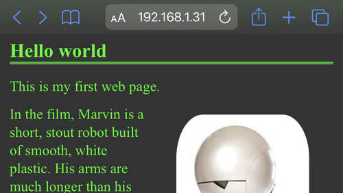

Portrait on a mobile with smaller text.

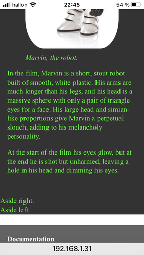

Therefore you might consider to change the fontsize when going to more narrow width. You might want to check this out on some acutal devices to see what fits best.

Perhaps something like this.

```css
@media (max-width: 700px) {
  body {
    font-size: 20px;
  }
}
```

Responsive typography is an equal important aspect of responsive websites.


Read more
---------------------------

You can read more about responsive typography and other aspects of responsive web design in the article "[MDN: Responsive design](https://developer.mozilla.org/en-US/docs/Learn/CSS/CSS_layout/Responsive_Design)".

There might be more parts of your website needed to have some responsivness, for example the navbar and the header. You can apply the same basic technique on them, to give them some responsive attributes.


Run the linters
---------------------------

Finish up by running all the linters and make them pass with no errors.

Try to use the `:fix` options if you get a lot of errors.


Summary
---------------------------

This exercise provides you with an insight inte different techniques to style and layout the different parts of the website.
