---
revision:
    "2023-11-07": "(B, mos) Minor updates when recording video."
    "2022-11-03": "(A, mos) First release."
---
A "Hello World" example with a webpage
===========================

This is an example on the basic structure of the HTML page with an external stylesheet and a JavaScript file.

The text below shows how you can create your own similair example, step by step. You can also review all the example code in the directory where this README resides.

[[_TOC_]]

This is how it can look like when we are done with this exercise. Still, it is the code behind it that is important.

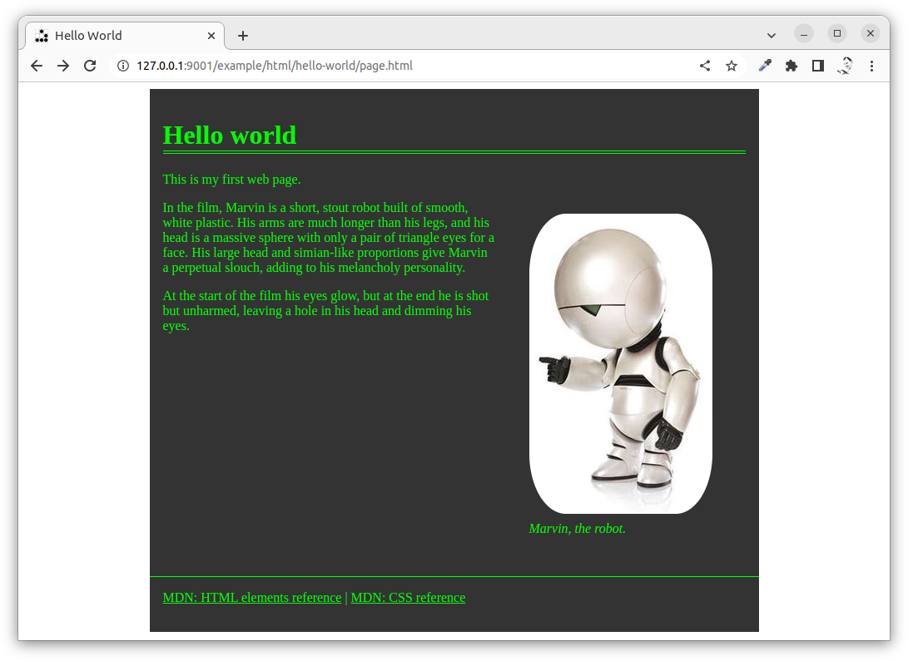


Video
-----------------------------

This is a recorded presentation, 30 minutes long (English), when Mikael goes through the content of this article.

[](https://www.youtube.com/watch?v=3hrJSr-3vIE)


Directory structure
---------------------------

The directory structure for this exercise looks like this.

```text
$ tree .
.
├── css
│   └── style.css
├── img
│   ├── glider.png
│   └── marvin.jpg
├── js
│   └── main.js
└── page.html

3 directories, 5 files
```

Do create a directory, for example `public/hello-world` where you can work in.


Create a webpage `page.html`
---------------------------

Create a webpage that just states "Hello World" and save it in `page.html`.

The basic structure of a HTML page can look like this.

```html
<!doctype html>
<html>
    <head>
    </head>
<body>
    <main>
        <h1>Hello world</h1>
        <p>This is my first webpage.</p>
    </main>
</body>
</html>
```

If you open the file `page.html` in your browser it will look something like this. You can use the url `file:///` and find your webpage through the file system or double-click on it in the file browser.

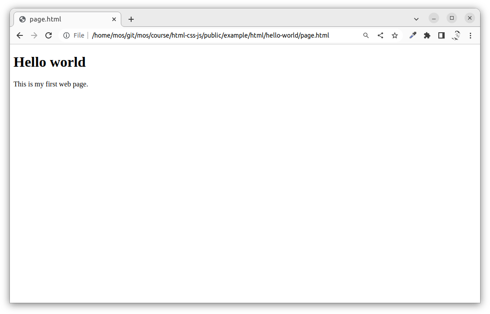

You can now run the linter `htmlhint` to check that everything is fine.

```
npm run htmlhint
```

You might get an error like this.

```text
/public/example/html/hello-world
   L4 |</head>
       ^ <title> must be present in <head> tag. (title-require)
```

That means that a tag `<title>` nneds to be present within the `<head>` element, like this.

```html
<!doctype html>
<html>
    <head>
        <title>Hello World</title>
    </head>
```

It will look like this when you are done.

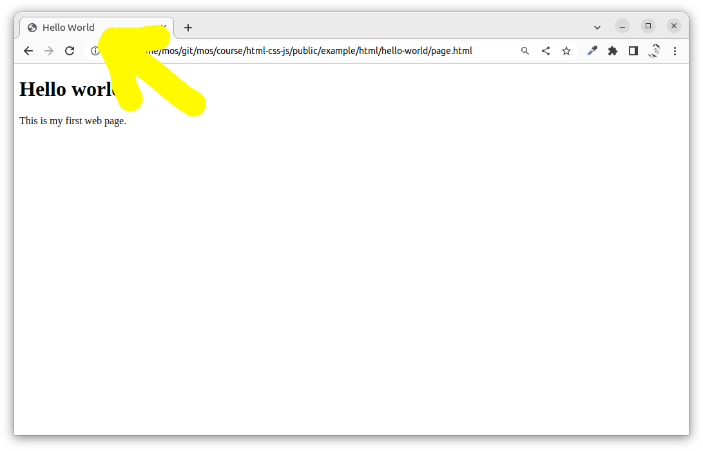

Verify that htmlhint passes.


Link to a stylesheet `css/style.css`
---------------------------

Create a stylesheet `css/style.css` that sets the color to green and the background color of the main element to black. In the webpage, link to the external stylesheet.

First we add the empty stylesheet file and references it from the webpage.

In `page.html` add the following as part of the `<head>` element.

```html
<link rel="stylesheet" type="text/css" href="css/style.css">
```

It can look like this.

```html
<!doctype html>
<html>
    <head>
        <title>Hello World</title>
        <link rel="stylesheet" type="text/css" href="css/style.css">
    </head>
```

Now try and run the stylelint validator.

```text
npm run stylelint
```

You will most likely get an error.

```text
public/example/html/hello-world/css/style.css
 1:1  ✖  Unexpected empty source  no-empty-source
```

Lets add some stylesheet code to make the webpage appear green on black and center the content.

```css
main {
  margin: 0 auto; /* Make the div center */
  max-width: 700px;
  color: lime;
  background-color: #333;
  padding: 1em; /* em is a size related to the current base font */
}

h1 {
  border-bottom: 4px double lime;
}
```

When you relaod the page it can look like this.

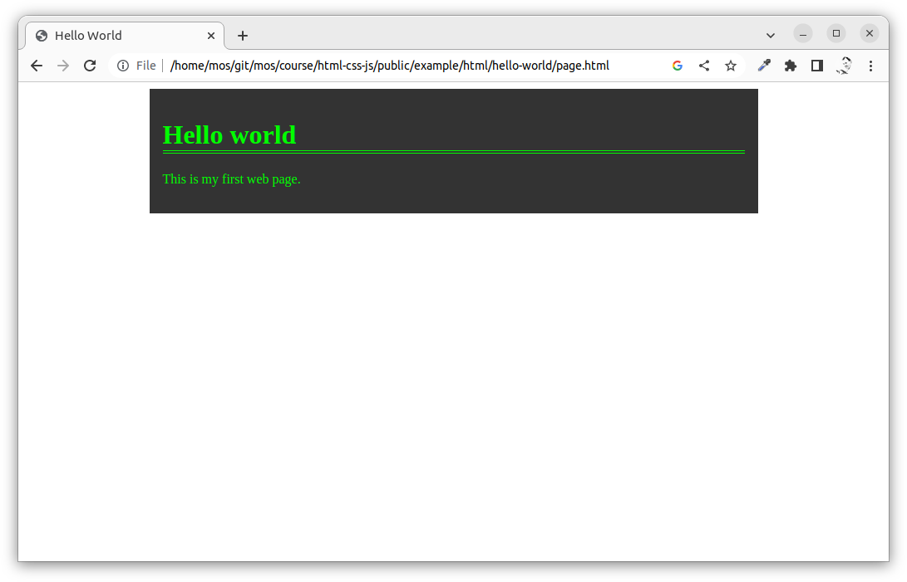

Each HTML element is drawn after each other, the p is follows the h1.

HTML element that is part of another, is drawn upon it. Lets visualise like this.

Update your stylesheet and add borders to the html and the body element.

```css
body {
  border: 2px solid #F9E79F ; /* light yellow */
}

html {
  border: 2px solid #AED6F1; /* light blue */
}
```

Reload your page and it looks like this, showing the outer border of the body element which is drawn "upon" the html element.

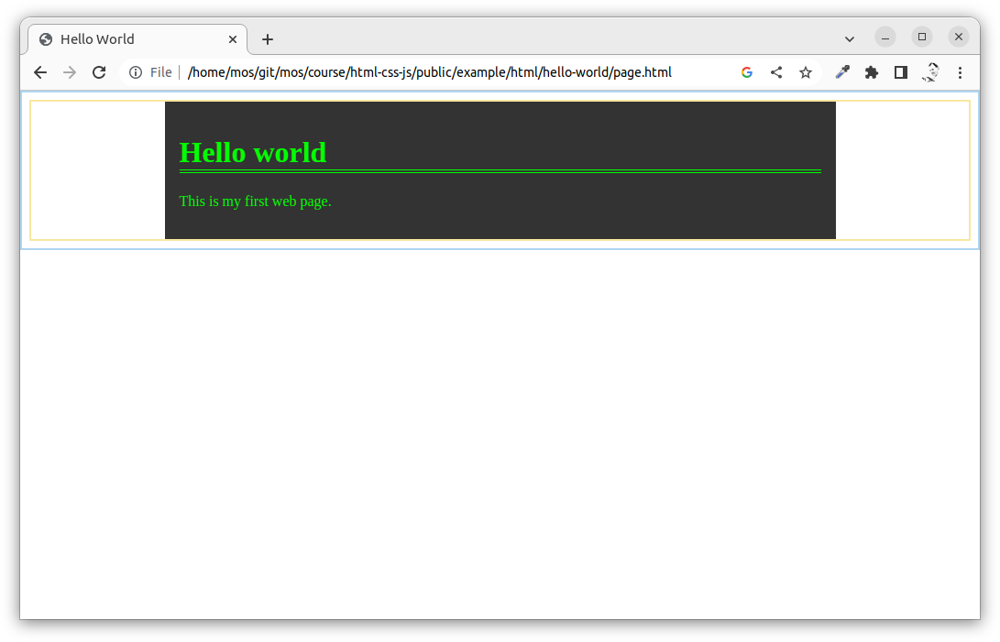

To make it even more clear you can change the background-color of the html and the body element, to see what is what.

Run the htmlhint and the stylehint linter to verify that all is okey.

If you still get errors with stylelint, try to fix them using the linter built in fixer.

```text
npm run stylelint:fix
```

If that did not solve it, then you need to fix it the hard way.

When you are done you can comment out the border/background test to have a nice green on black page (or whatever color you might choose). Leave the html/body section in the stylesheet though, you never know when you might need it to do some debugging.


Include a JavaScript `js/main.js`
---------------------------

Create an empty JavaScript file `js/main.js` and include the script at the bottom of your webpage.

This is how you include an external JavaScript file.

```html
<script type="module" src="js/main.js"></script>
```

A good place to include it is at the bottom of the page, like this.

```html
<script type="module" src="js/main.js"></script>
</body>
</html>
```

The script is not that essential for the webpage so the browser can lood the html and the style first and then add the javascript as the last resource.

In the js file we add a code section writing "Hello World" to the console. It can look like this.

```javascript
/**
 * This is javaScript.
 */
"use strict";

console.log("Hello World from JavaScript")
```

Run the linter eslint to verify the js code.

```text
npm run eslint
```

You might get some errors.

```text
/public/example/html/hello-world/js/main.js
  4:1   error  Strings must use singlequote  quotes
  4:13  error  Extra semicolon               semi
  6:13  error  Strings must use singlequote  quotes
```

Try to fix those errors using the builtin fixer.

```text
npm run eslint:fix
```

Verify that the errors are gone by running the linter again and do study the code how it looks like.

You can now reload your webpage and inspect if there is any output in the console. You open the console by `F12` or right-click and select "Inspect" and the select the "Console" tab in the browser dev tools.

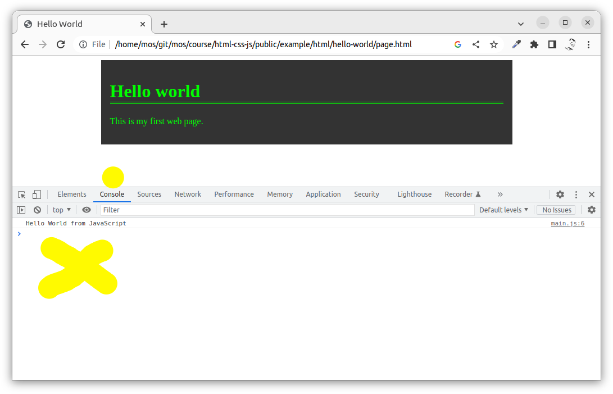

Run the linter eslint and htmlhint to verify that no errors occurs.


Run all linters
---------------------------

You have have one action that runs all the linters, so far, and you can run it like this.

```text
npm run lint
```

It is all fine if no errors are displayed.

If you need to fix something you can try using the linters fix option, if such exists, or fix it manually.

You can view all the runnable actions by executing `npm run`.


Open the webpage using a web server
---------------------------

Using the `file:///` to open the webpage might be fine some times. But you should actually use a web server when you develop your code.

Start the web server and then open the webpage through it.

```text
npm run http-server
```

The output shows the urls you might use. Use one of them and browse to your webpage.

It can look like this when you open the page through the url `http://127.0.0.1:9001/example/html/hello-world/page.html`.

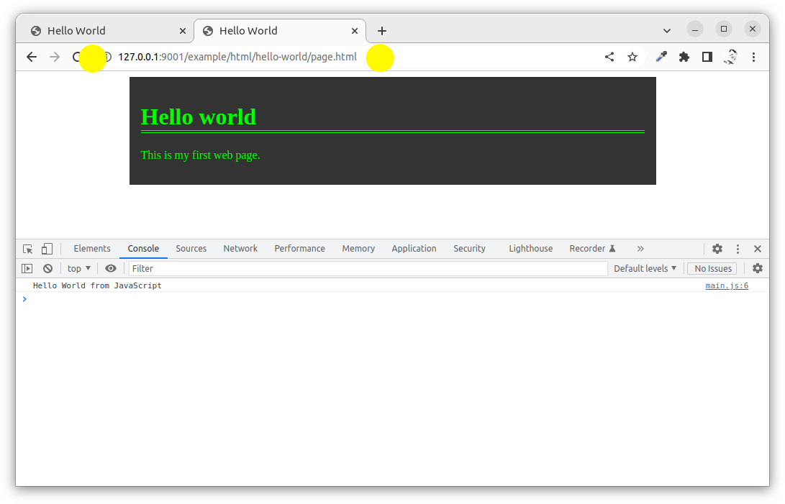

In the terminal where you started the web server you will see the access log. Each access to a webpage prints out a log entry.

Continue to do your work using the web server.


Devtools Network tab
---------------------------

The devtools in the browser has a tab "Network" showing each resource that is loaded as partof the webpage. In our example we have `page.html`, `style.css` and `main.js`.

The first time you load the page it can look like this. You can also do a hard reload using `shift-ctrl-r` (`shift-cmd-r` on Mac) to see the same result.

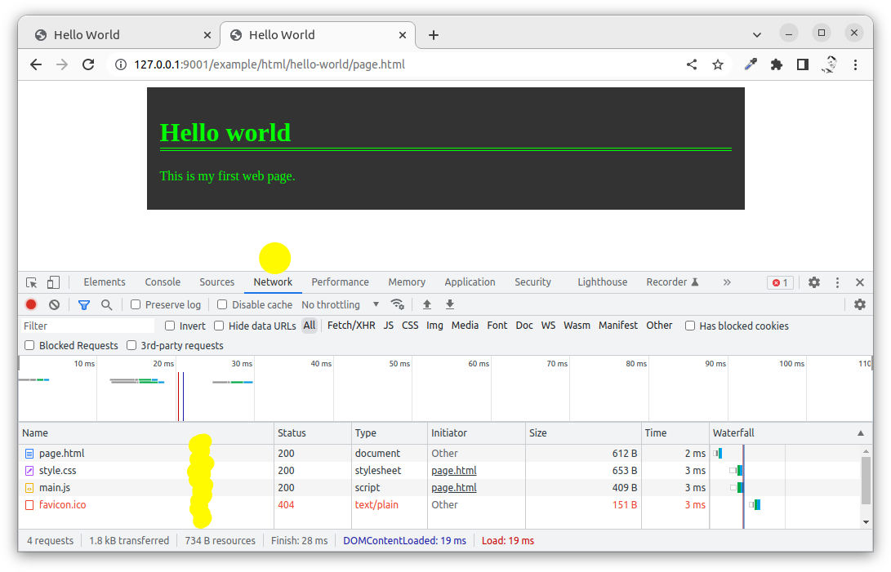

All the parts if the page is loaded showing a 200 as status saying OK.

There is a 404 for the `favicon.ico` which is a default behaviour to look for a fav icon in the top directory of the website. We will fix that soon.

If you now reload the page using `ctrl-r` or `cmd-r` on Mac you will see that some parts (stylesheet and js) are now cached. These are cached locally in the browser and the are not downloaded from the webserver.

You can also see that the status for the webpage is 304 which implies it is not modified since last time so no need to actually download the whole page but only the http headers.

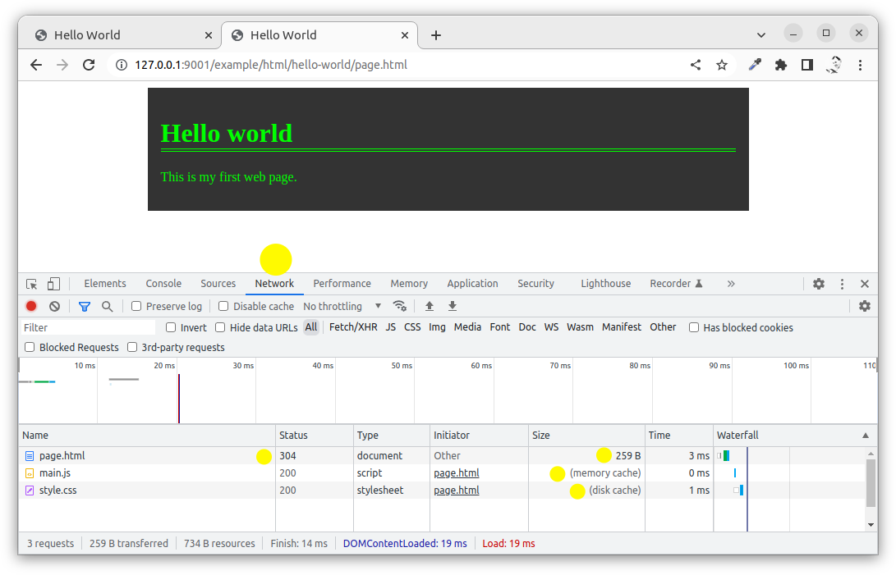

Do not forget to put a `shift` infront when reloading to ensure that all cached resources are reloaded from the webserver.

You can also check the output of the webservers access log to see what requests are sent to the server.


Do updates and verify them
---------------------------

Keep the webserver running and have the network tab opened.

Go in to each file and do some changes. After each change, reload the webpage and ensure you see the change.

* `page.html`
* `css/style.css`
* `js/main.js`

Use hard reload if you do not see the change.

Run the linters to assure that they pass.


Add a favicon
---------------------------

A favicon is an image being displayed in the browser tab showing the webpage. The favicon is usually an image in the .ico or .png format.

You can include the favicon into your webpage like this.

```html
<link rel="icon" href="img/glider.png">
```

Include it within your `<head>` element.

```html
        <link rel="icon" href="img/glider.png">
    </head>
<body>
```

The actual file is a image looking like this.


Now reload your page (use hard if needed) and you will see the glider emblem (or some other image you may choose) as your favicon.

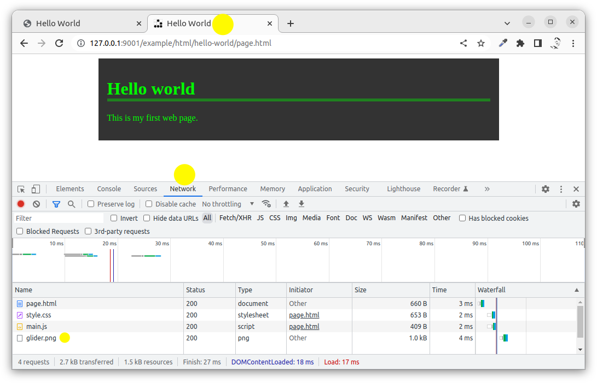


Add an image
---------------------------

There is an image in `img/marvin.jpg` looking like this.


Lets include it in the webpage.

```html

```

Lets put it after the first paragraph.

```html
<h1>Hello world</h1>
<p>This is my first webpage.</p>

```

Reload the page to view the image.

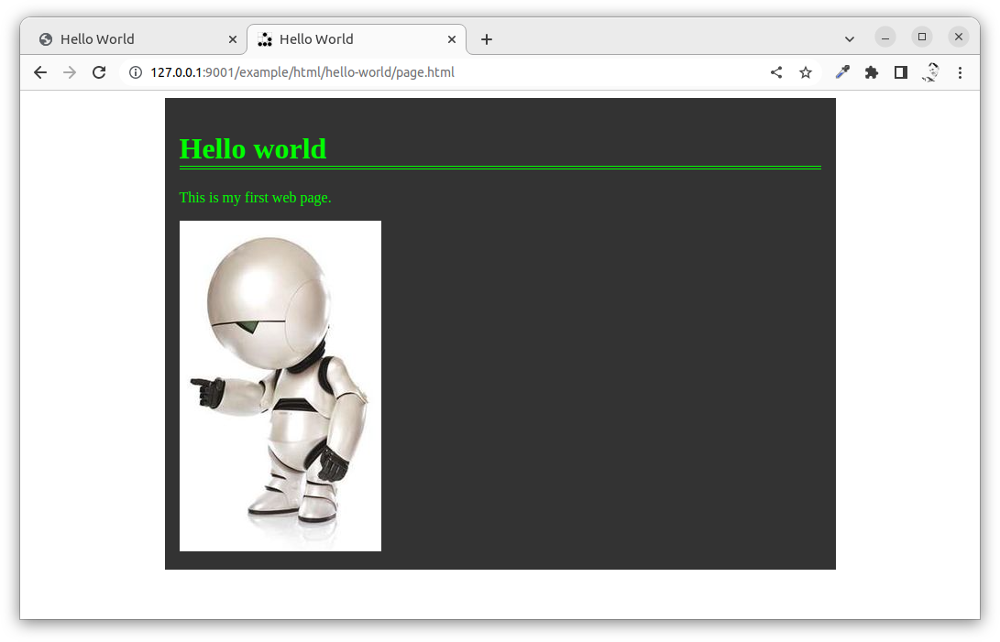

We can now try to round the corners of the image using the css class named `.rounded`.

```css
.rounded {
  border-radius: 20%;
}
```

We apply that css class to the html element like this, without using the first dot.

```html

```

Reloading the page we now see that the image has rounded corners.

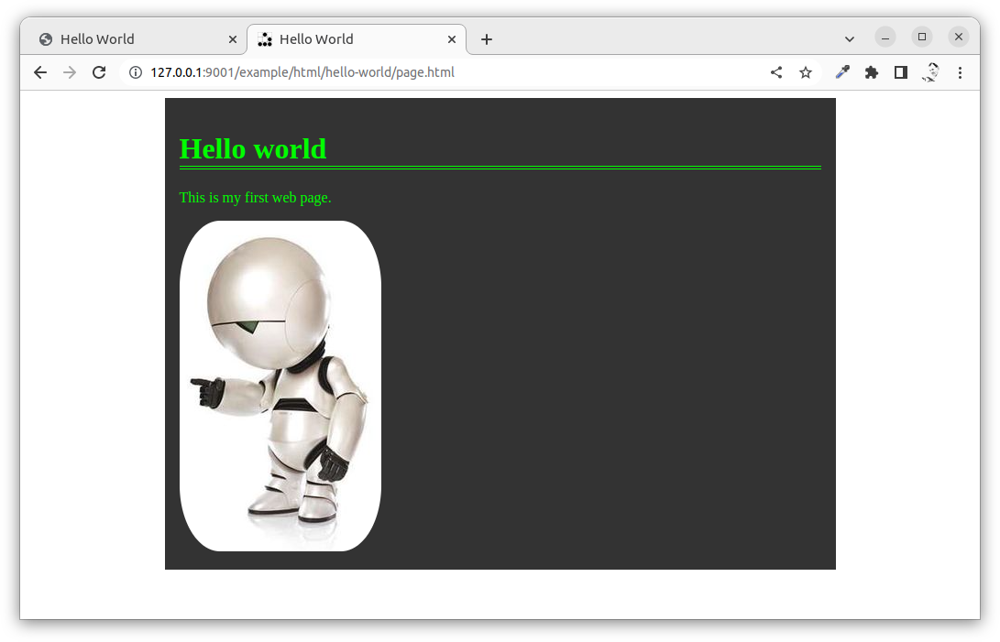

If you open the devtools Network tab you will see that the image resource for marvin is loaded like the other resources.

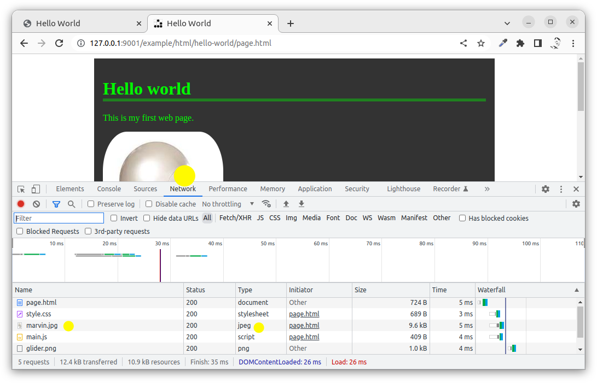


Add links
---------------------------

Lets add a few links to useful external resouces as a footer to the page.

A link, or anchor, looks like this.

```html
<a href="the url">the text to click</a>
```

A link to the reference manual for HTML on MDN can look like this.

```html
<a href="https://developer.mozilla.org/en-US/docs/Web/HTML/Element">MDN: HTML elements reference</a>
```

Lets add a footer to the page and add the link there, like this.

```html
    <footer>
        <a href="https://developer.mozilla.org/en-US/docs/Web/HTML/Element">MDN: HTML elements reference</a>
    </footer>
```

By the way, lets add the link to the [MDN CSS reference](https://developer.mozilla.org/en-US/docs/Web/CSS/Reference) while we are on to it.

You might also want to give the footer the same style as main, this can be done like this in the stylesheet.

```css
main,
footer {
  /* the css rules goes here */
}
```

The links need to be styled also, the default style does not really fit with our black background.

```css
a {
  color: lime;
}

a:hover {
  color: white;
}
```

Perhaps we should add some extras to make it look even nicer. Try to figure out what the current rules does.

```css
main,
footer {
  padding-bottom: 2em;
}

footer {
  border-top: 1px solid lime;
}
```

It can look like this when you are done.

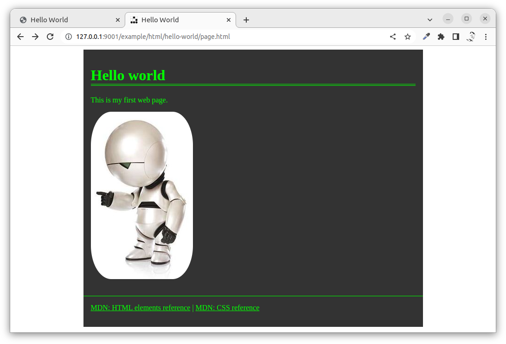


Float and clear fix
---------------------------

Lets add some text right below the Marvin image (text from [Hitchhikers fandom on Marvin](https://hitchhikers.fandom.com/wiki/Marvin)).

```html
<p>In the film, Marvin is a short, stout robot built of smooth, white plastic. His arms are much longer than his legs, and his head is a massive sphere with only a pair of triangle eyes for a face. His large head and simian-like proportions give Marvin a perpetual slouch, adding to his melancholy personality.</p>
<p>At the start of the film his eyes glow, but at the end he is shot but unharmed, leaving a hole in his head and dimming his eyes.</p>
```

It looks like this to start with.

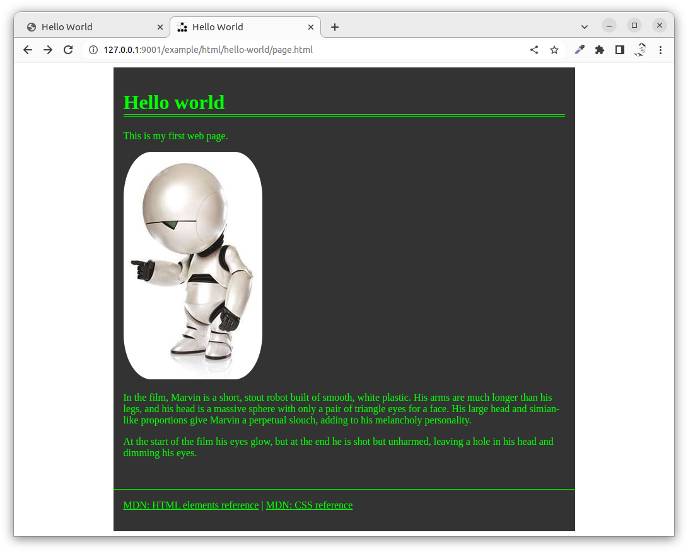

It would now be nice if we could get the text to wrap around the image and moving the image to the left or to the right. To do this we create two css rules that we might apply to the image.

```css
.left {
  float: left;
}

.right {
  float: right;
}
```

One of the rules can now be applied directly to the image html element. Here is how the rule "right" is applied.

```html

```

We can now reload the webpage and see that the image is removed from the ordinary flow and moved to the right.

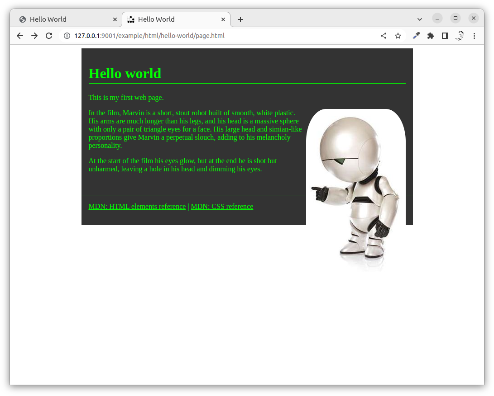

We got a "glitch" in the above image because the element main did not acknowledge the whole size of the image and it did not surround it. THis happens when we float elements and move them out of their ordinary flow.

We kan fix this with a "clearfix" and one way to do that is to make the parent element main force itself to achnowledge the full size of the image by adding a rule `overflow: auto;`.

It can look like this.

```css
main {
    overflow: auto;
}
```

Reloading the page shows a better result, like we expected.

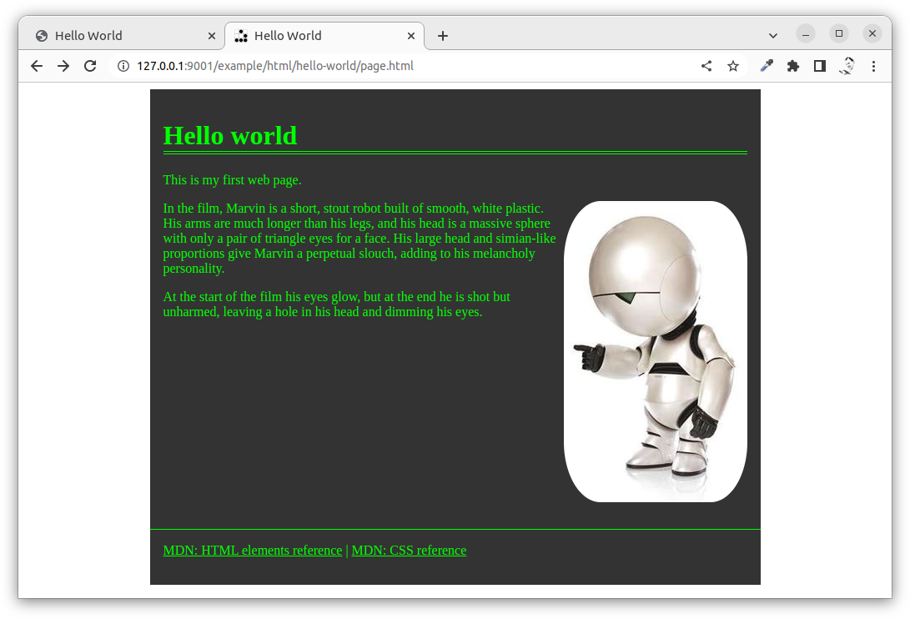


Figure and figcaption
---------------------------

We can add a text below the image by using the figure element and its figcaption part.

We take the image, now looking like this.

```html

```

We make a comment `<!-- -->` around the original image and then create a figure element with a figcaption.

```html
<!--  -->

<figure class="right">
    
    <figcaption>Marvin, the robot.</figcaption>
</figure>
```

It looks better and better, now with a text below the image.


Show the source
---------------------------

When the webpage is loaded by the browser from the url, it gets the source for the webpage. You can view this source by "right-click view source".

The source for our page migh look like this.

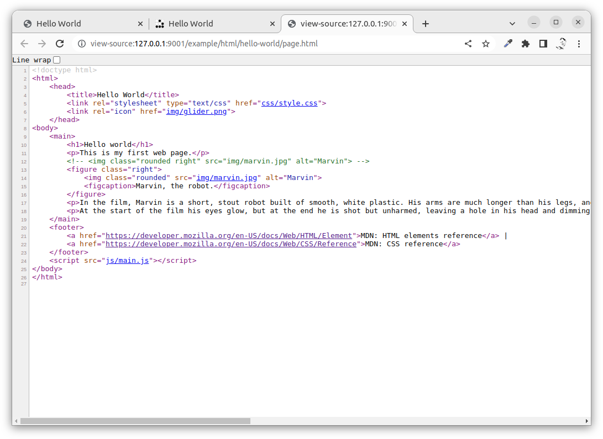


Build the DOM
---------------------------

When the browser receives the source it starts to build up a tree representation of all the html elements, this is called the Document Object Model (DOM).

During this process the browser might interpret your source and make its own judgements on how to build the DOM. If you write bad source code, the browser still tries to represent the page to the best of its effort.

The result from the parsed source code is visible in the devtools and the "Elements" tab. There you can see both the html and the css that is actually representing the current page.

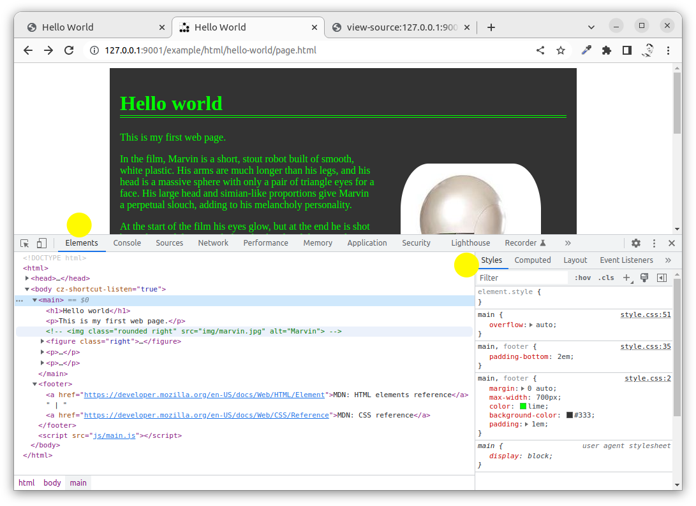

This is a real good tool for debugging ang developing your webpage. Here you can change elements and style to help you try out various constructs and how they affect the page. All the changes you do will disappear when you hit reload.


W3C validator HTML
---------------------------

There exists online validators from the W3C that can help checking that the source we create are corrent in all standards and guidelines.

For HTML we can use [Markup Validation Service](https://validator.w3.org/) and choose the "Validate by Direct Input" and copy the code we got from the "Shouw source" in the browser.

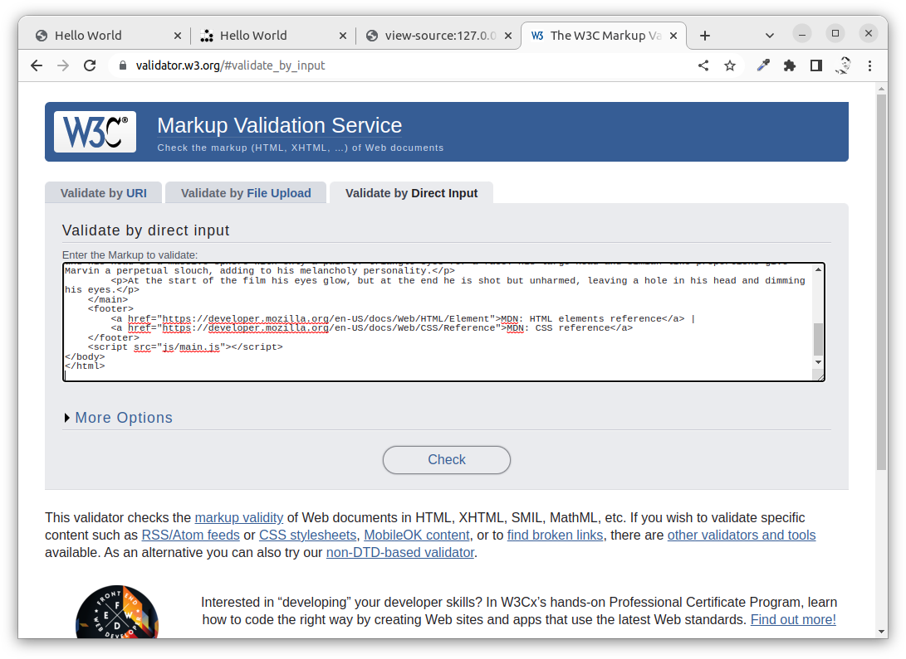

The results can look like this and it appears we have a warning.

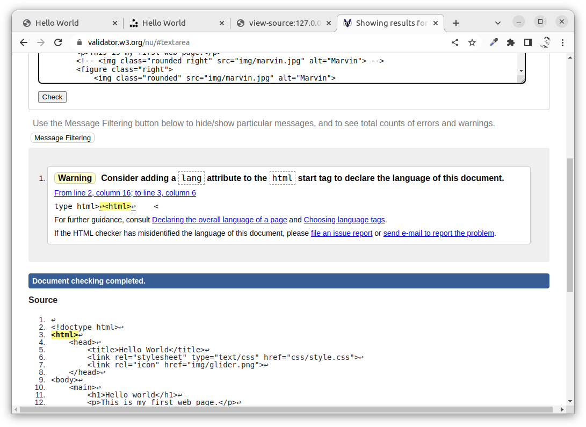

We can fix the warning by adding a lang attribute.

```html
<html lang="en">
```

Fixing that, and checking once more, should make it all green.


W3C validator CSS
---------------------------

There is a [W3C CSS validator](https://jigsaw.w3.org/css-validator/) that can check our stylesheet. Copy your stylesheet from the source code in your texteditor or from the browser by showing the source and click on the stylesheet in the source.

The validator looks like this.

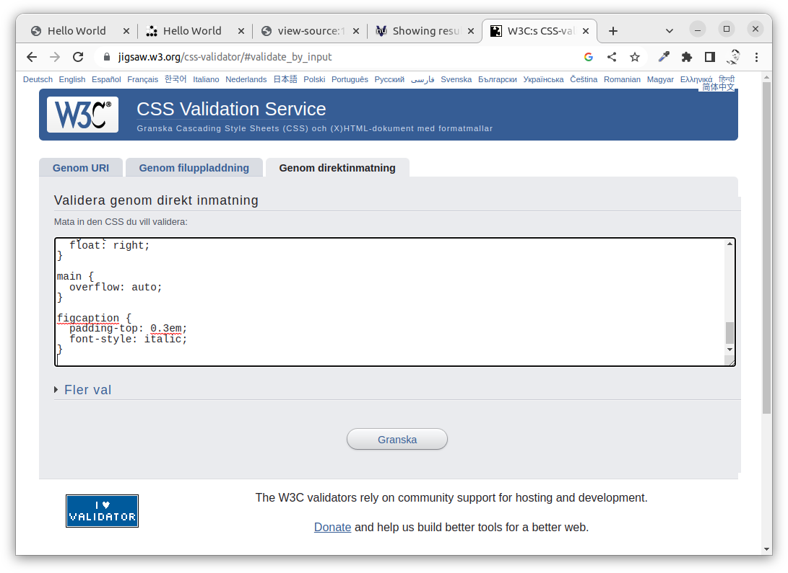

It looks like it passed for me without issues.

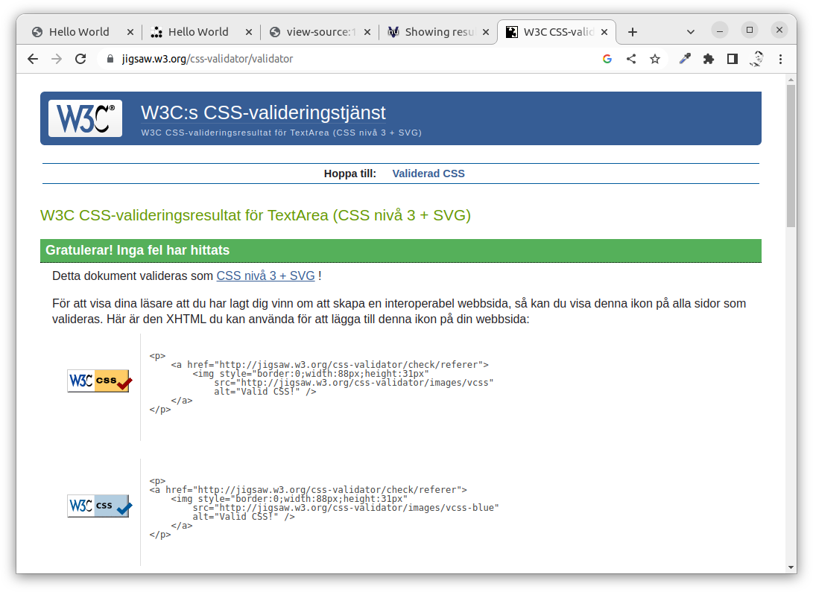

The W3C validators are great resources and combine them with the linters to assure that you create good code.


Summary
---------------------------

You have learned about creating the basics in a webpage using an external stylesheet and en ambryo of JavaScript.

You have also tried out some constructs in both html and css.
