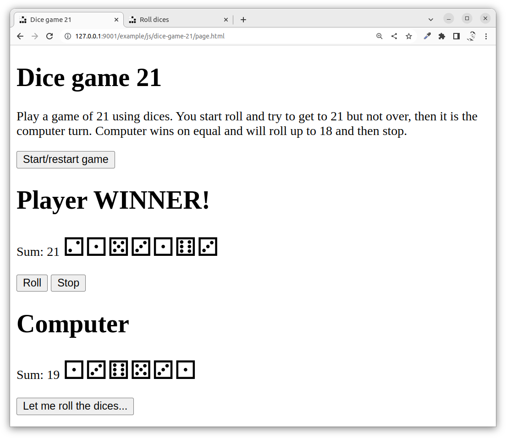

---
revision:
    "2022-11-29": "(A, mos) First release."
---
Create a dice game 21 using JavaScript
===========================

This live coding and example program shows how to create a small application in vanilla JavaScript using techiques like:

* HTML, CSS, JavaScript
* ESM modules and classes
* Structure in HTML
    * Connect with events and eventhandlers
    * Update and modify the DOM

The main resource in this exercise is the recorded video where Mikael creates the application step by step. 

You can then review the source code and try it out on your own if you clone this repo.

[[_TOC_]]

This is how it can look like when we are done with this exercise.



You can try out [the live example here](https://mikael-roos.gitlab.io/html-css-js/example/js/dice-game-21/page.html).


Prepare
---------------------------

You know the basics of JavaScript and how it works with the browser environment.


Directory structure
---------------------------

The directory structure for this exercise, when it is done, looks like this.

```text
$ tree .                 
.                        
├── README.md            
├── css                  
│   └── style.css        
├── img                  
│   └── glider.png       
├── js                   
│   ├── main.js          
│   └── modules          
│       ├── Dice.js      
│       └── Player.js    
└── page.html            
                         
4 directories, 7 files   
```


Recording
---------------------------

This is the live coding session where Mikael creates the code now stored in this repo (67 min).

[](https://www.youtube.com/watch?v=zy1fM8Ey-IU)
