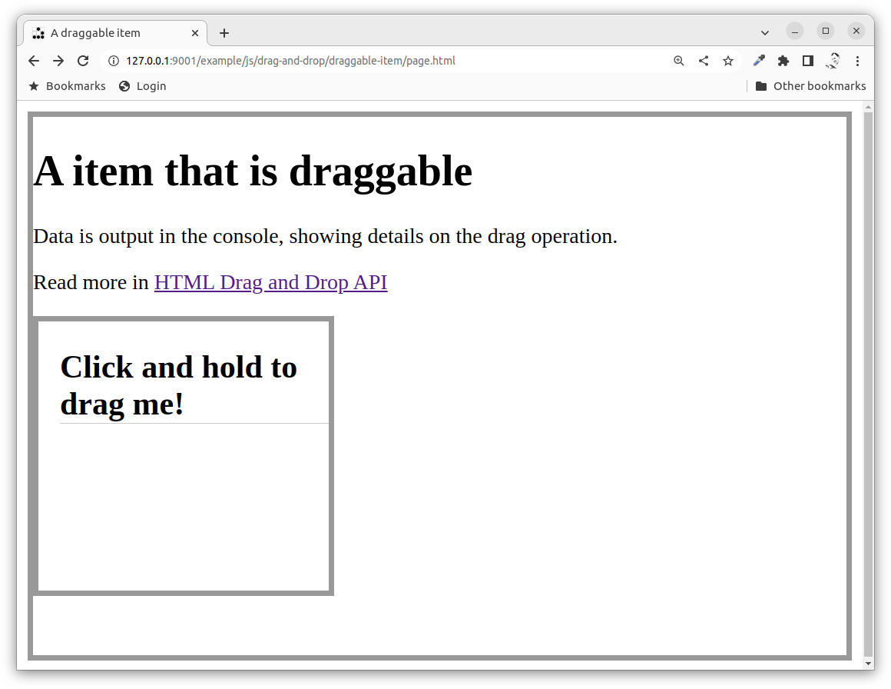
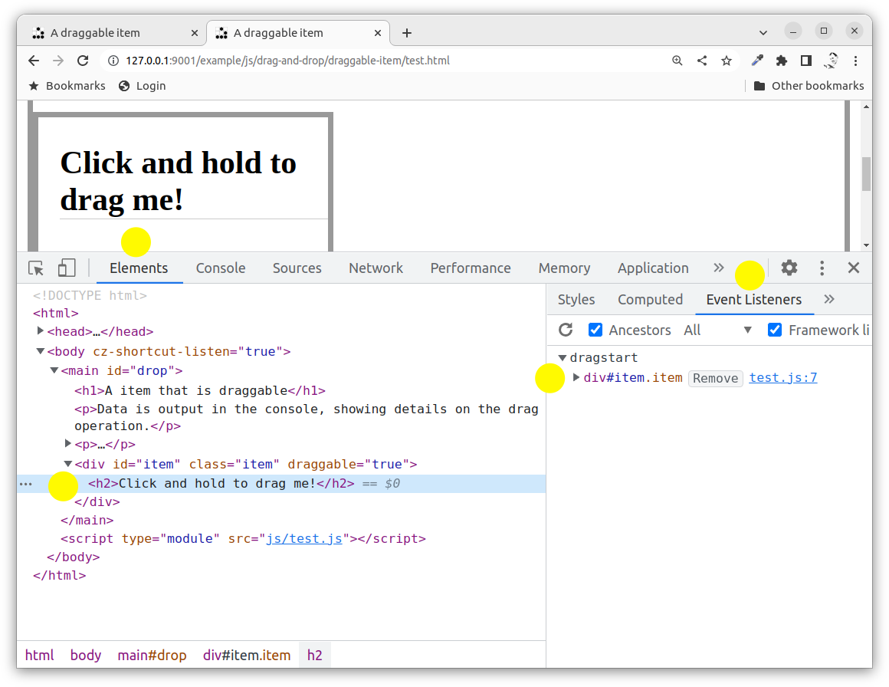
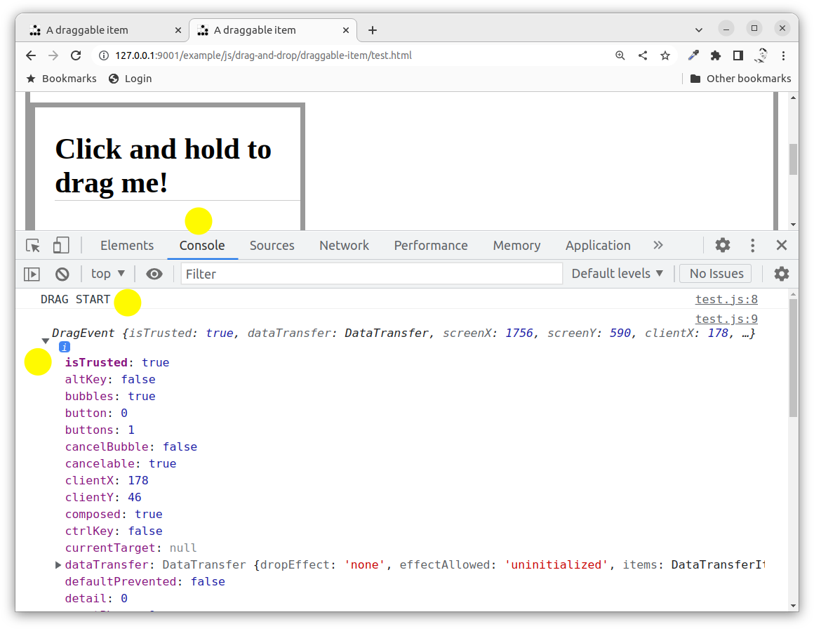
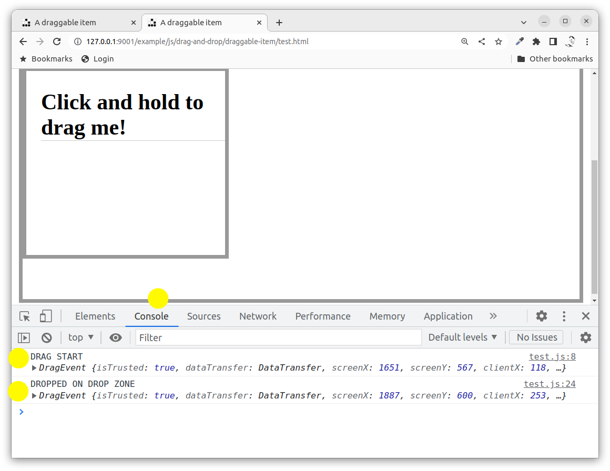
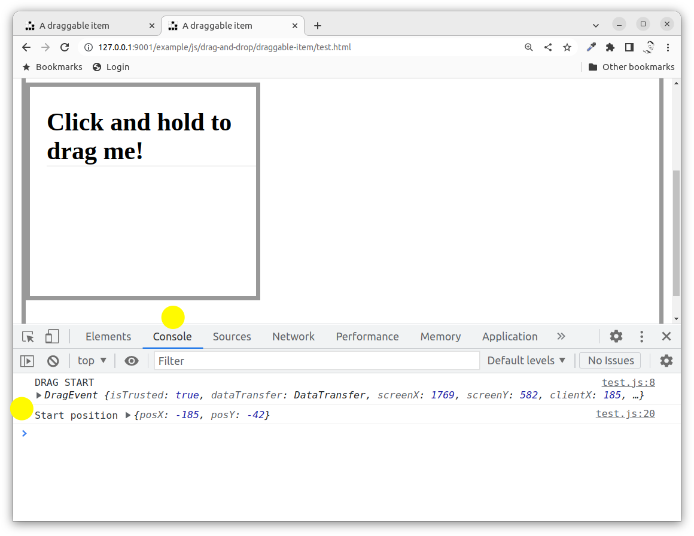
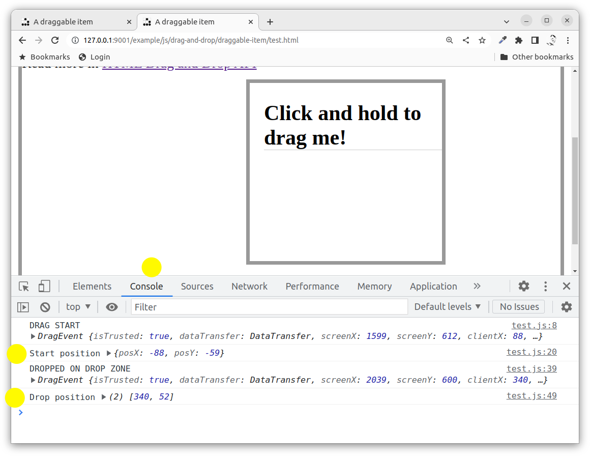

---
revision:
    "2022-12-12": "(A, mos) First release."
---
Using the HTML Drag and Drop API to create draggable items
===========================

This example shows the basics of the HTML Drag and Drop API that enables items on the web page to be selected, moved around and dropped on a area that supports drop events.

One way to use this feature is to implement where items on the web page can be copied, moved around, or items in a list can be re-orginized. It provides support to the developer to implement a richer user interface to the web application.

Another way to use this feature is to allow the user to drag items such as files and images onto the web page to upload files or include images onto the web application. This implements an integration between the web application and the local desktop environment.

[[_TOC_]]

This is how the example application looks like when it is started.



You can try out [the live example here](https://mikael-roos.gitlab.io/html-css-js/example/js/drag-and-drop/draggable-item/page.html).


Resources
---------------------------

Read up on the HTML Drag and Drop API.

* [HTML Drag and Drop API](https://developer.mozilla.org/en-US/docs/Web/API/HTML_Drag_and_Drop_API)

And read om more how it works.

* [File drag and drop](https://developer.mozilla.org/en-US/docs/Web/API/HTML_Drag_and_Drop_API/File_drag_and_drop)
* [Drag operations](https://developer.mozilla.org/en-US/docs/Web/API/HTML_Drag_and_Drop_API/Drag_operations)
* [Recommended Drag Types](https://developer.mozilla.org/en-US/docs/Web/API/HTML_Drag_and_Drop_API/Recommended_drag_types)


Prepare
---------------------------

You should be aware of how JavaScript works with events and be versed in general on how to create programs using JavaScript, HTML and CSS.


Directory structure
---------------------------

The directory structure for this exercise, when it is done, looks like this.

```text
├── README.md
├── css
│   └── style.css
├── img
│   └── glider.png
├── js
│   ├── main.js
│   └── test.js
├── page.html
└── test.html

3 directories, 7 files
```

The files named `test.{html,js}` are implementing the code in this exercise as spelled out below. 

The `page.html` is implementing a complete drag and drop example.


Recording
---------------------------

This is the recording where Mikael uses and talks about the example application (11 min).

[](https://www.youtube.com/watch?v=R2J6BUCmtSk)


A draggable item
---------------------------

The first thing is to declare an element to be draggable by assigning it the attribute `draggable="true"`, like this.

```html
<div id="item" class="item" draggable="true"><h2>Click and hold to drag me!</h2></div>
```

Then we need to add an eventlistener to the event `dragstart` to that draggable element.

```javascript
const itemArea = document.getElementById('item')

itemArea.addEventListener('dragstart', (event) => {
    console.log('DRAG START', event)
})
```

When you reload the page you will have the draggable element together with its event handler visible in the devtools.



You can now try to select the item in the web page, hold down the mouse and try to drag the element. You should see the following output in the console.



The event object contains details that are important to implement the drag and drop operation.


A droppable area
---------------------------

You need to define som element on the page as a droppable area, that is where the user can drop the draggable element.

You can implement this by adding the event listeners `dragover` and `ondrop` to the droppable area.

For this example will the main element be the droppable area.

```html
<main>
    <!-- some other elements might be here -->
</main>
```

Then add the event listeners just to see that they work as expected.

```javascript
const dropZone = document.querySelector('main')

dropZone.addEventListener('dragover', (event) => {
  console.log('DRAG OVER DROP ZONE', event)
  event.preventDefault()
})

dropZone.addEventListener('drop', (event) => {
  console.log('DROPPED ON DROP ZONE', event)
})
```

It is important to prevent the default event handler from happening in the `dragover` event handler, otherwise you will not get the call to your `drop` event handler.

You can also add an eventlistener for the `dragenter` event. This could be useful if you want the style to change for the drop area to visulize that the item can be dropped here. There is also a matching event for `dragleave`.

```javascript
dropZone.addEventListener('dragenter', (event) => {
  console.log('DRAG ENTER DROP ZONE', event)
})
```

You can now take the draggable item and drag it onto the drop zone. You will see the event `dragenter` fire when you reach the drop zone and the event `dragover` fires each time you move over the drop zone and finally the event `drop` fires when you release the mouse button to drop the item. You might want to remove some of the output to make more sense on what is outputed in the console.



Above picture shows the output when the draggable item was dragged and dropped on the the droppable area. There was no output for the events `drageenter` or `dragmove`.


Preparing data for the drag
---------------------------

You will need to deal with moving the element on your own, when the element is being dragged and moved from one position to another. One way to do this is to prepare data in the draggable event in the event handler `dragstart` and then use that information in the `drop` event handler.

The application is free to include any data in the drag operation. Each data stored in the property `event.dataTransfer` as a string of a particular MIME type, for example `text/plain` or `text/html`. Us store data using the function `setData()`.

Here is a way to store the original position of the element using `setData()` in the event handler for `dragstart`.

```javascript
itemArea.addEventListener('dragstart', (event) => {
  console.log('DRAG START', event)

  // Get original position
  const style = window.getComputedStyle(event.target, null)
  const startX = parseInt(style.getPropertyValue('left'), 10) - event.clientX
  const startY = parseInt(style.getPropertyValue('top'), 10) - event.clientY
  const start = {
    posX: startX,
    posY: startY
  } 
  
  // Save the position in the dataTransfer
  event.dataTransfer.setData('application/json', JSON.stringify(start))
  console.log('Start position', start)
})
```

In the code above we first we find the position of the element being dragged, then we organise it as an object that can be JSON stringified and attached as a string to the `event.dataTransfer` property. This way we can store details on the drag operation.

This is how it can look like when you start to drag the item.



The next thing is to use this data in the drop event to carry out the actual move.


Handle the drop
---------------------------

We can now extract the `event.dataTrasfer` when the item is dropped on the drop zone. The elemeent can be moved with the style attribute and using relative or absolute positioning. The following example uses relative positioning the element can be moved. 

```javascript
dropZone.addEventListener('drop', (event) => {
  console.log('DROPPED ON DROP ZONE', event)

  // Get the position of the dragged element and where the drop was
  const start = JSON.parse(event.dataTransfer.getData('application/json'))
  const dropX = event.clientX
  const dropY = event.clientY
  console.log('Drop position', [dropX, dropY])

  // Move element position from start to drop
  itemArea.style.left = (dropX + start.posX) + 'px'
  itemArea.style.top = (dropY + start.posY) + 'px'
})
```

The handler starts to retrive the data stored in the `event.dataTransfer` and then it finds the position for the drop using the event object. The actual move is made using the element style and relative positioning.

A small note is that you can not see from the code above that this is using relative positioning, you need to view that in the stylesheet where it says that the draggable item has `position: relative`.



The sample code above can only move one item, you might need a different code structure to move more objects and to generalize the code in the event handlers. But that is an exercise for another day. The above setup is just the basics to get going with drag and drop.


More on dragging and dropping
---------------------------

You can define the image on the draggable item when its being dragged. The browser provides a default image for you and it is visible right next to the pointer while dragging.

You can define the drop effect when the user drops the draggable item onto a drop area. The choices are copy, move or link. This is supported through the `event.dataTransfer.dropEffect` property. The actual behaviour needs to be implemented for each application. The intention is to provide guidelines on the user interface so the user understands a bit more on the operation going on.

```javascript
itemArea.addEventListener('dragstart', (event) => {
  console.log('DRAG START', event)

  // Attach the drop effect
  event.dataTransfer.dropEffect = 'move' // move, copy, link
})
```

The event `dragend` fires on the draggable element at the end of the process, no matter if the drag was successful or not.

Read more on "[HTML Drag and Drop API](https://developer.mozilla.org/en-US/docs/Web/API/HTML_Drag_and_Drop_API)" and view the examples.
