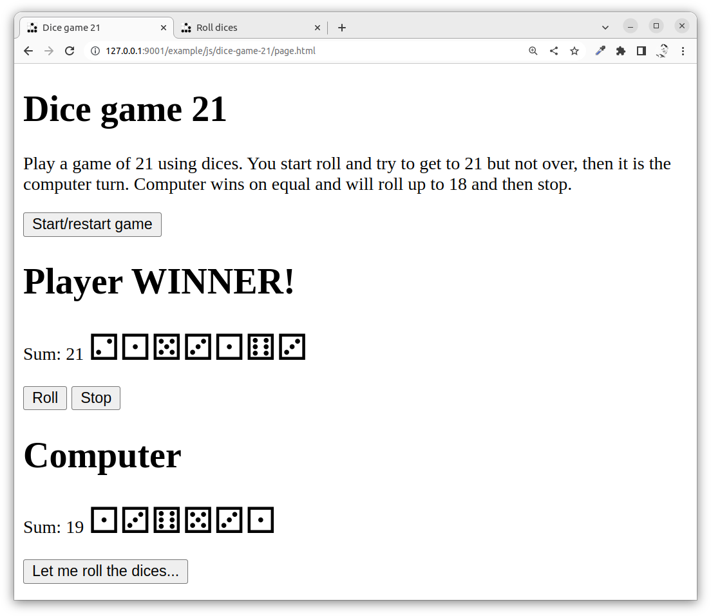
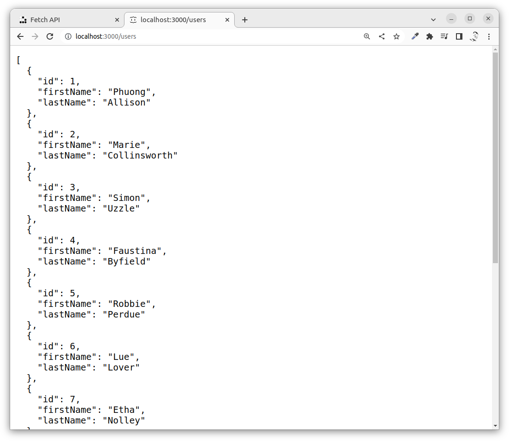
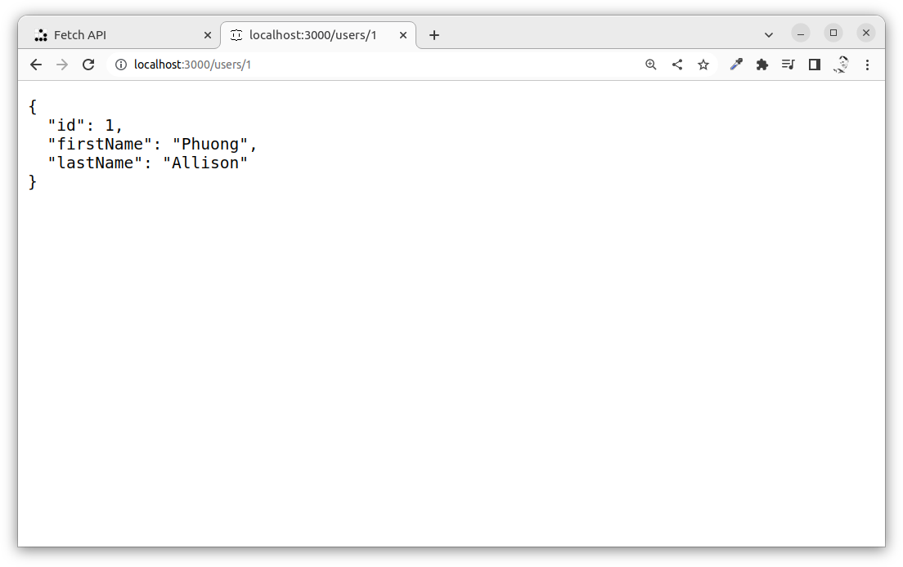
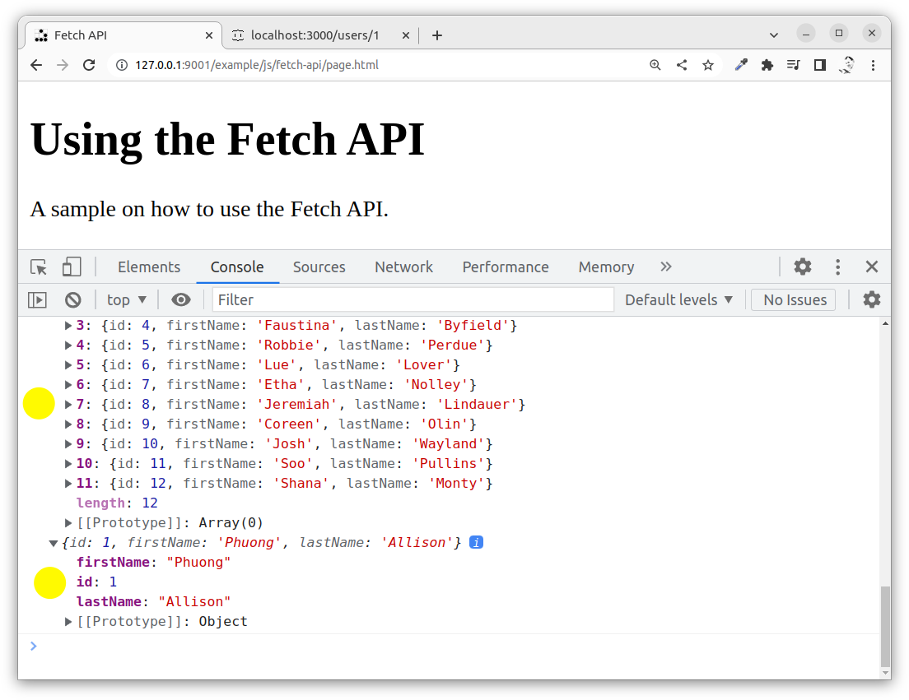
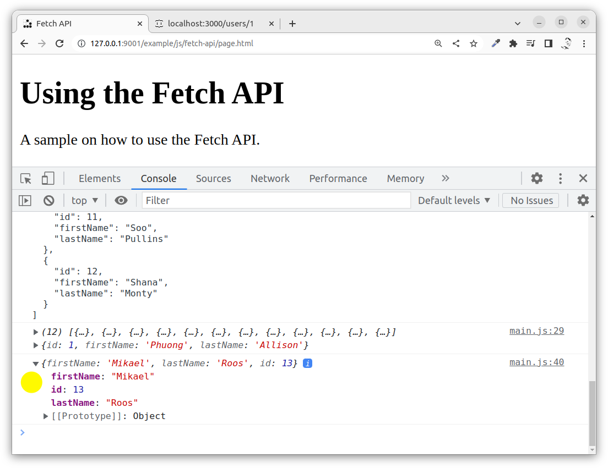
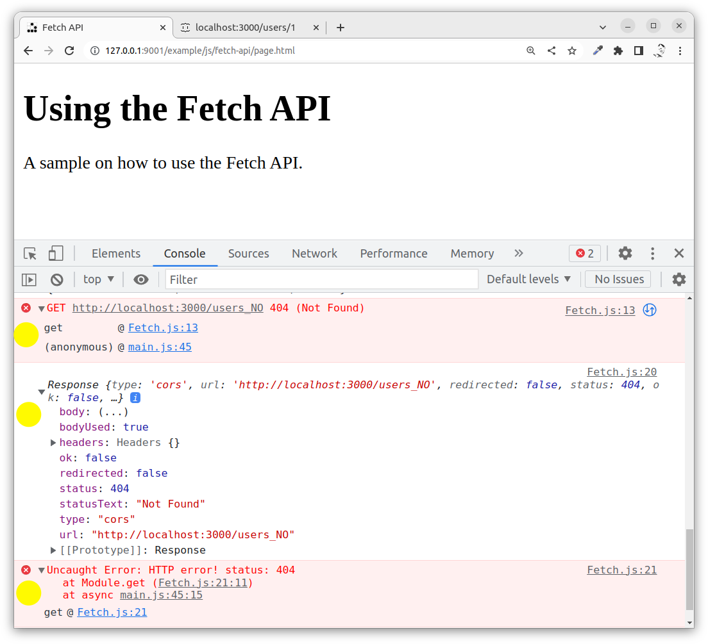

---
revision:
    "2022-12-06": "(B, mos) Add examples on PUT, PATCH and DELETE."
    "2022-11-30": "(A, mos) First release."
---
Using the Fetch API to talk to a REST server
===========================

This exercise shows you how to get going with the Fetch API to perform asynchronous requests to a web/REST server using JavaScript, without the page being reloaded. We will see how we can do GET requests and parse the JSON response and we will see how we can create a POST request to submit data to the server.

We will use the asynchronous programming techique with async/await.

[[_TOC_]]

<!--
This is how it can look like when we are done with this exercise.


-->

You can try out [the live example here](https://mikael-roos.gitlab.io/html-css-js/example/js/fetch-api/page.html).


Prepare
---------------------------

You know the basics of JavaScript and how it works with the browser environment. You know about events and how to modify the DOM.


Resources
---------------------------

While you work through this exercise you might want to have the documentation at hand to read more in detail on the Fetch API and the constructs of asynchronous programming with async and await.

* MDN on the Fetch API, study the methof `fetch()` and the object `Response`.
    * [Fetch API](https://developer.mozilla.org/en-US/docs/Web/API/Fetch_API)
    * [Using the Fetch API](https://developer.mozilla.org/en-US/docs/Web/API/Fetch_API/Using_Fetch)

* Axel with the book "JavaScript for impatient programmers (ES2022 edition)" has a few chapters on asynchronous programming, tha part on async/await is in chapter 41.
    * [41 Async functions](https://exploringjs.com/impatient-js/ch_async-functions.html)

Remember to look up the stuff you do not know using google "mdn <stuff>".


Directory structure
---------------------------

The directory structure for this exercise, when it is done, looks like this.

```text
$ tree .
.
├── README.md
├── css
│   └── style.css
├── data
│   ├── db.json
│   └── db_orig.json
├── img
│   └── glider.png
├── js
│   ├── main.js
│   └── modules
│       └── Fetch.js
└── page.html

5 directories, 8 files
```


<!--
Recording
---------------------------

This is the live coding session where Mikael creates the code now stored in this repo (67 min).

[](https://www.youtube.com/watch?v=zy1fM8Ey-IU)
-->


A dummy REST server
---------------------------

When learning fetch it is handy to have an existing REST server that we can try to work with, lets try to setup one.

Start reading quickly on the [npm package 'json-server'](https://www.npmjs.com/package/json-server) and roughly browse its documentation.

This is how to setup the 'json-server'.

```text
npm install --save-dev json-server
```

You know need a JSON database that the json-server can work with. You can create your own, or you can use the [`data/db.json` included in this example](data/db.json).

You can now start the json-server with the databasefile, like this.

```text
npx json-server --watch data/db.json
```

Try that it works by opening the url displayed in the startup message.

The default way to access the server is like this.

```text
http://localhost:3000/users
http://localhost:3000/users/1
```

It can look like this.





Good, you have a sample REST server to work with.


The first GET request
---------------------------

Create a HTML page and include the JavaScript and add the following code to it, to try out how to do a GET request to the REST server and receive a JSON object.

```javascript
// The url to access
const url = "https://localhost:3000/users"

// Do a fetch request on that url using await
let response = await fetch(url)

// Get the response as json (asynchronous request)
let data = await response.json()

// Print out the data raw and formatted as a string
console.log(data)
console.log(JSON.stringify(data, null, 2))
```

When you execute the code it can look like this in the console.


This was a fetch request using GET. We uses the `await` keyword since the requests to fetch and the response are both asynchornous and none blocking. The `await` and the accompaning `async` are keywords that makes it real easy to work with asynchronous requests.

It tend to look like the program is sequential, but it is not. When the request to `fetch()` blocks on input/output, for example when waiting on the response, then it hands over execution to the event loop so other parts of the code can execute. When the response is received it continues execution and returns its value.

The asynchronous `await` and `async` hides the work with promisifying your code creates cleaner code than its relative `.then` and `.catch`. All of these are improvements to code structure related to classical event handling. You might want to read more on this in the Axel book, or be just satisfied with that the `await` is a nice solution to non-blocking asynchronous code.


Wrap the fetch GET into a function
---------------------------

Since our code most likely will do many fetch requests it might be a good idea to wrap them into functons. For this example I will create a module and store my fetch methods in that.

Rewriting the code above might look like this in a module like `js/modules/Fetch.js`.

```javascript
/**
 * Do a fetch GET request and return the response as JSON.
 *
 * @param {string} url to send request to
 * @returns {object} the JSON response
 */
export async function get (url) {
  // Do a fetch request on that url using await
  const response = await fetch(url)

  // Get the response as json (asynchronous request)
  const data = await response.json()

  return data
}
```

The function uses `await` and thus it need to be declared as `async`. Thats the way to setup the code. Any function using `await` must be declared as `async`.

In the main program we include the module and use it to access two urls.

```javascript
// Import all exported functions from the module into an object
import * as Fetch from './modules/Fetch.js'

// Wrapping the code into a module
const url1 = 'http://localhost:3000/users'
const url2 = 'http://localhost:3000/users/1'

const resp1 = await Fetch.get(url1)
const resp2 = await Fetch.get(url2)

console.log(resp1, resp2)
```

We use `await` on the functions to allow non-blocking asynchronous execution.

It can look like this when checking the console output.



Now we have good code structure.


Do a POST request to add data
---------------------------

Doing a post request in general means that you add data to the REST servers database. You can send the data you post as JSON through the body.

This is how we intend to use the function from the main code.

```javascript
// Do a POST request
const url3 = 'http://localhost:3000/users'
const body3 = {
  firstName: 'Mikael',
  lastName: 'Roos'
}

const resp3 = await Fetch.post(url3, body3)

console.log(resp3)
```

To make it easy to write code in main I opted to set the body using the object literal. Besides the body, it looks more or less tha same as the `Fetch.get()` on this level.

Then we create the function in the module, it can lok like this.

```javascript
/**
 * Do a fetch POST request and return the response as JSON.
 *
 * @param {string} url to send request to
 * @param {object} body to submit
 * @returns {object} the JSON response
 */
export async function post (url, body = null) {
  const options = {
    method: 'POST',
    headers: {
      'Content-Type': 'application/json'
    },
    body: JSON.stringify(body)
  }
  const response = await fetch(url, options)

  const data = await response.json()

  return data
}
```

The major difference from the GET request is that we need to send in the `options` as a argument to set the method to POST and the header to 'application/json' and then to include the body as a JSON string.

This is how it can look like when you execute the code.



You can further study the Fetch API to see what kind of data you can send in the options object. You can basically create any type of HTTP request this way.


Error handling with 
---------------------------

Tex examples above did not do any error handling, they expected that it all turned out alright and that the status code was ok.

We could add a checkto assure that the status code really is ok, otherwise we can through an exception.

Something like this might do the trick.

```javascript
  // Check if status is ok
  if (!response.ok) {
    console.log(response)
    throw new Error(`HTTP error! status: ${response.status}`);
  }
```

Add above code into `Fetch.get()` and `Fetch.post()` at the bottom right before the return statement.

We can check how this works by provoking an exception.

```javascript
// Provoke an exception using a 404 url
const url4 = 'http://localhost:3000/users_NO'

const resp4 = await Fetch.get(url4)

console.log(resp4)
```

When the code is executed we find the following output in the console.



First there is a 404 from the fetch itself. 

Then the Response object is logged to the console so we can inspect it.

Finally the uncaught exception, that we raised, are printet out to console.

Depending on our application we need to decide what to do with the various response codes.

Another thought is if we should return the JSON data from the function, or if we should return the whole Response object. But I guess that is also a matter for the particular application we develop and how we choose to structure it.


Do a PUT/PATCH request to modify data
---------------------------

With a PUT (or PATCH) request can you update data on the REST server (depending on what the server supports).

A PUT requests will update the whole entry, so each part of the entry needs to be in the body.

```javascript
// Do a PUT request (replace the whole item)
const url5 = 'http://localhost:3000/users/13'
const body5 = {
  id: 13,
  firstName: 'Mikael (mos)',
  lastName: 'Roos-ish'
}

const resp5 = await Fetch.put(url5, body5)

console.log("PUT", resp5)
```

A PATCH request will only update the parts you send with it.

```javascript
// Do a PATCH request (only update its parts)
const url6 = 'http://localhost:3000/users/13'
const body6 = {
  id: 13,
  lastName: 'Roos-mos'
}

const resp6 = await Fetch.patch(url6, body6)

console.log("PATCH", resp6)
```


Do a DELETE request to delete data
---------------------------

With a DELETE request can you delete data on the REST server (depending on what the server supports).

```javascript
// Do a DELETE request
const url7 = 'http://localhost:3000/users/13'
const body7 = {
  id: 13
}

const resp7 = await Fetch.del(url7, body7)

console.log("DELETE", resp7)
```

Include the id to be deleted in the body

<!--
Create a GUI for a REST API
---------------------------

Perhaps as a spinoff exercise when done with above.

Create a GUI that can send Fetch requests to a server.

To show how to work with the DOM to create a GUI application.
-->


Summary
---------------------------

You have learnt to use the Fetch API to GET and POST data from/to a REST API using JavaScript. You have also learnt the basics of non-blocking asynchronous programming with `async` and `await`.

You might want to study a bit more on both the REST API and the foundations of asynchronous programming. See the resources on top of this document for places to dig into it a bit more.
