---
revision:
    "2022-11-18": "(A, mos) First release."
---
A "Hello World" example with JavaScript in a webpage
===========================

This example shows some basics on how to get going to include JavaScript in your browser and how to run a JavaScript using Nodejs.

[[_TOC_]]

This is how it can look like when we are done with this exercise. Still, it is the code behind it that is important.


Prepare
---------------------------

You should have knowledge on HTML and CSS and you should have access to a webserver to run for development.


Directory structure
---------------------------

The directory structure for this exercise, when it is done, looks like this.

```text
$ tree .
.
├── README.md
├── img
│   └── glider.png
├── js
│   └── main.js
└── page.html

2 directories, 4 files
```

Do create a directory, for example `public/example/js/hello-world` where you can work in.


Create a webpage `page.html`
---------------------------

Start by creating a webpage `page.html` and add some biolerplate HTML code into it.

For example like this.

```html
<!doctype html>
<html>
    <head>
        <title>Hello world small example</title>
        <link rel="icon" href="img/glider.png">
    </head>

    <body>
        <main>
            <h1>Hello World in HTML</h1>
        </main>
    </body>

    <script src="js/main.js"></script>
</html>
```

At the near bottom of the code can you reference the file `js/main.js` that contains the JavaScript code.


Create a JavaScript file `js/main.js`
---------------------------

To the file `js/main.js` you can add your first "Hello world" code.

```javascript
/**
 * My first code.
 */
'use strict'

console.log('Hello world')
```

[The part with `'use strict'`](https://developer.mozilla.org/en-US/docs/Web/JavaScript/Reference/Strict_mode) is to use a slightly strictore way to interpret JavaScript, than the early intentions with the language.

You can look up [`console.log()` in the docs](https://developer.mozilla.org/en-US/docs/Web/API/console/log).

Start up your webserver and load the page. Then open the devtools and check the output in the console.

It can look like this.

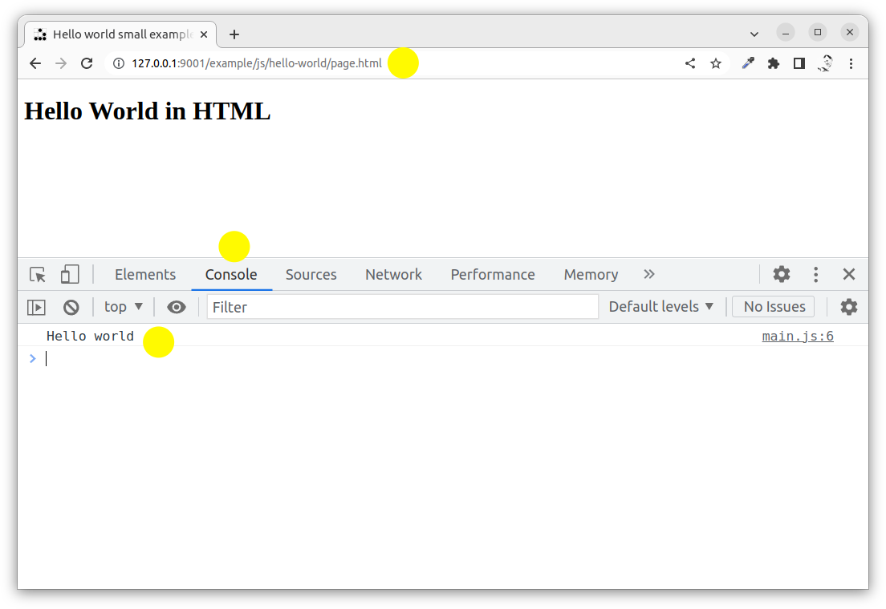


Node.js
-----------

Before we proceed with coding in the browser, lets try to run the code using the Node.js environment. This is the way to execute JavaScript on the server, or just without the need of a browser environment.

Open a terminal to the directory where you have the files and move into the `js/` directory.

Check the content of the file `main.js`. Then execute it using `node main.js`.

It can look like this.

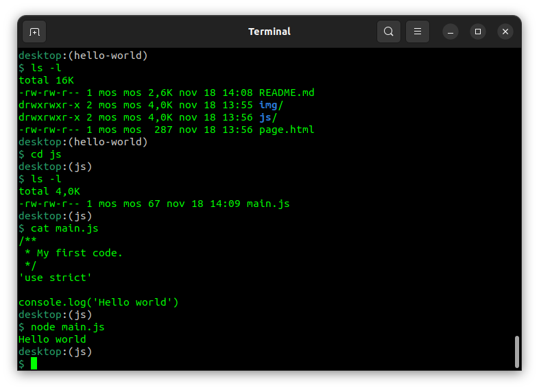

Sometimes it might be easier to learn and test the constructs using Node. Just remember that the browser is one type of environment and node is another type of environment, some parts are the same and some parts differ.


Read and modify the DOM
-----------

One reason why JavaScript was introduced was to have the ability to modify the DOM tree to update the page content by client-side activities.

We can find an element and update its content. The following code will update the content of the first h1 element in the Document which represents the DOM tree.

```javascript
/**
 * Find the h1 element and update its innerHTML.
 */
const h1Collection = document.getElementsByTagName('h1')
const firstH1 = h1Collection.item(0);
firstH1.innerHTML = 'Hello World From JavaScript'
```

You find the docs by searching "MDN getElementsByTagName", "MDN NodeList.item()" and "MDN Element.innerHTML".

If you add the code above into your `main.js` and the reload the page it might look like this.

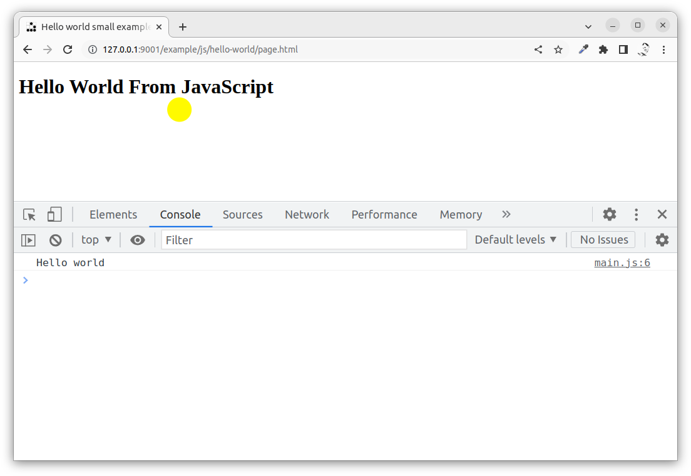

You can now use this example to see that the actual source of the page and the current DOM representation differ. This is good to know that it works like this.

The source is received when the browser loads the page and it looks like this.

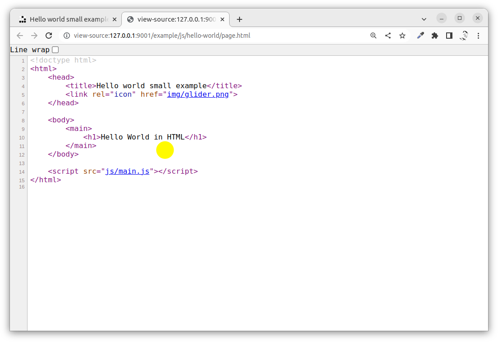

The updated DOM tree however looks like we can see in the devtools elements, this is after the JavaScript code is executed and modified the DOM.

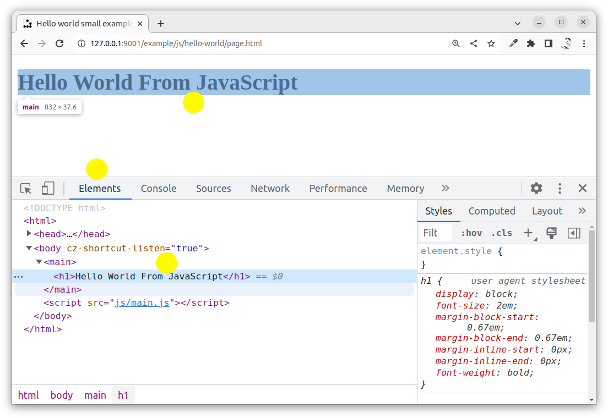


Add a new node to the DOM
-----------

There might be several techniques to add new content to the DOM, but the standard way is likely to include the following steps.

1. Find e reference element in the DOM tree (where to insert the new content).
1. Create a new element with some content.
1. Add the element to the DOM tree (the page content is updated).

Add the following code to your `main.js`.

```javascript
/**
 * Update the DOM tree by adding a paragraph.
 */
// Get the pointer into the DOM
const h1CollectionAgain = document.getElementsByTagName('h1')
const firstH1Again = h1Collection.item(0);

// Create the new element
const newPara = document.createElement('p')
newPara.innerHTML = 'Hello world in a newly added paragraph.'

// Insert the new element right after
firstH1Again.insertAdjacentElement('afterend', newPara)
```

Look up the different functions and types in the MDN docs to practice how to read the docs.

Now reload the page and it might look like this.

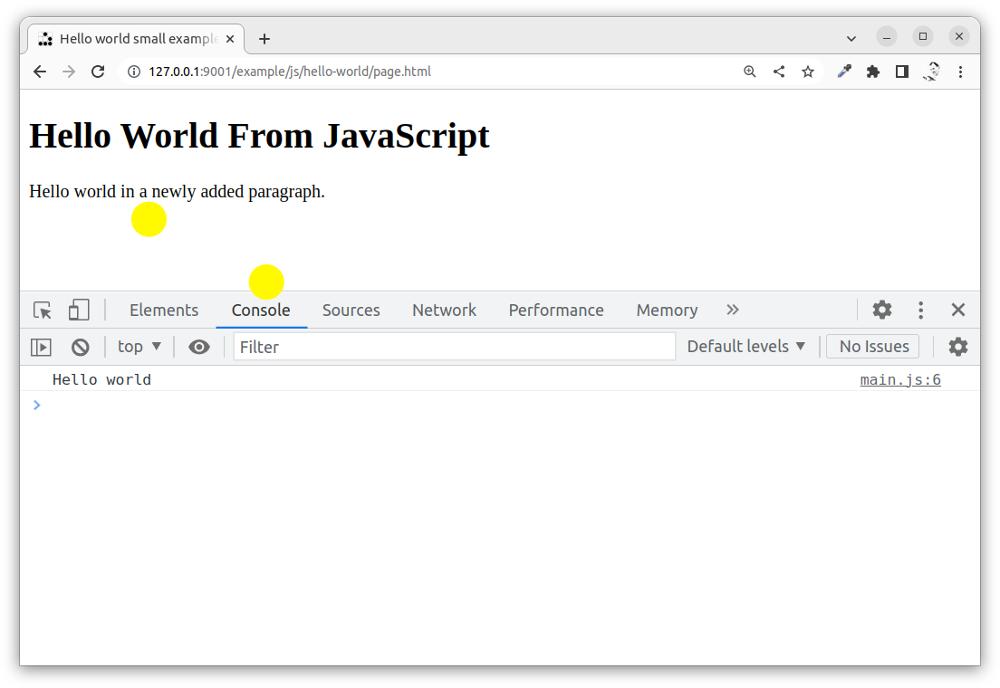

Use the devtools console to see if you get any errors.

As you can see from the code, you did not really need to create `h1CollectionAgain` and `firstH1Again`. You could actually reuse the `h1Collection` and `firstH1`. Try to rewrite your code and reuse the variables instead of creating new ones. Thar is just an exercise in working with the code.

You can read more on "[Document Object Model (DOM)](https://developer.mozilla.org/en-US/docs/Web/API/Document_Object_Model)".


Listen for events
-----------

The browser creates and triggers events when the document is loaded, when the user reacts with the browser and for other things that might happen during the page life.

With JavaScript we can attach to these events and listen for them and attach event handlers.

One event is the [`DOMContentLoaded`](https://developer.mozilla.org/en-US/docs/Web/API/Window/DOMContentLoaded_event) which is triggered when the content of the DOM is loaded.

We can attach a event handler to that. An eventhandler is code, or a function, that is called when the event is triggered.

Add the following to you `main.js`.

```javascript
/**
 * Listen to events
 */
document.addEventListener('DOMContentLoaded', (event) => {
  console.log(event)
})
```

Now reload the page and you will see the output of the variable `event` in the console.

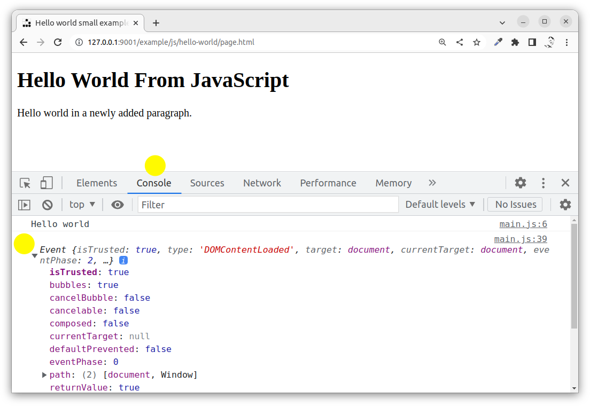

You can click on the event variable, which is an object containing settings of the actual event. This is a good way to inspect the content of variables.


Create and call a function
-----------

In the above example you saw a construct which was an "[arrow function expression](https://developer.mozilla.org/en-US/docs/Web/JavaScript/Reference/Functions/Arrow_functions)" which is a nice way to write an inline and anonymous function without the need of actually declare a function.

Another way to do it would be do declare a function and call it. That would look like this.

```javascript
/**
 * Log the event to the console.
 * 
 * @param {object} event the event occuring
 */
function logger (event) {
  console.log(event)
}

document.addEventListener('DOMContentLoaded', logger)
```

If you keep the old code and add the new above you will see two outputs into the console of the event variable.


Change the style
-----------

Another way to interact with the DOM is to update the style of the document. To visualize this we can add a button to the HTML page, and attach a function to it when it is clicked and in that function we modify the background color of the body.

Lets go and start with adding the button to the HTML code and adding a id to it (to make it easier to find it in the DOM).

```html
<button id="colorButton">Random the color!</button>
```

In `main.js` we add an eventhandler for the click event on that specific button.

```javascript
/**
 * Randomly change the color when the button is clicked.
 */
const button = document.getElementById('colorButton')
button.addEventListener('click', changeBackgroundColor)
```

To try out the code you can add a function `changeBackgroundColor()` that outputs `I was clicked!` into the console.

```javascript
/**
 * Change the background color of the body.
 */
function changeBackgroundColor () {
  console.log('I was clicked!')
}
```

It could look like this when I click the button repeatedly and view the results in the console.

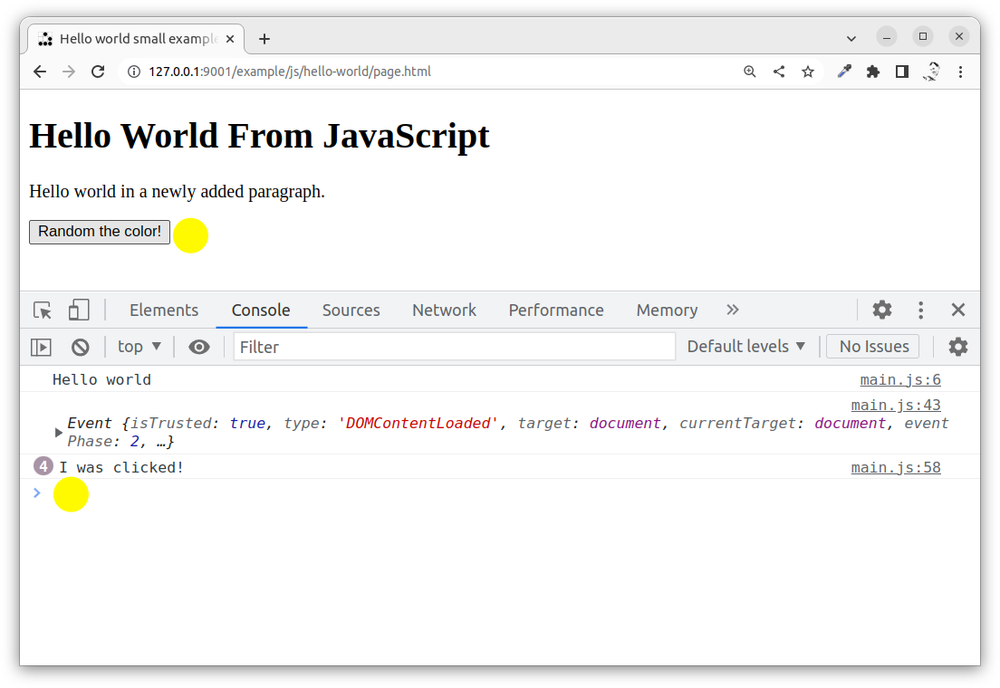

Now we update the code in the function to get the body element and change its background style to a random color.

The idea is something like this.

1. Get the body element.
1. Randomize a color.
1. Use its style attribute and set the background color.

It could look like this when the function is updated.

```javascript
/**
 * Change the background color of the body.
 */
function changeBackgroundColor () {
  // Get the body element
  const bodyElements = document.getElementsByTagName('body')
  const body = bodyElements.item(0)

  // Randomize a color
  const randomColor = Math.floor(Math.random() * 16777215).toString(16)
  console.log('Color: ' + randomColor)

  // Use the style attribute to set the background color
  body.style.backgroundColor = `#${randomColor}`
}
```

Can you follow the code above and figure out how it works?

The part with the `#${randomColor}` is called [string interpolation](https://developer.mozilla.org/en-US/docs/Web/JavaScript/Reference/Template_literals) (or template literals/strings) where the string `'#'` is prepended before the value of the variable. The hashtag is needed so that the style is intepreted as a color value like `#37c76a` which is green-ish.

This is how it looks like when running the page.

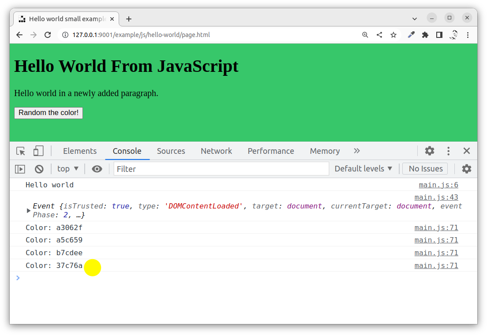


The sources and the debugger
-----------

The devtools has a JavaScript debugger which you can reach in devtools and the "Source" tab, it can look like this when you add a breakpoint to the first line in the function `changeBackgroundColor()`.

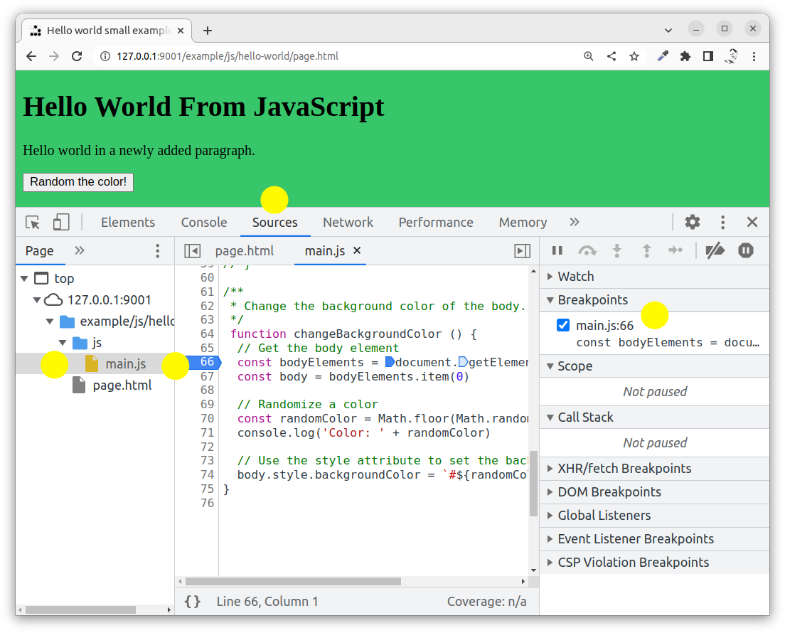

You can now press the button and see that the background color is not changed since the execution of the code stopped at the breakpoint.

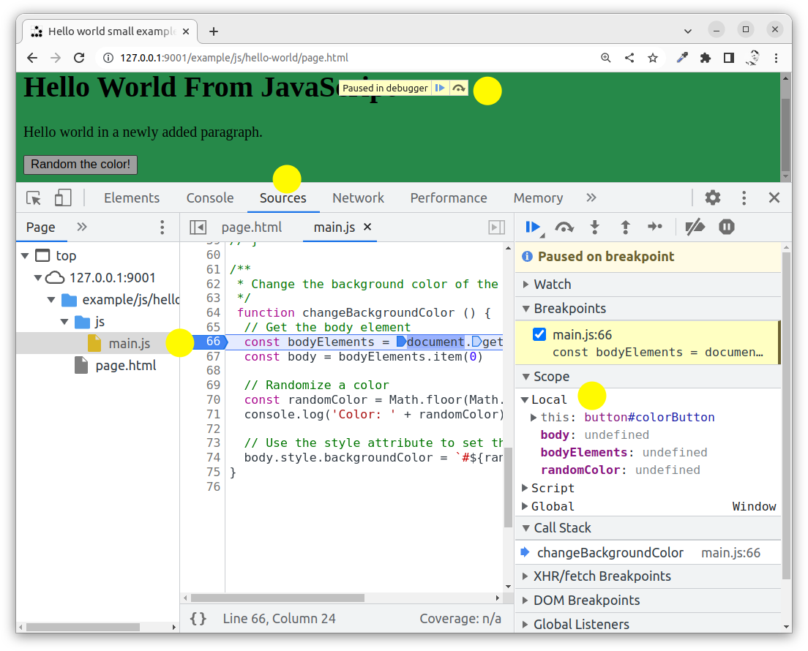

You can inspect the local vaiables of the function.

Now try to step a few lines to the line which actually changes the color, but do not execute that line just yet.

Now point to the variable `randomColor` and changes its value to some color, I choose a red color.

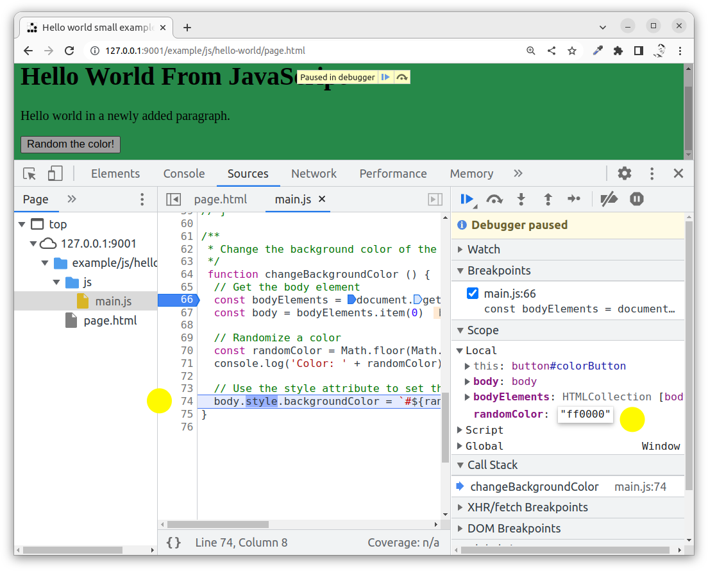

Now step over the line to execute it. My page gets all red.

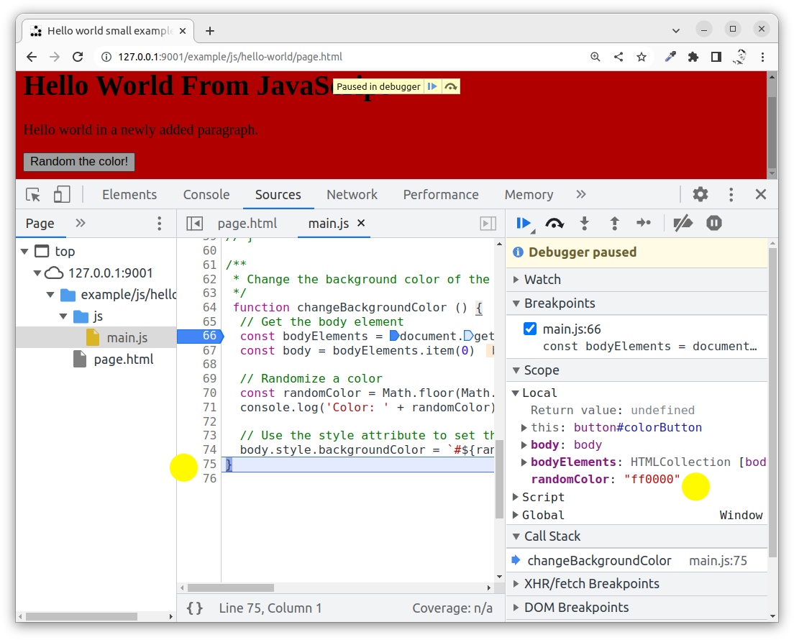

The debugger can be a powerful tool for debugging and tracing how the program works.

Finish up by resuming the script to let it finish.


Exercise roll the dices
-----------

Now when you know the basics you should be all ready to create a small program on your own that rolls 5 dices when the user presses a button. You feel that you are ready to take up such a challenge?

You can see the exercise in [`roll-dices`](../roll-dices/) with a solution. But you should really try it out on your own first.

1. Create a page, including a button and a script
1. When the user clicks the button
  1. Create five dices and show them in the page

There are UTF-8 representations of dice sides.

It could loko like this if you take up the challenge.

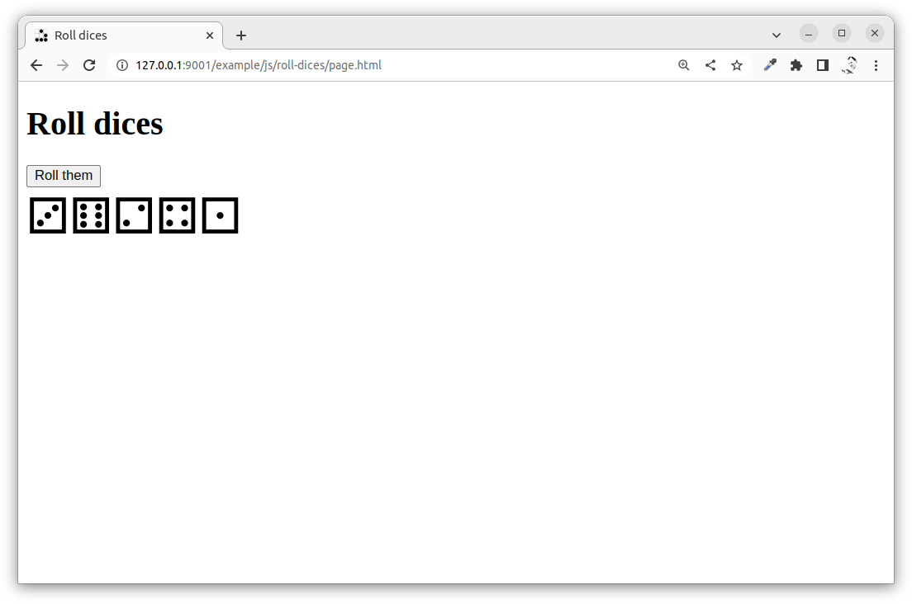


Summary
-----------

You have learnt some basic constructs to work with JavaScript in the browser, includin how to add code to the webpage, work with DOM and events.

Now you might want to proceed to learn more about the JavaScript language and its programming constructs.
