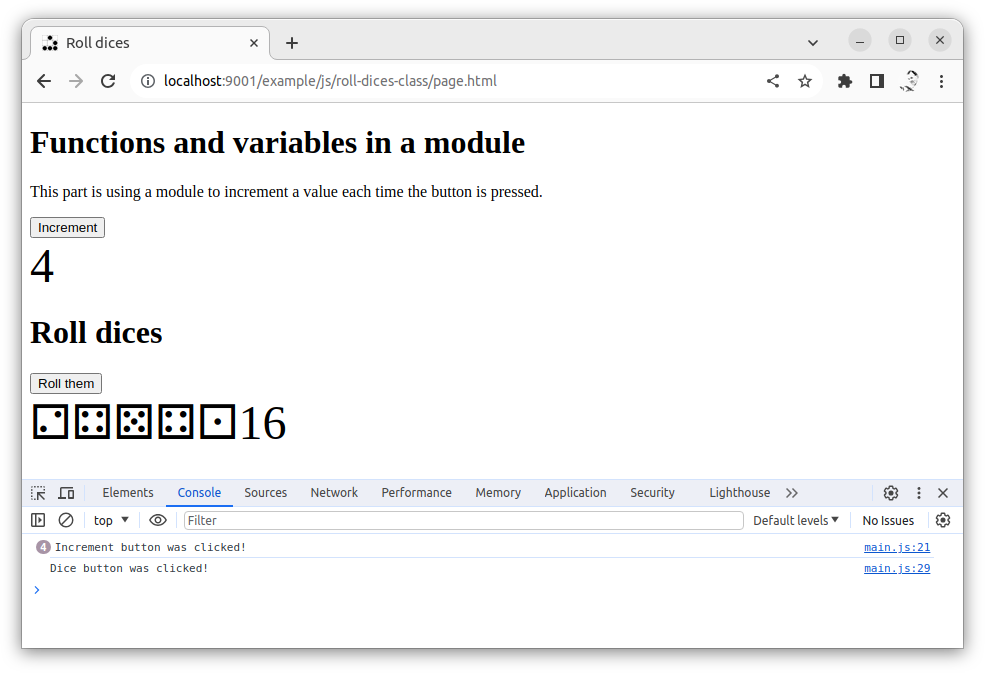

---
revision:
    "2023-11-21": "(A, mos) First release."
---
Roll dices in a webpage using JavaScript - class
===========================

This example program shows how to roll a set of dices when the user clicks a button. ThHe code is organised in a class.

[[_TOC_]]

This is how it can look like when we are done with this exercise. Still, it is the code behind it that is important.




Live example
---------------------------

You can try out [the live example here](https://mikael-roos.gitlab.io/html-css-js/example/js/roll-dices-class/page.html).

View its source code it you are in need of the solution for this exercise.


Prepare
---------------------------

You should have walked through the exercise "[Roll dices in a webpage using JavaScript - function in module](../roll-dices-module/)".


Directory structure
---------------------------

Do create a directory, for example `public/roll-dices-class` where you can work in.

The directory structure for this exercise, when it is done, might look like this.

```text
$ tree .
.
├── css
│   └── style.css
├── js
│   ├── main.js
│   └── module
│       ├── Demo.js
│       └── Dice.js
└── page.html
```


A class
---------------------------

Here are som basics when working with classes.

This is how a class can look like when saved in `module/Demo.js`.

```javascript
export default class Demo {

  #sum

  constructor () {
    this.#sum = 0
  }

  increment () {
    this.#sum += 1
  }

  get sum () {
    return this.#sum
  }
}
```

This is how you include the class into the main program and instantiate a new object from the class.

```javascript
// import Demo class
import Demo from './module/Demo.js'

const demo = new Demo();
```

THen you can use the class and its properties.

```javascript
demo.increment()
output.innerHTML = demo.sum
```


Write the code yourself
---------------------------

Can you try to write the code youreself to organise your dice code into a class?

1. Start with a web page `page.html` that includes a stylesheet `css/style.css` and the javascript file `js/main.js`.

1. Write the class in `js/module/Dice.js` with its properties.

1. In the `js/main.js`, import the class and instantiate a new object from it.

1. From `js/main.js`, use the object and update the webpage with the results of the rolled dice.

Do you have any considerations on aht parts of the code should go into the class and what parts should reside in the main?


Well done
---------------------------

Now you have seen how you can organise your JavaScript code into classes, modules, functions and how to import and export them and how to use them in a main program.

This provides the features needed to prduce well structured code.
