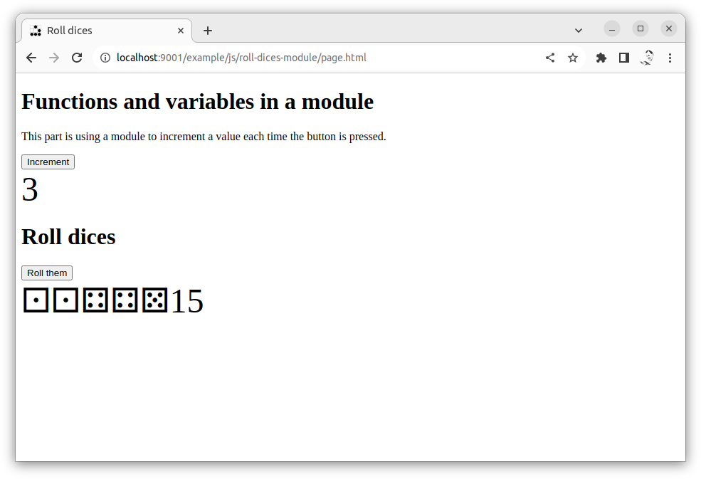

---
revision:
    "2023-11-21": "(A, mos) First release."
---
Roll dices in a webpage using JavaScript - function in module
===========================

This example program shows how to roll a set of dices when the user clicks a button. The code is organised in functions that lives in a module.

[[_TOC_]]

This is how it can look like when we are done with this exercise. Still, it is the code behind it that is important.




Live example
---------------------------

You can try out [the live example here](https://mikael-roos.gitlab.io/html-css-js/example/js/roll-dices-module/page.html).

View its source code it you are in need of the solution for this exercise.


Prepare
---------------------------

You should have walked through the exercise "[Roll dices in a webpage using JavaScript](../roll-dices/)".


Directory structure
---------------------------

Do create a directory, for example `public/roll-dices-module` where you can work in.

The directory structure for this exercise, when it is done, might look like this.

```text
$ tree .
.
├── css
│   └── style.css
├── js
│   ├── main.js
│   └── module
│       ├── demo.js
│       └── dice.js
└── page.html
```


Modules with functions
---------------------------

Here are som basics when working with modules.

This is how a module can look like when saved in `module/demo.js`.

```javascript
let sum = 0

function increment () {
  sum += 1
}

export {sum, increment}
```

The export statement defines what parts of the module that are exported.

This is how you include the module into the main program.

```javascript
// import from modules
import { sum, increment } from './module/demo.js'
```

Once the parts of the module is imported, then use them as ordinary variables and functions in your code.

```javascript
increment()
output.innerHTML = sum
```


Write the code yourself
---------------------------

Can you try to write the code youreself to organise your dice code into a module?

1. Start with a web page `page.html` that includes a stylesheet `css/style.css` and the javascript file `js/main.js`.

1. Write the module in `js/module/dice.js` with its functions and variables. Decide what the module should export.

1. In the `js/main.js`, import the module and its parts.

1. From `js/main.js`, use the imported functions and update the webpage with the results of the rolled dice.

Do you have any considerations on what parts of the code should go into the module and what parts should reside in the main?


Practice more
---------------------------

If you succeed with this exercise, then proceed to the exercise where you should [write your code using a class](../roll-dices-class/).
