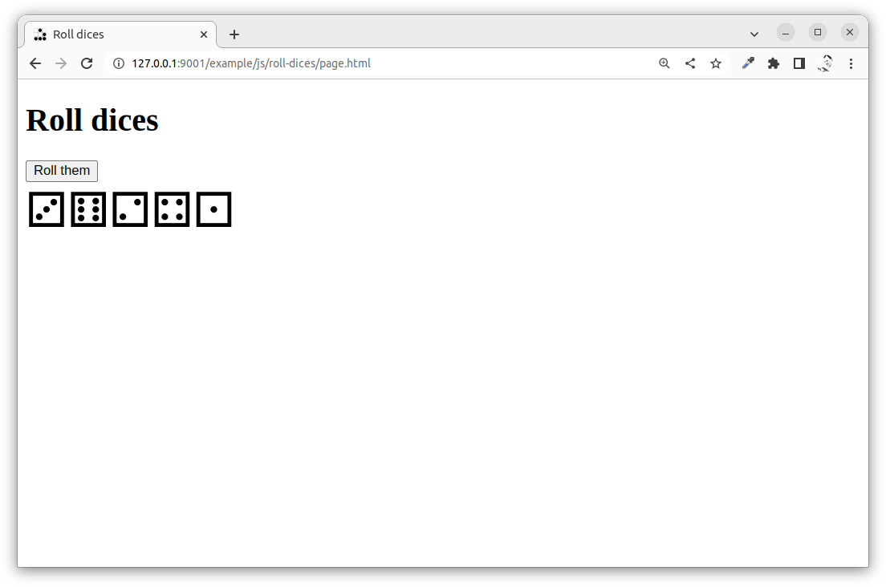

---
revision:
    "2022-11-18": "(A, mos) First release."
---
Roll dices in a webpage using JavaScript
===========================

This example program shows how to roll a set of dices when the user clicks a button.

[[_TOC_]]

This is how it can look like when we are done with this exercise. Still, it is the code behind it that is important.



You can try out [the live example here](https://mikael-roos.gitlab.io/html-css-js/example/js/roll-dices/page.html).


Prepare
---------------------------

You should have walked through the exercise "[A 'Hello World' example with JavaScript in a webpage](../hello-world/)".


Directory structure
---------------------------

The directory structure for this exercise, when it is done, looks like this.

```text
$ tree .
.
├── README.md
├── css
│   └── style.css 
├── img
│   └── glider.png
├── js
│   └── main.js
└── page.html

2 directories, 4 files
```

Do create a directory, for example `public/example/js/roll-dices` where you can work in.


Check out the example
---------------------------

Open the `page.html` in your browser and click the button.

Debugging details might be output into the console.
