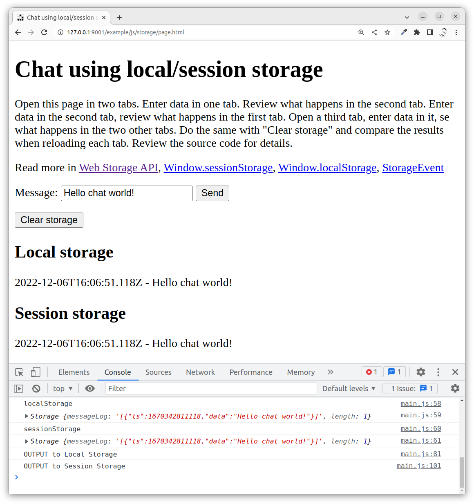
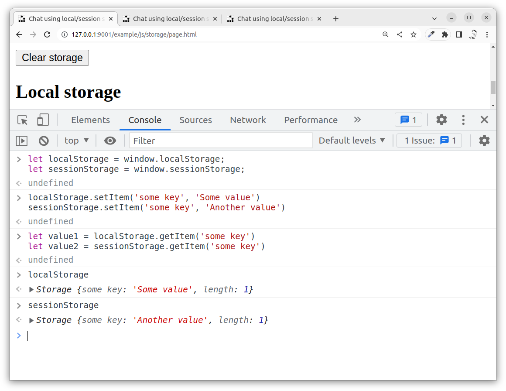
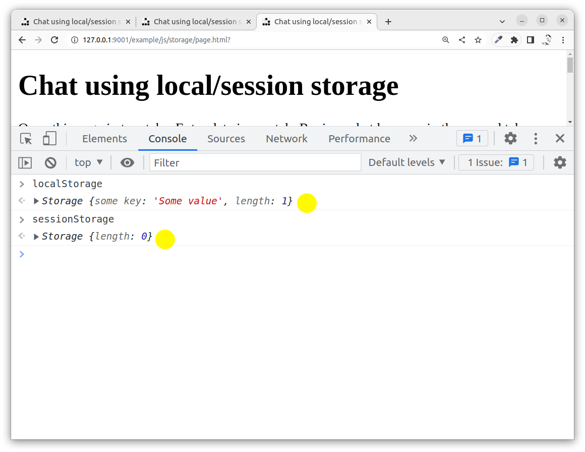
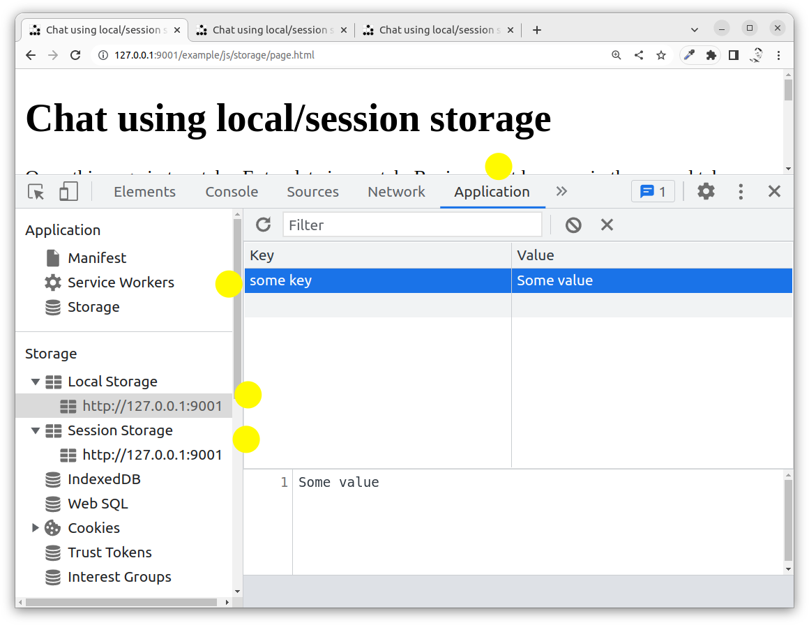
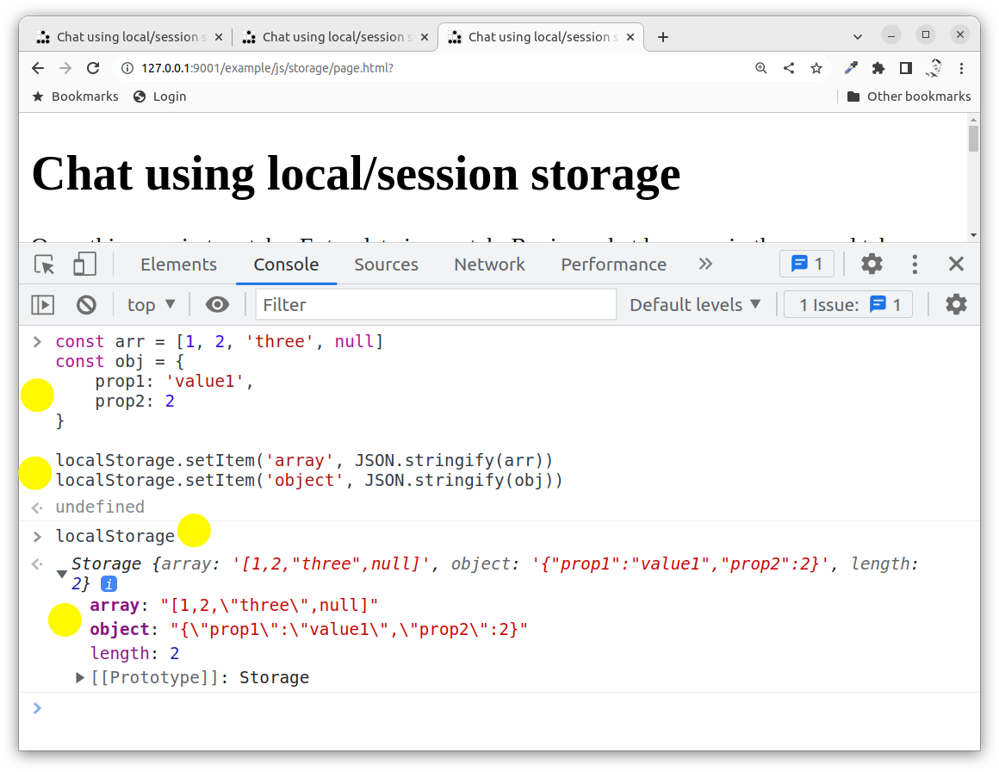
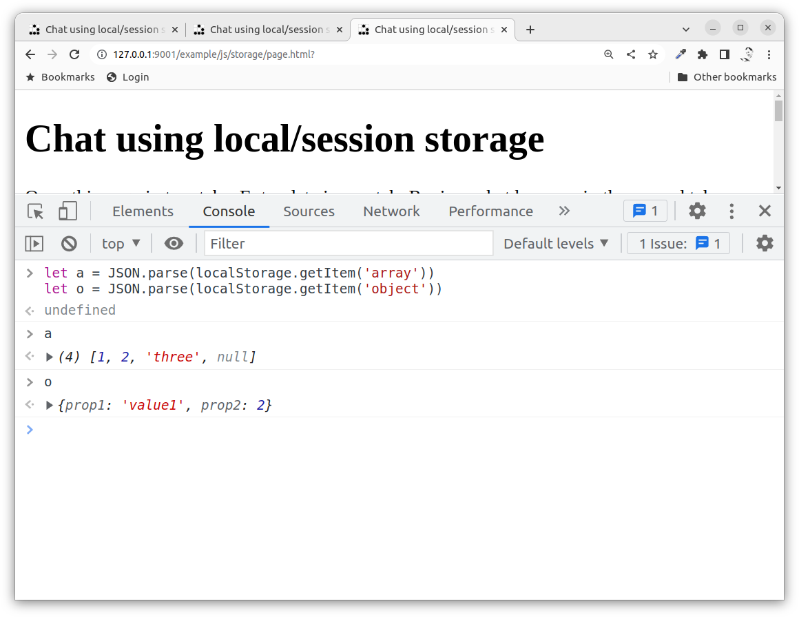

---
revision:
    "2022-12-12": "(B, mos) Adding storage event."
    "2022-12-06": "(A, mos) First release."
---
Using Web Storage API to explore a chat-like application
===========================

This example is a chat-like application using the Web Storage API to save information in the browser storage.

There is a recording where Mikael talks about the storage primitives and goes through the details of the example program. This article also explains some of the important foundations of the Web Storage API.

You can then review the source code and try it out on your own if you clone this repo.

[[_TOC_]]

This is how the chat-like application looks like when it is started.



You can try out [the live example here](https://mikael-roos.gitlab.io/html-css-js/example/js/storage/page.html).


Resources
---------------------------

Read up on the Web Storage API.

* [Web Storage API](https://developer.mozilla.org/en-US/docs/Web/API/Web_Storage_API)
* [Window.sessionStorage](https://developer.mozilla.org/en-US/docs/Web/API/Window/sessionStorage)
* [Window.localStorage](https://developer.mozilla.org/en-US/docs/Web/API/Window/localStorage)
* [StorageEvent](https://developer.mozilla.org/en-US/docs/Web/API/StorageEvent)


Prepare
---------------------------

You should be aware of how JavaScript works with events and be versed in general on how to create programs using JavaScript, HTMl and CSS.


Directory structure
---------------------------

The directory structure for this exercise, when it is done, looks like this.

```text
├── README.md
├── css
│   └── style.css
├── img
│   └── glider.png
├── js
│   └── main.js
└── page.html

3 directories, 5 files
```


Recording
---------------------------

This is the recording where Mikael uses and talks about the example application (13 min).

[](https://www.youtube.com/watch?v=BCw4QIGry3k)


Local and Session Storage
---------------------------

The difference between the Local and the Session storage is that the Session storage is for each tab in the browser and the Local storage is for the browser and thus accessible in any tab accessing the same resource.

The storages are connected to the window object.

```javascript
let localStorage = window.localStorage;
let sessionStorage = window.sessionStorage;
```

The storage is a key value storage and you can set the value of a particular key like this.

```javascript
localStorage.setItem('some key', 'Some value')
sessionStorage.setItem('some key', 'Another value')
```

Then you can read the value like this.

```javascript
let value1 = localStorage.getItem('some key')
let value2 = sessionStorage.getItem('some key')
```

You can also read the complete storage like this.

```javascript
console.log(localStorage)
console.log(sessionStorage)
```

This is how you can try this out in the console.



You can now open another tab in the browser, on the same url, and then checking the content of the local/session storage.

You should see that the local storage is the same in both tabs, but the session storage is local to each tab.



You can view the current stored data in the browser devtools in the Application tab.



You can also clear the current storage.

```javascript
localStorage.clear()
sessionStorage.clear()
```

Remember that you need to clear the session storage on each tab. The local storage is clearad for all tabs.

Other useful methods are `removeItem(key)` to remove an item with a specific key and `key(index)` to find what the key is named at the specific index.


Saving advanced structures using JSON
---------------------------

You can not save complex datastructures like an array, object and function directly to the storage. You can only save strings.

These might look like they work, but the do not, they are all converted to strings.

```javascript
localStorage.setItem('array', [1, 2, 3])
localStorage.setItem('object', { prop1: 'value1', prop2: 'value2'})
```

<!--
localStorage.setItem('function', function () {
    console.log('Inside function')
})
-->

However, the JSON datastructure is a way to convert native JavaScript arrays and objects into a string, thus making it possible to save the the storage as strings.

This is how to do it.

```javascript
const arr = [1, 2, 'three', null]
const obj = {
    prop1: 'value1',
    prop2: 2
}

localStorage.setItem('array', JSON.stringify(arr))
localStorage.setItem('object', JSON.stringify(obj))
```

You can then print the content of the local storage to see how it looks.



You could then retrieve and convert the JSON data back to their native JavaScript type.

```javascript
let a = JSON.parse(localStorage.getItem('array'))
let o = JSON.parse(localStorage.getItem('object'))
```



Using JSON stringify and parse will enable you to work with complex datastructures in the storage.

`JSON.stringify()` is to convert native JavaScript objects to a string representing a JSON data structure.

`JSON.parse()` parses a JSON string into a native JavaScript object.


Events for Web Storage
---------------------------

When the localStorage is updated an event is raised. That is so other tabs/pages, using the same localStorage, can update themself.

This does not work for the sessionStorage since that is only local to one page/tab.

You can then attach an event handler to that event.

```javascript
addEventListener('storage', (event) => {
    //
})
```

You can use the `event.storageArea` to check what Storage object was affected. The event object also contains details on the key that was changed and its old and new value.

Read more on "[Window: storage event](https://developer.mozilla.org/en-US/docs/Web/API/Window/storage_event)".

