---
revision:
    "2022-12-13": "(A, mos) First release."
---
Using the WebSocket API
===========================

This example is a chat-like application to explore the WebSocket API with focus on the client side code and how to build a client to an existing WebSocket server. You will see how to connect to server, how to use an echo- and a broadcast-server and how to work with subprotocols.

For the server side code we use various servers like Express, Node http-server and `ws` which is a WebSocket library. The server code is however not focus for this example and is then not explained in any detail in this document.

[[_TOC_]]

This is how the chat-like application looks like when it is started.

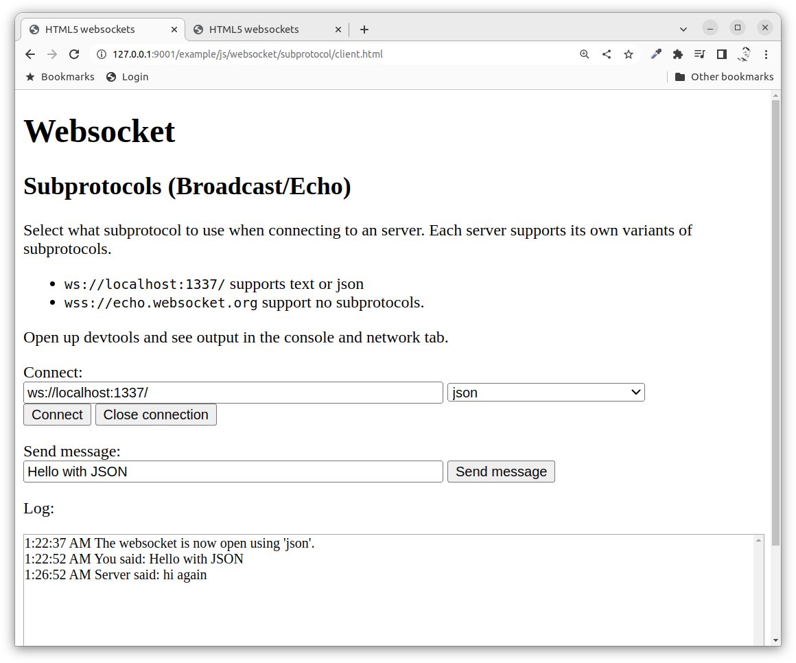

<!--
You can try out [the live example here](https://mikael-roos.gitlab.io/html-css-js/example/js/websocket/echo/client.html).
-->


Resources
---------------------------

Read up on the WebSocket API.

* [The WebSocket API (WebSockets)](https://developer.mozilla.org/en-US/docs/Web/API/WebSockets_API)
* [Writing WebSocket client applications](https://developer.mozilla.org/en-US/docs/Web/API/WebSockets_API/Writing_WebSocket_client_applications)


Prepare
---------------------------

You should be aware of how JavaScript works with events and be versed in general on how to create programs using JavaScript, HTML and CSS.


Directory structure
---------------------------

The directory structure for this exercise, when it is done, looks like this.

```text
.
├── README.md
├── broadcast
├── connect
├── echo
└── subprotocol

4 directories, 1 file
```

Each sub directory contains its own example showing various aspects of the API.

You can consume the examples in this order, from easy to more advanced.

1. connect
1. echo
1. broadcast
1. subprotocol


Recording
---------------------------

This is the recording where Mikael uses and talks about the example application (17 min).

[](https://www.youtube.com/watch?v=-7xCvDCOlos)


Connect
---------------------------

Lets start with a small example that only creates a client that connects to the server.

To get going with this example you will need access to the code and start by moving into the directory `connect/` and install the dependencies and then start the server.

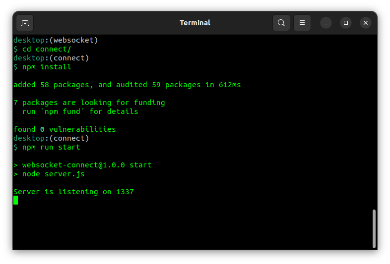

The server is up and running, lets open the client in the web browser.

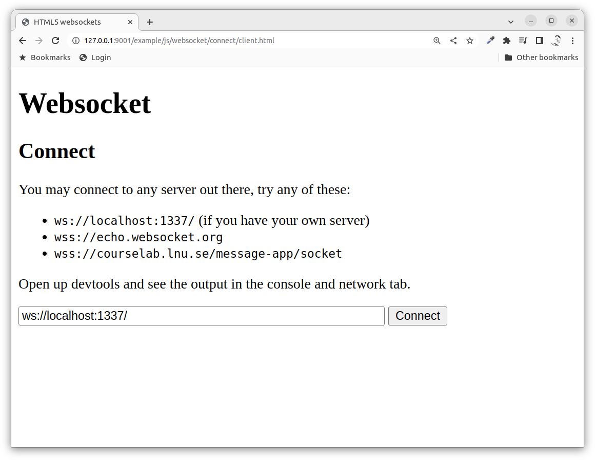

Use any of the suggested servers and try to connect the client to the server by pressing the "Connect" button.

It should look like this in the console.

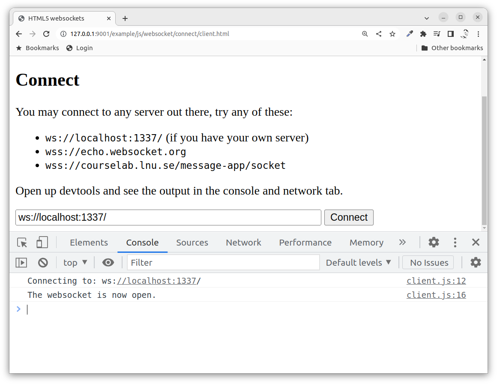

You should also see that the server received the request from the client.

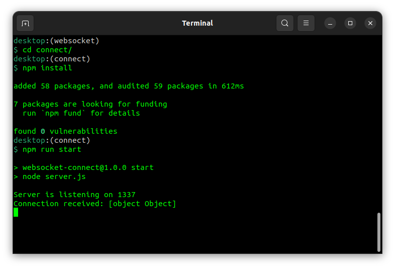

Now we can look into the client side of the code.

```javascript
// Get the elements needed
const url = document.getElementById('url')
const connect = document.getElementById('connect')

// Prepare the websocket variable
let websocket

// Create the websocket to connect to the url
connect.addEventListener('click', () => {
    console.log('Connecting to: ' + url.value)
    websocket = new WebSocket(url.value)

    // Add event handler for when the websocket has connected
    websocket.onopen = () => {
        console.log('The websocket is now open.')
    }
})
```

We get the html elements used in the application and we prepare a variable to hold the actual websocket object.

We create the websocket when the user clicks on the connect button by supplying the url to connect to.

We add an event handler to the `websocket.onopen` which is called when the websocket has successfully connected to the server.

That is all for the connecting and setup.


Echo
---------------------------

Now we move into the directory `echo` to try the same setup with an echo server.

Install the dependencies and start the server the same way as before.

Then start up the client in the browser, it might look like this.

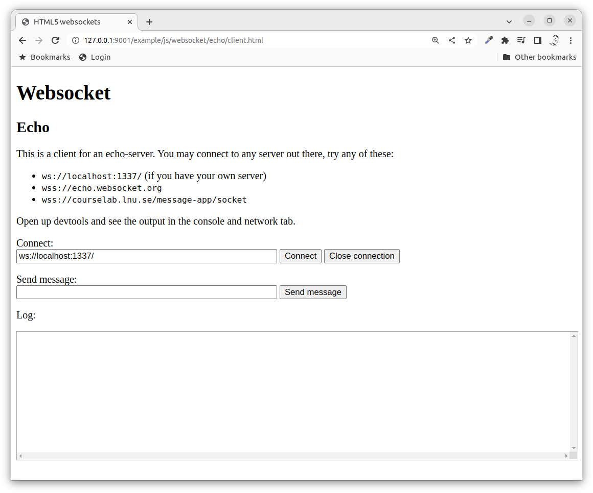

You can connect to a server which is an echo server. The intent with the echo server is to echo the same message back to you.

Try to connect and send a message or two to the server, it might look like this.

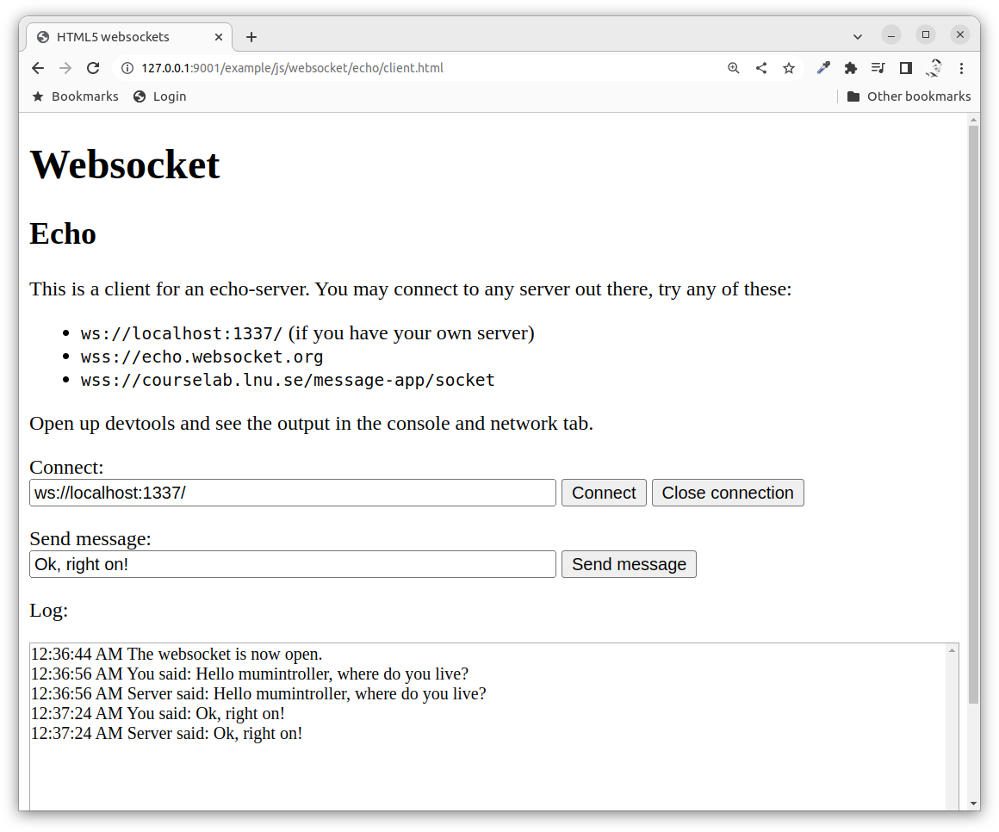

In the above example we can see in the log that the client connected, sent and received two messages.

The server output might look like this.

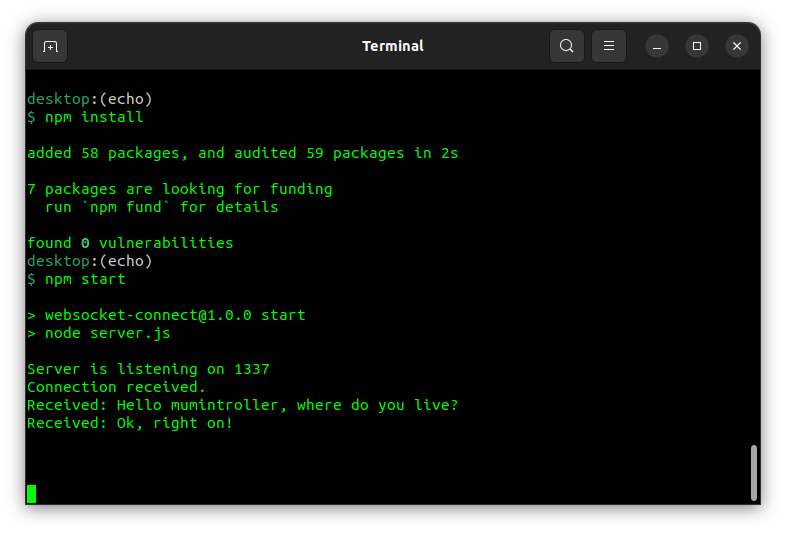

Now lets look at the client code and let us focus on the part of the websocket.

```javascript
connect.addEventListener('click', () => {
    console.log('Connecting to: ' + url.value)
    websocket = new WebSocket(url.value)

    // Handler for when the connection is opened
    websocket.onopen = () => {
        console.log('The websocket is now open.')
        console.log(websocket)
        outputLog('The websocket is now open.')
    }

    // Handler for when the message is received
    websocket.onmessage = (event) => {
        console.log('Receiving message: ' + event.data)
        console.log(event)
        console.log(websocket)
        outputLog('Server said: ' + event.data)
    }

    // Handler for when the socket is closed
    websocket.onclose = () => {
        console.log('The websocket is now closed.')
        console.log(websocket)
        outputLog('Websocket is now closed.')
    }
})
```

We have the same handler for when the user presses the "Connect" button.

We added a handler for when the websocket is closed from the server side.

There there is the handler for receiving a message from the server where the actual message is stored in the event object through `event.data`. It is here up to the client application to decide the format of the content in `event.data`.

The common thing for all handlers are that they output information to the console and to the chat log through the function `outputLog()`. The implementation of the `outputLog()` is not of any great interest currently since we are only focusing on the websocket client part.

We have a button "Close" that forces a close of the connection from the client side. IN the code below is `close` the button that was pressed.

```javascript
/**
 * What to do when user clicks Close connection.
 */
close.addEventListener('click', () => {
    console.log('Closing websocket.')
    websocket.send('Client closing connection by intention.')
    websocket.close()
    console.log(websocket)
    outputLog('Prepare to close websocket.')
})
```

The important part of the code above is `websocket.close()` which closes the websocket connection.

Then we have the important part of sending a message to the server which looks like this. In the example code below is the `sendMessage` the button to click to send a message.

```javascript
/**
 * What to do when user clicks to send a message.
 */
sendMessage.addEventListener('click', () => {
    const messageText = message.value

    if (!websocket || websocket.readyState === 3) {
        console.log('The websocket is not connected to a server.')
    } else {
        websocket.send(messageText)
        console.log('Sending message: ' + messageText)
        outputLog('You said: ' + messageText)
    }
})
```

The message is sent as pure text using `websocket.send()`. To avoid trouble we check that the websocket is open and ready, `websocket.readyState === 3` would mean that the websocket is closed.

That is all on how to implement an echo client using websockets. The basic idea is to connect and send a message, then wait until a message is received and print it out.


Broadcast
---------------------------

To start the broadcast server you move into the directory `broadcast/` and install the dependencies and start the server.

Now you can open the client in your browser. The client user interface looks the same as the echo client, more or less. Do connect and send a message.

The open up the same client in another tab and connect and send another message.

Now review that the message is also seen in the first tab.

You now have an application where multiple users can connect to the same broadcast server which receives any message from the connected clients and broadcasts the incoming messages to all the clients.

The client in the first tab may look like this.

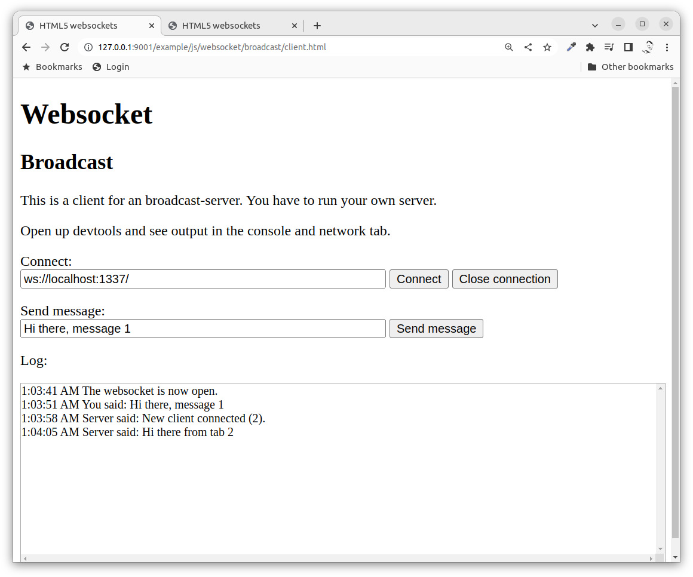

The corresponding output on the server side might look like this.

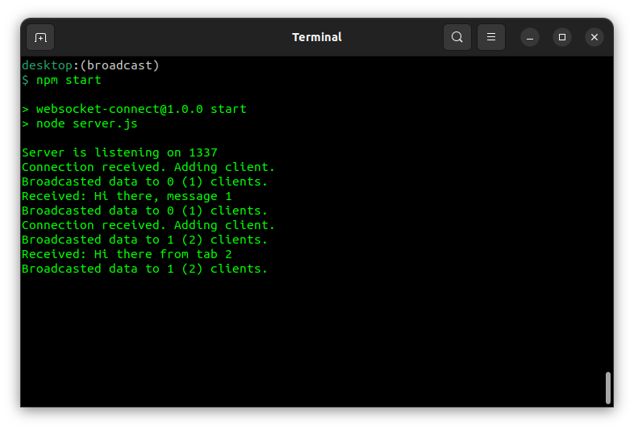

Ok, lets look at the client side code to see if anything changed from the implementation of the echo client.

Well, no. It was actually the same code base. The basic idea of the client is just like before.

1. Connect to the server.
1. Add a handler for incoming messages.
1. Create outcoming messages and send to the server.
1. Close the connection.


Subprotocol
---------------------------

The example in the directory `subprotocol/` shows how you can connect to a server and sending an argument stating what type of protocol you might want to speak. This enables servers to support seeral implementations of application level protocols and the clients can send a list of the protocols they support.

The major difference on the client side is to send the subprotocol when connecting to the server. The server then should decide wether to accept or deny the connection request.

```javascript
websocket = new WebSocket(url, protocol)
```

You can also send an array of possible protocols to speak, the idea is that the server chooses the first matching protocol.

```javascript
websocket = new WebSocket(url, ['protocol-A', 'protocol-B'])
```

When the connection is made and the event callback for `websocket.onopen` is called the protocol is supplied in the property `websocket.protocol`.

It might look like this when two clients connect with different protocols and the send a message to the broadcast server.

First we connect using the text protocol.

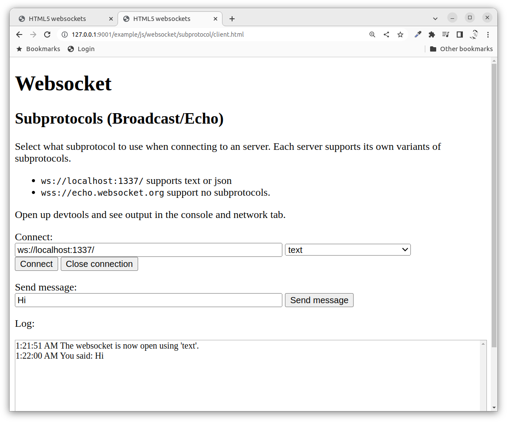

Then we connect another client using the json protocol. That client looks like this.

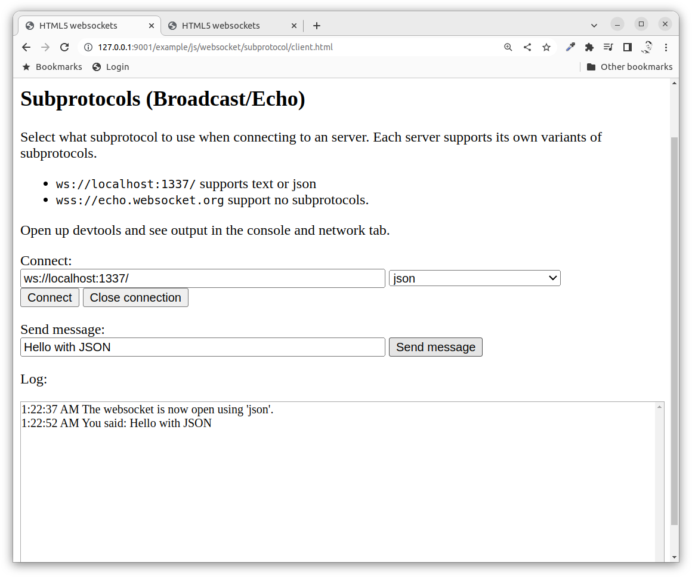

Then we check the output in the tab using the text protocol. Here we see that the last messages are sent in JSON format.

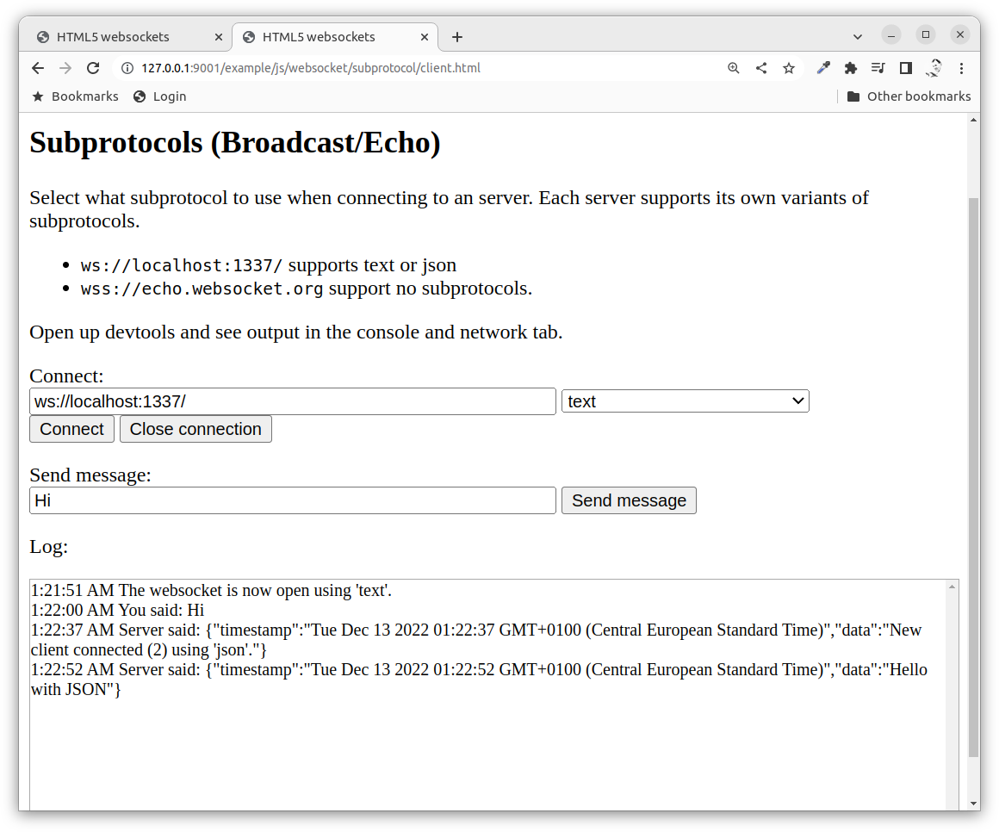

The JSON messages sent through the websockets looks like this, but this is application specific so you can choose your own custom format if you implement both the client and the server.

```json
{
   "timestamp":"Tue Dec 13 2022 01:22:52 GMT+0100 (Central European Standard Time)",
   "data":"Hello with JSON"
}
```

The output from the server might look like this when the two clients connects with the subprotocols and sends the messages.

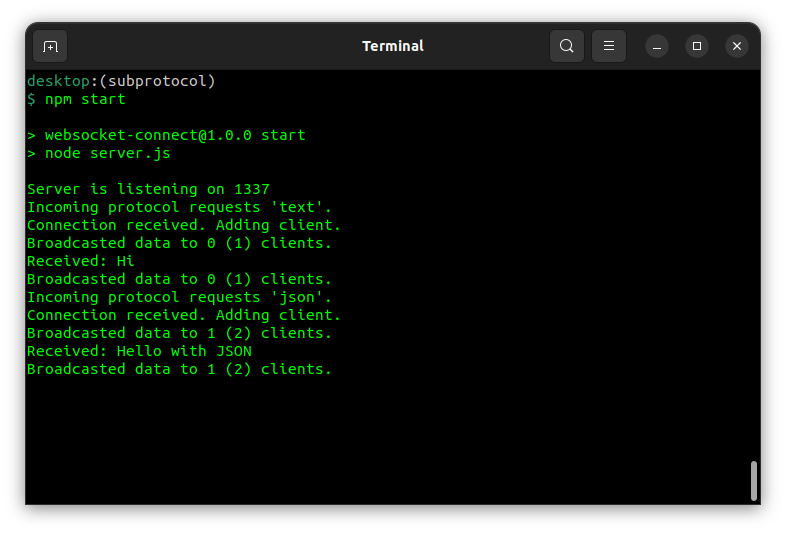

That is how it can work when two cliens use different protocols connecting to the same server which supports bot protocols.


JSON messages
---------------------------

To actually implement a JSON message over websockets you will need to create the JSON object and stringify it before sending it to the server. When you receive the message you need to JSON parse it back to a JSON object.

First stringify and send the json message.

```javascript
// Sending a JSON message
let message = {
    timestamp: new Date(),
    message: 'This is the actual message'
}

let jsonString = JSON.stringify(message)

websocket.send(jsonString)
```

Then receiving the parsing the json message.

```javascript
// Receiving a JSON message
websocket.onmessage = (event) => {
    let jsonObject = JSON.parse(event.data)
    // Use the message as a native object
}
```

Using JSON is a good idea to implement your own application level protocol over websockets.
