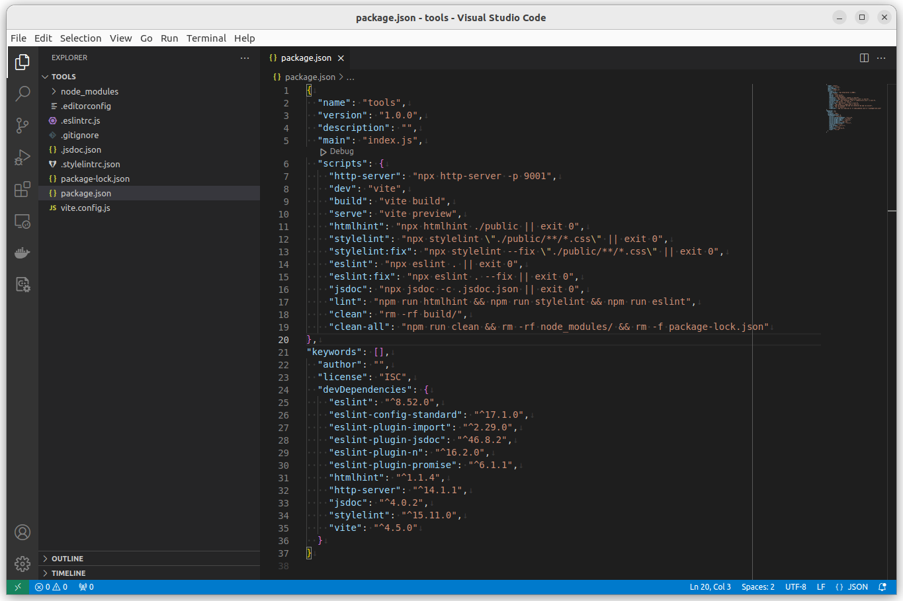

---
revision history:
  2024-11-11: "(Rev E) Use version 8 of eslint."
  2023-11-07: "(Rev D) Split into two parts."
  2023-11-06: "(Rev C) Moved to its own repo."
  2023-11-01: "(Rev B) Renamed and changed its structure, added vite."
  2022-11-01: "(Rev A) First release."
---
Development tools and linters
========================



This repo contains details on how to create an environment with development tools and linters for HTML, CSS and JavaScript (client and server). It also contains explanations on the tools.

[[_TOC_]]


Video
-----------------------------

This is a recorded presentation, 11 minutes long (English), when Mikael goes through the content of this article.

[](https://www.youtube.com/watch?v=nIg5X6ltfqA)


Install
------------------------

This is the short story on how to prepare a new repo for development by installing tools and linters for HTML, CSS and JavaScript.

Start with an empty directory, then do the following.

```text
npm init --yes
npm install --save-dev              \
    htmlhint                        \
    stylelint                       \
    stylelint-config-recommended    \
    eslint@8                        \
    eslint-config-standard          \
    eslint-plugin-import            \
    eslint-plugin-jsdoc             \
    eslint-plugin-promise           \
    eslint-plugin-n                 \
    http-server                     \
    jsdoc                           \
    vite
```

You will now have the file `package.json` generated for you and the tools installed will be defined with their actual version in the file. Review it for details.

Download sample configuration files using curl.

```text
curl --silent --output .editorconfig https://gitlab.com/mikael-roos/html-css-js-dev/-/raw/main/.editorconfig
curl --silent --output .gitignore https://gitlab.com/mikael-roos/html-css-js-dev/-/raw/main/.gitignore
curl --silent --output .stylelintrc.js https://gitlab.com/mikael-roos/html-css-js-dev/-/raw/main/.stylelintrc.js
curl --silent --output .eslintrc.js https://gitlab.com/mikael-roos/html-css-js-dev/-/raw/main/.eslintrc.js
curl --silent --output .jsdoc.json https://gitlab.com/mikael-roos/html-css-js-dev/-/raw/main/.jsdoc.json
curl --silent --output vite.config.js https://gitlab.com/mikael-roos/html-css-js-dev/-/raw/main/vite.config.js
```

The script part needs to manually be added to the `package.json`. This is how the tools are to be executed.

```json
{
    "scripts": {
        "http-server": "npx http-server -p 9001",
        "dev": "vite",
        "build": "vite build",
        "serve": "vite preview",
        "htmlhint": "npx htmlhint public src || exit 0",
        "stylelint": "npx stylelint **/*.css || exit 0",
        "stylelint:fix": "npx stylelint --fix **/*.css || exit 0",
        "eslint": "npx eslint . || exit 0",
        "eslint:fix": "npx eslint --fix . || exit 0",
        "jsdoc": "npx jsdoc -c .jsdoc.json || exit 0",
        "lint": "npm run htmlhint && npm run stylelint && npm run eslint",
        "test": "npm run lint",
        "clean": "rm -rf build/",
        "clean-all": "npm run clean && rm -rf node_modules/ && rm -f package-lock.json"
    }
}
```

<!--
"eslint": "npx eslint . --ext .mjs || exit 0",
"eslint:fix": "npx eslint . --ext .mjs --fix || exit 0",

jsdoc.json need configuring from dirs to read js files
-->

Verify that the scripts are available. You should see all scripts with their implementation.

```text
npm run
```

When you are done you will have the following directory structure.

```text
$ tree -a . -L 1
.
├── .editorconfig
├── .eslintrc.js
├── .gitignore
├── .jsdoc.json
├── .stylelintrc.js
├── node_modules
├── package-lock.json
├── package.json
└── vite.config.js

1 directory, 8 files
```

You have now installed essential development tools and linters.


Files to test with
------------------------

This repo contains a few files that you can use to verify that the linters works as expected. 

The directory `public/` contains files that are setup like static web pages.

The directory `src/` contains files that are to be built using a builder and generate a website into the `dist/` folder.

The following commands will verify that the linters works by checking files in that directory.

You can try to run the linters separately to verify that they work.

```
npm run htmlhint
npm run stylelint
npm run eslint
```

Thera are two fixers that will try to fix the errors they notice.

```
npm run stylelint:fix
npm run eslint:fix
```


npm run lint
------------------------

Execute all linters to build a test suite for your application.

This is how the script is defined.

```json
{
    "scripts": {
        "lint": "npm run htmlhint && npm run stylelint && npm run eslint",
    }
}
```

Try it out by executing it like this.

```
npm run lint
```


npm test
------------------------

To run `npm test` usually executes all the tests in the repo.

In this example is that defined as running all the linters.

This is how the script is defined.

```json
{
    "scripts": {
        "test": "npm run lint",
    }
}
```

Try it out by executing it like this.

```
npm test
```


npm run clean
------------------------

Remove all generated files with `npm run clean`.

You can remove all installed and generated files using `npm run clean-all`.

This is how the scripts are defined. Modify the scripts when needed to clean out all generated files.

```json
{
    "scripts": {
        "clean": "rm -rf build/",
        "clean-all": "npm run clean && rm -rf node_modules/ && rm -f package-lock.json"
    }
}
```

Modify the scripts if you want it to clean upp differently. The idea is the `clean` removes all files that are generated and `clean-all` removes even the installed files. 

If you do `clean-all` everything that is installed in the repo will be removed and you can restore it by doing `npm install`.


Start the web server
------------------------

In the tools a web server is included. You start it like this.

```
npm run http-server
```

It serves files from the directory `public/`. You can create that directory and add a file `hello.html` like this.

```
mkdir public
echo "<p>Hello</p>" > public/hello.html
```

Open your browser to localhost:9001 and verify that you can click on the page `hello.html` and view the message "Hello".


Read more on each tool
------------------------

You have now installed a local development environment with tools and linters. You can read more on each tool in [`README_tools.md`](./README_tools.md) to learn how each tool is setup and where you can find more information on the tool.
