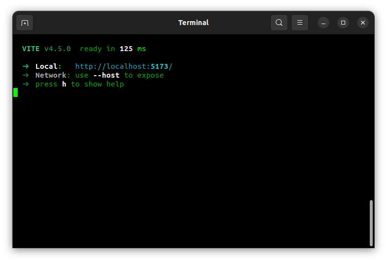
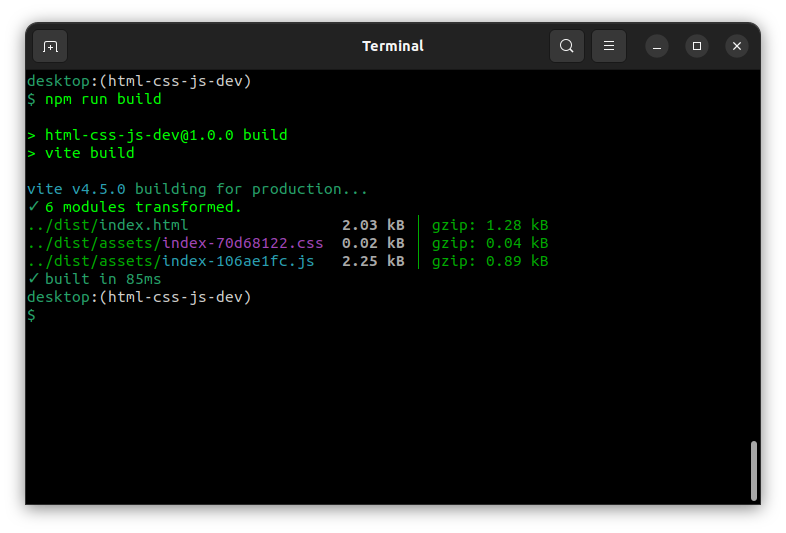
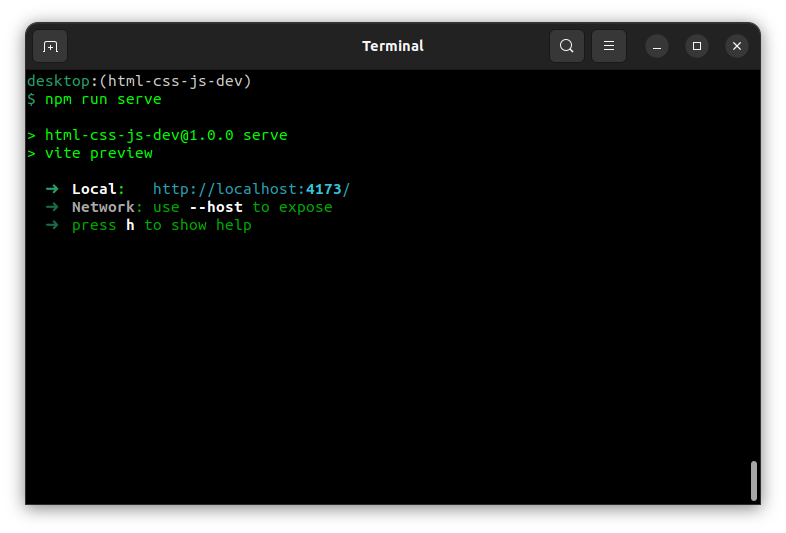

---
revision history:
  2023-11-22: "(Rev A) First release."
---
A JavaScript builder tool - Vite
========================



This article explains how to use and work with the Vite builder tool to create you web application from its `src/` and generate a distribution into `dist/`.

[[_TOC_]]


<!--
Video
-----------------------------

This is a recorded presentation, 11 minutes long (English), when Mikael goes through the content of this article.

[](https://www.youtube.com/watch?v=nIg5X6ltfqA)
-->


About Vite
------------------------

You should know some basics about [Vite](https://vitejs.dev/), just give it a minute or two to scroll around its website and read "[Why Vite](https://vitejs.dev/guide/why.html)".


About the example code
------------------------

The example code used in this article comes from the example "[Create a dice game 21 using JavaScript](https://gitlab.com/mikael-roos/html-css-js/-/tree/main/public/example/js/dice-game-21)". The same code is used here, but re-written into the structure that the builder tool uses.


About installing the tool
------------------------

The article "[Development tools and linters](./README.md)" shows how to install the Vite builder tool together with more linters and tools for development of web applications with HTML, CSS and JavaScript when you are working with a fresh repo for development.


Get going with this exercise
------------------------

To quickly start up this exercise you can clone this example repo, like this.

```
git clone git@gitlab.com:mikael-roos/html-css-js-dev.git
cd html-css-js-dev
```

Start by installing all the tools.

```
npm install
```

Check what scripts are available.

```
npm run
```

Now we can start using the builder tool.


Directory structure
------------------------

All the source files are now available in the dictory `src/` like this.

```
$ tree src             
src                    
├── css                
│   └── style.css      
├── img                
│   └── glider.png     
├── index.html         
└── js                 
    ├── main.js        
    └── modules        
        ├── Dice.js    
        └── Player.js  
```


The builder tool features
------------------------

Vite consist of a

* development server to work with development of files in `src/`,
* a build tool to generate a distribution in `dist/` from the source in `src/`,
* preview the generated distribution in `dist/`.

The script `npm run dev` starts the development server using the files in vite root directory `src/`.

The script `npm run build` builds the target into the `dist/` directory.

The script `npm run serve` starts a server to serve the content from `dist/`.


Development with `npm run dev`
---------------------------

Start the development server.

```
npm run dev
```


_Figure. This is how the output can look from the command `npm run dev`._

Open a browser to the port displayed, usually `http://localhost:5173/`.

You should see the game of 21 and be able to play it.


Live reload of changes
---------------------------

Open the file `src/index.html` in your editor and do some minor changes to the content of the file, save them and see that the page content is updated. That is live reload of your changes.


Create a distribution into `dist/`
---------------------------

When you are done with development of the application, then you can create a distribution copy of it. The distribution code is generated to the directory `dist/`.

Run the following command to generate the distribution code.

```
npm run build
```



_Figure. This is how the output can look from the command `npm run build`._

You can see from the output what files and directories that were generated.

The structure in the `dist/` directory can look like this.

```
$ tree dist
dist
├── assets
│   ├── index-106ae1fc.js
│   └── index-70d68122.css
└── index.html
```

Open the files in your editor and view the minified and consolidated code in each asset file.


Test out the distribution from `dist/`
---------------------------

You can run the distribution code using the following command.

```
nom run serve
```



_Figure. This is how the output can look from the command `npm run serve`._

Open a browser to the port displayed, usually `http://localhost:4173/`.

You can also open another web server on that directory. The following is already included in the repo.

```
npm run http-server dist
```

Follow the instructions to open yet another browser to the link you see in the terminal output. You should get the same 21 web application.


Summary
---------------------------

This is how a builder tool let you work in many files and then consolidate them in an efficient manner when its time for production.
