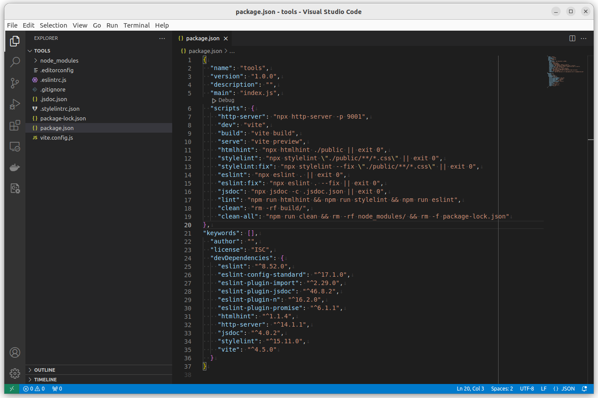

---
revision history:
  2023-11-07: "(Rev D) Split into two parts."
  2023-11-06: "(Rev C) Moved to its own repo."
  2023-11-01: "(Rev B) Renamed and changed its structure, added vite."
  2022-11-01: "(Rev A) First release."
---
Development tools and linters
========================

<!--  -->

This is an explanation of each tool that is included in the development environment, showing how to install each tool separately and how to configure it and where to find more information on the tool.

If you are looking for the short story on how to install and configure all tools at once, then read the [`README.md`](./README.md).

[[_TOC_]]


Settings for text editor
------------------------

The file `.editorconfig` is used to enforce the coding style in the texteditor, read more on [EditorConfig](https://editorconfig.org/).

To enable editorConfig in Visual Studio Code you may install an extension "[EditorConfig for VS Code](https://marketplace.visualstudio.com/items?itemName=EditorConfig.EditorConfig)".


htmlhint
------------------

The tool htmlhint checks your HTML files.

Do this to install [htmlhint](https://www.npmjs.com/package/htmlhint).

```
npm install htmlhint --save-dev
```

Add the following to the script part of the `package.json`.

```json
{
    "scripts": {
        "htmlhint": "npx htmlhint ./public || exit 0"
    }
}
```

You can now execute it like this to check all HTML files in the directory `public/`.

```
npm run htmlhint
```

Check the help.

```
npx htmlhint --help
```

Read more on [HTMLHint](https://htmlhint.com/).


stylelint
------------------

The tool stylelint checks your CSS files.

Do this to install [stylelint](https://www.npmjs.com/package/stylelint).

```
npm install stylelint stylelint-config-recommended --save-dev
```

Add the following to the script part of the `package.json`.

```json
{
    "scripts": {
        "stylelint": "npx stylelint \"./public/**/*.css\" || exit 0",
        "stylelint:fix": "npx stylelint --fix \"./public/**/*.css\" || exit 0",
    }
}
```

You need a configuration file like `.stylelintrc.json` with the ruleset to use. A default setup can look like this.

```json
{
  "extends": "stylelint-config-recommended"
}
```

You can now execute it like this to validate all css-files below the public directory.

```
npm run stylelint
```

If you get erros from the linters, try fixing them like this.

```
npm run stylelint:fix
```

Check the help.

```
npx stylelint --help
```

Read more on [Stylelint](https://stylelint.io/).


eslint
------------------

The tool eslint checks your JavaScript files.

Do this to install [eslint](https://www.npmjs.com/package/eslint) and to set it up to use a coding standard.

This process is always done in this repo, so the configuration file `eslintrs.js` already exists and all the tools are in the `package.json`.

To install and setup eslint.

```
npm init @eslint/config
```

During the installation process you are asked a few questions to help configuring and installing the tool.

The current choice of coding standard is "[JavaScript Standard Style](https://standardjs.com/)".

After the installation is done you may add the follwoing scripts to the script part of the `package.json`.

```json
{
    "scripts": {
        "eslint": "npx eslint . || exit 0",
        "eslint:fix": "npx eslint . --fix || exit 0"
    }
}
```

You can now execute it like this.

```
npm run lint
npm run lint:fix
```


eslint with jsdoc comments
------------------

To enforce [JSDoc comments](https://jsdoc.app/) the following is added.

First install the jsdoc-plugin for eslint.

```
npm install --save-dev eslint-plugin-jsdoc
```

Then add the following to the eslint configuration file.

```javascript
{
  plugins: [
    'jsdoc'
  ],
  extends: [
    'plugin:jsdoc/recommended'
  ]
}
```

You can now run the eslint again. You can even partially fix missing JSDoc comments.

```
npm run eslint
npm run eslint:fix
```


### Example on JSDoc comments

This is how the JSDOC should look like.

```javascript
/**
 * Calculates the sum of the parameters.
 * @param {number} x - Operand.
 * @param {number} y - Operand.
 * @returns {number} The sum of the operands.
 */
function add(x, y) {
  return x + y
}
```


Generate JSDoc
------------------------

This is how to generate JSDoc for your project.

Start by installing the tool.

```
npm install --save-dev jsdoc
```

Then add the following scripts to your `package.json`.

```json
{
  "scripts": {
    "jsdoc": "npx jsdoc -c .jsdoc.json || exit 0",
  },
}
```

You can now run the command to generate the documentation.

```
npm run jsdoc
```

You can view the configuration file `.jsdoc.json` to see its settings. 

The documentation is generated to `doc/jsdoc` and you can point your browser to view it.

You can read more on "[Configuring JSDoc with a configuration file](https://jsdoc.app/about-configuring-jsdoc.html)".


Run a web server
------------------------

It might be useful to run a simple web server to try out your code, you can do like this to include it in your development environment.

Install [http-server](https://www.npmjs.com/package/http-server).

```
npm install http-server --save-dev
```

Then add the following script to start it up.

```json
  "scripts": {
    "http-server": "npx http-server -p 9001 "
  },
```

You can now start the web server and it will load the files available in the directory `public/`.

```
npm run http-server
```


Vite build tool
---------------------------

This is how to add the [builder tool Vite](https://vitejs.dev/). First we install the packages.

```text
npm install --save-dev vite
```

Create a configuration file `vite.config.js` and add the following to it.

```javascript
export default {
  root: 'src',
  build: {
    outDir: '../dist',
    emptyOutDir: true,
    target: 'esnext'
  }
}
```

This means that the root directory for Vite is the `src/`. Go on and create that directory.

```text
mkdir src
```

We now add the Vite scripts to the script part in the `package.json`.

```json
{
    "scripts": {
        "dev": "vite",
        "build": "vite build",
        "serve": "vite preview"
    }
}
```

Check with `npm run` that the scripts are available.

The script `npm run dev` starts the development server using the files in vite root directory `src/`.

The script `npm run build` builds the target into the `dist/` directory.

The script `npm run serve` starts a server to show the content in `dist/`.

You can now try out the vite build tool. But first we need a entrypoint in the file `src/index.html`. Do create that file and add the following code into it.

```html
<!doctype html>
<p>Hello World Vite</p>
```

If it all works the try to `npm run build` and `npm run serve` and verify that the `dist/` directory is generated and that the same results appear in the webpage.

Vite consist of a 

* development server to work with development of files in `src/`,
* a build tool to generate a distribution in `dist/` from the source in `src/`,
* preview the generated distribution in `dist/`.

Remember the difference in the `src/` and the `dist/` directories. It will be more obvious when we start to add more code.

