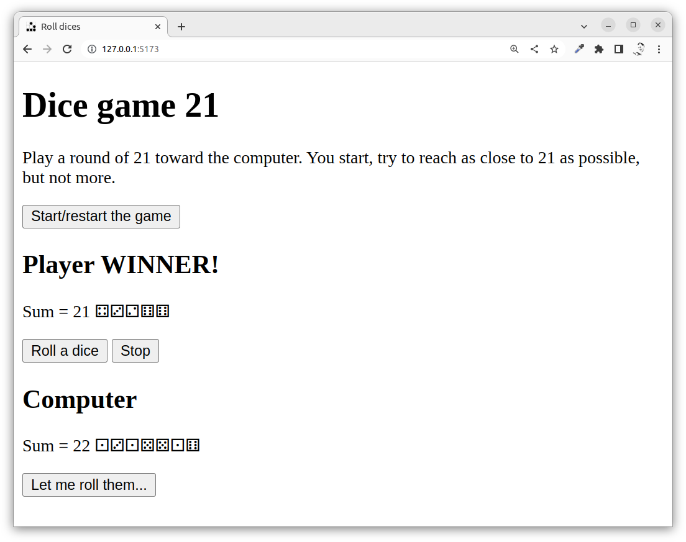
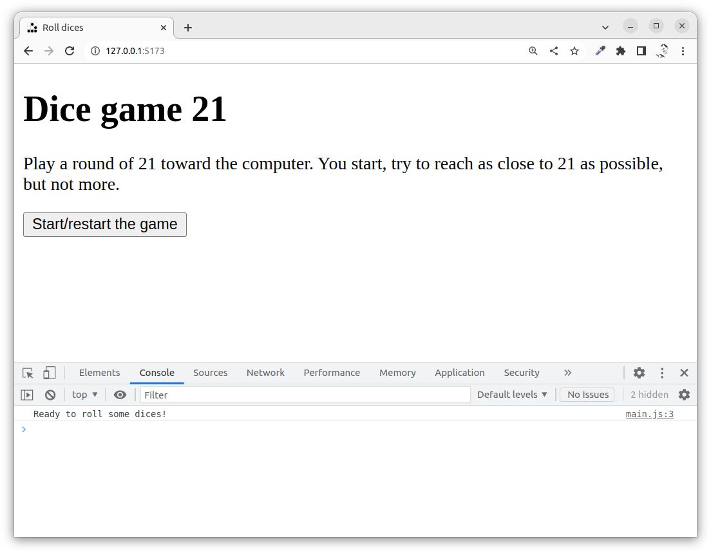
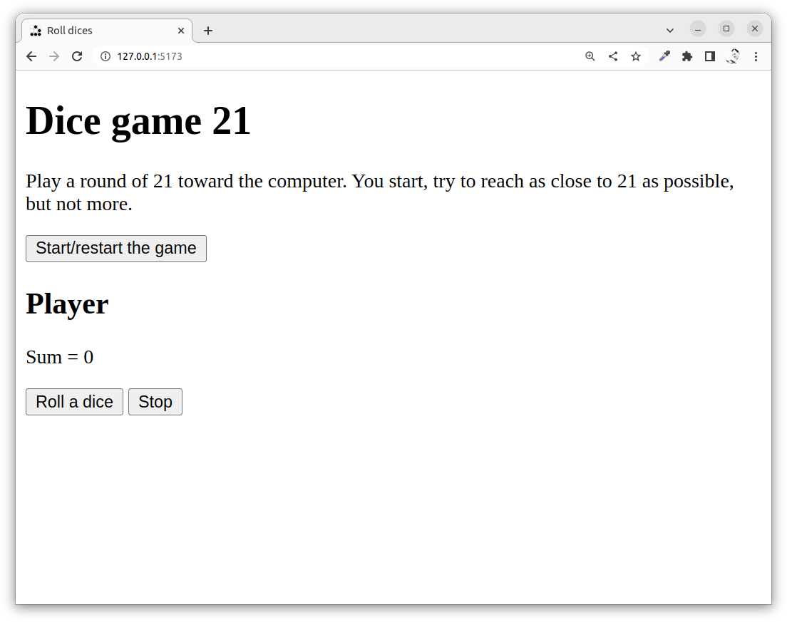
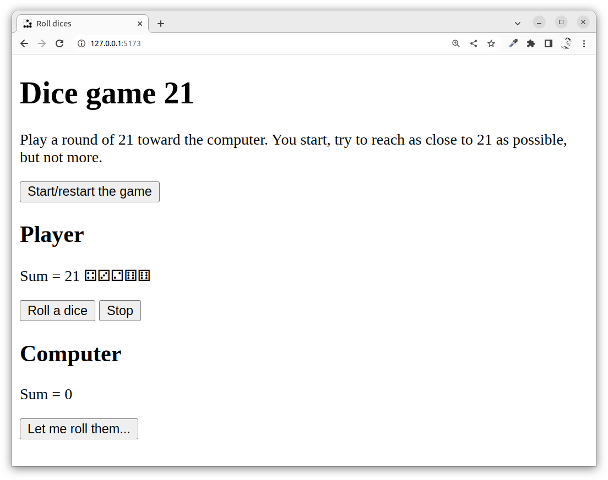
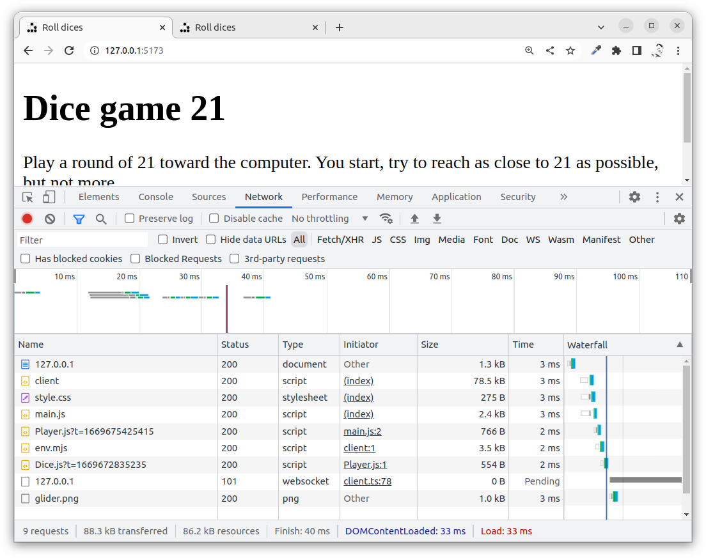
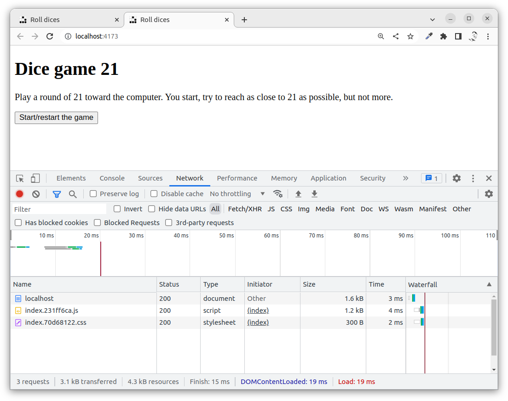
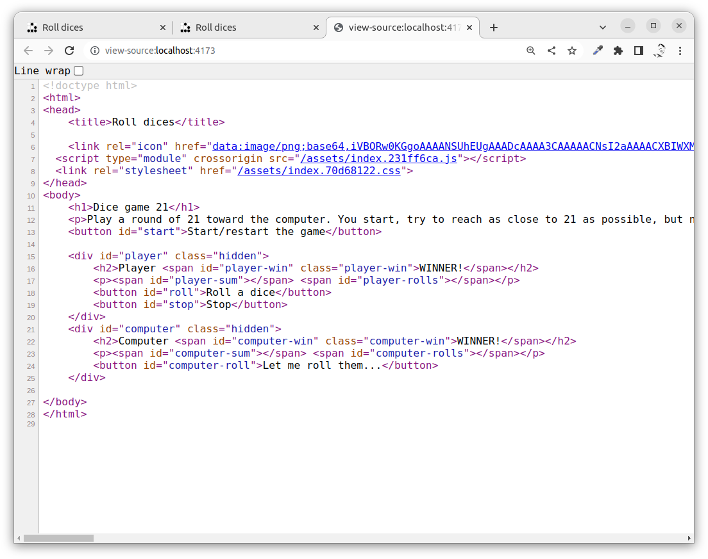
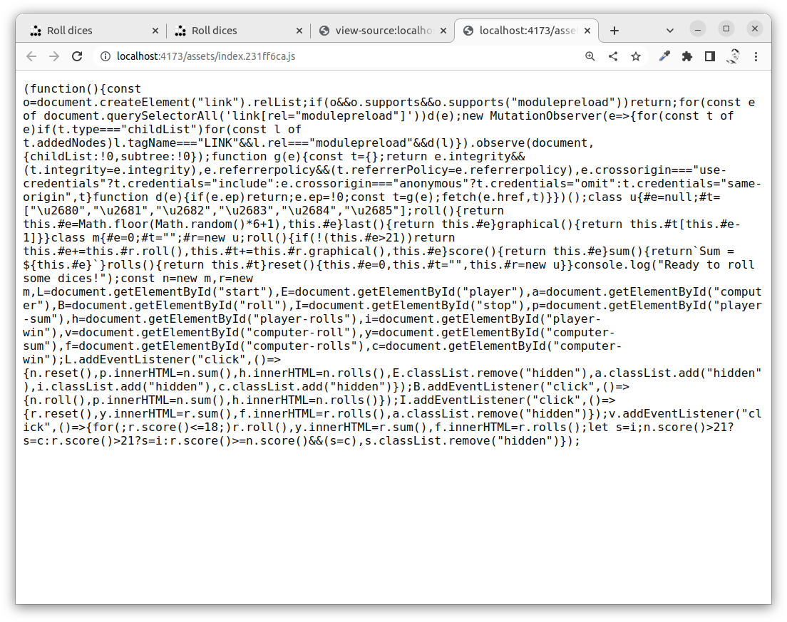

---
revision:
    "2022-11-29": "(A, mos) First release."
---
Get going with the Vite build tool (Hello World Vite)
===========================

This example shows how to get going with the Vite build tool and how to integrate it with the linters you are using. 

[[_TOC_]]

This is how it can look like when we are done with this exercise. Still, it is the code behind it that is important.



<!--
You can try out [the live example here](https://mikael-roos.gitlab.io/vite-builder/dist).
-->


Recording
---------------------------

This is a recording when Mikael goes through this exercise, step by step (27 min).

[](https://www.youtube.com/watch?v=1-4kfdEimBU)


Prepare
---------------------------

You should have walked through the exercise "[Create a dice game 21 using JavaScript](https://gitlab.lnu.se/1dv528/course-content/examples-part-a/-/tree/main/public/example/js/dice-game-21)" which gives you insight into the example code used in this repo.

You should know some basics about [Vite](https://vitejs.dev/), just give it a minute or two to scroll around its website and read "[Why Vite](https://vitejs.dev/guide/why.html)".


Directory structure
---------------------------

This repository is how the final results look when you are done with the exercise. 


Get going
---------------------------

Do create an empty directory, for example `vite-builder`, where you can work in.

The intention is that this directory should be its own repository, so we will install everything into this directory and treat it as the root of a new repo.


### npm init

Start to prepare the repo to contain the `package.json` file.

```text
npm init --yes
```


### Install the linters

Looking at the development repo at "[Development Environment JavaScript](https://gitlab.com/mikael-roos/development-environment-javascript)" and we want to set up the same development environment.

Install the linters and save them as the dev environment.

```text
npm install --save-dev      \
    htmlhint                \
    stylelint               \
    eslint                  \
    eslint-config-standard  \
    eslint-plugin-import    \
    eslint-plugin-jsdoc     \
    eslint-plugin-promise   \
    eslint-plugin-n         \
    jsdoc
```

Now you have all the linters installed and setup as part of your development environemnt.


### Get configuration files

The linters has their own configuration files and we get them from the development (or actually this) repo using the command curl or wget. We also include a `.gitignore` and the `.editorconfig` configuration files.

Using curl.

```text
# Move to the root of the repo
curl --silent --output .editorconfig https://gitlab.com/mikael-roos/vite-builder/-/raw/main/.editorconfig
curl --silent --output .gitignore https://gitlab.com/mikael-roos/vite-builder/-/raw/main/.gitignore
curl --silent --output .stylelintrc.json https://gitlab.com/mikael-roos/vite-builder/-/raw/main/.stylelintrc.json
curl --silent --output .eslintrc.js https://gitlab.com/mikael-roos/vite-builder/-/raw/main/.eslintrc.js
curl --silent --output .jsdoc.json https://gitlab.com/mikael-roos/vite-builder/-/raw/main/.jsdoc.json
```

Or using wget.

```text
# Move to the root of the repo
wget -qO .editorconfig https://gitlab.com/mikael-roos/vite-builder/-/raw/main/.editorconfig
wget -qO .gitignore https://gitlab.com/mikael-roos/vite-builder/-/raw/main/.gitignore
wget -qO .stylelintrc.json https://gitlab.com/mikael-roos/vite-builder/-/raw/main/.stylelintrc.json
wget -qO .eslintrc.js https://gitlab.com/mikael-roos/vite-builder/-/raw/main/.eslintrc.js
wget -qO .jsdoc.json https://gitlab.com/mikael-roos/vite-builder/-/raw/main/.jsdoc.json
```

You can now verify that all files are downloaded and available in your repo.

```text
ls -l .editorconfig .gitignore .stylelintrc.json .eslintrc.js .jsdoc.json
```


### Setup the scripts

Add the following to the scripts area in the `package.json`. It includes the scripts for the linters and some cleanup scripts.

```json
{
    "scripts": {
        "htmlhint": "npx htmlhint ./src || exit 0",
        "stylelint": "npx stylelint \"./src/**/*.css\" || exit 0",
        "stylelint:fix": "npx stylelint --fix \"./src/**/*.css\" || exit 0",
        "eslint": "npx eslint . || exit 0",
        "eslint:fix": "npx eslint . --fix || exit 0",
        "jsdoc": "npx jsdoc -c .jsdoc.json || exit 0",
        "lint": "npm run htmlhint && npm run stylelint && npm run eslint",
        "clean": "rm -rf build/",
        "clean-all": "npm run clean && rm -rf node_modules/ && rm -f package-lock.json"
    }
}
```

When you are done you can check that the scripts are available.

```text
npm run
```


Install Vite
---------------------------

Now we can add the builder tool Vite, first we install the packages.

```text
npm install --save-dev vite
```

Create a configuration file `vite.config.js` and add the following to it.

```javascript
export default {
  root: 'src',
  build: {
    outDir: '../dist',
    emptyOutDir: true,
    target: 'esnext'
  }
}
```

This means that the root directory for Vite is the `src/`. Go on and create that directory.

```text
mkdir src
```

We now add the Vite scripts to the script part in the `package.json`.

```json
{
    "scripts": {
        "dev": "vite",
        "build": "vite build",
        "serve": "vite preview"
    }
}
```

Check with `npm run` that the scripts are available.

The script `npm run dev` starts the development server using the files in vite root directory `src/`.

The script `npm run build` builds the target into the `dist/` directory.

The script `npm run serve` starts a server to show the content in `dist/`.

You can now try out the vite build tool. But first we need a entrypoint in the file `src/index.html`. Do create that file and add the following code into it.

```html
<!doctype html>
<p>Hello World Vite</p>
```

If it all works the try to `npm run build` and `npm run serve` and verify that the `dist/` directory is generated and that the same results appear in the webpage.

Vite consist of a 

* development server to work with development of files in `src/`,
* a build tool to generate a distribution in `dist/` from the source in `src/`,
* preview the generated distribution in `dist/`.

Remember the difference in the `src/` and the `dist/` directories. It will be more obvious when we start to add more code.


Work with Vite
---------------------------

The following sections contain details on how you can work with vite by structuring your code in the `src/` directory. We will go through an example with a dice program that uses ESM modules.

We will not focus on the actual code written, we will just see where to store the files in the directory structure. You may checkout the actual code by viewing the files in this repo.

Before we start, the directory structure looks like this if we exclude the directories `.git` and `node_modules`.

```text
$ tree -a -I .git -I node_modules .
.
├── .editorconfig
├── .eslintrc.js
├── .gitignore
├── .jsdoc.json
├── .stylelintrc.json
├── README.md
├── dist
│   └── index.html
├── package-lock.json
├── package.json
├── src
│   └── index.html
└── vite.config.js

2 directories, 11 files
```

Check that your own structure looks like above.


Dice game 21 using dices
---------------------------

This example program is a dice game playing 21. It works like this.

The player starts the game and rolls a dice. The player can continue to roll dices to reach 21 or close to 21. If the player gets more points than 21 then the player looses.

When the player stops, it will be the computer players time to roll. The computer player rolls and stops when the sum is 18 or more. The computer wins on equal.

The game looks like this when the game starts, all code is saved in `src/index.html` which is the starting point for the application. The stylesheet is in `src/css/style.css` and the favicon image in `src/img/glider.png`. The JavaScript code is in the directory `src/js/` and the only file inmported into the page is the `src/js/main.js`.

```text
$ tree src
src
├── css
│   └── style.css
├── img
│   └── glider.png
├── index.html
└── js
    └── main.js

3 directories, 4 files
```

This is how the index page looks like, however, the actual game is not really the important part of this example.




Using ESM modules
---------------------------

The game is implemented using ESM modules. Classes for `Dice` and `Player` are implemented in the files `src/js/modules/Dice.js` and `src/js/modules/Player.js`.

The complete directory structure now looks like this.

```text
$ tree src
src
├── css
│   └── style.css
├── img
│   └── glider.png
├── index.html
└── js
    ├── main.js
    └── modules
        ├── Dice.js
        └── Player.js

4 directories, 6 files
```

When the game is played out it can look like this.

The user presses the "Start/restart" button.



The user presses the "Stop" button when done.



The computer rolls automatically the dices and stops at 18 or more.


The source and the dist
---------------------------

All source files are stored in `src/` and using the development server through `npm run dev` you can develop the code which reloads the page on any new save you do.

If you inspect the files loaded when in development you will see some files the vite injects.



When you are all done you can build the code and let vite create the `dist/` directory that is the intended distribution of the source code. This part of the code is intended to be put up on a production server.

Now try build the distribution code.

```text
num run build
```

The code generated into the `dist/` is structured like this.

```text
$ tree dist
dist
├── assets
│   ├── index.231ff6ca.js
│   └── index.70d68122.css
└── index.html

1 directory, 3 files
```

Now preview the dist code.

```text
npm run serve
```

The application should work the same as when in development.

You can now see what files are loaded into the application.



You can see the naming of the files, these names are structured by vite during the build process.

If you view the source of the HTML page you will see that the favicon is embedded into the page for efficiency (line 6).



Try clicking on the stylesheet and you will see that it is minified.

Try clicking on the JavaScript file and you will see that it is minified and all modules are budnled into one file.



Vite builds to prepare for efficient delivery of the production application.


Short story on setting up the development environment
-----------------------

This is a copy & paste to create a development environment in a new fresh and emty directory. The commands below are summarized from above in this exercise.

First, create a new and empty directory and move into it.

Create the `src/` dir.

```text
mkdir src
```

Install using npm.

```text
npm init --yes
npm install --save-dev      \
    htmlhint                \
    stylelint               \
    eslint                  \
    eslint-config-standard  \
    eslint-plugin-import    \
    eslint-plugin-jsdoc     \
    eslint-plugin-promise   \
    eslint-plugin-n         \
    jsdoc                   \
    vite
```

Download sample configuration files using curl.

```text
curl --silent --output .editorconfig https://gitlab.com/mikael-roos/vite-builder/-/raw/main/.editorconfig
curl --silent --output .gitignore https://gitlab.com/mikael-roos/vite-builder/-/raw/main/.gitignore
curl --silent --output .stylelintrc.json https://gitlab.com/mikael-roos/vite-builder/-/raw/main/.stylelintrc.json
curl --silent --output .eslintrc.js https://gitlab.com/mikael-roos/vite-builder/-/raw/main/.eslintrc.js
curl --silent --output .jsdoc.json https://gitlab.com/mikael-roos/vite-builder/-/raw/main/.jsdoc.json
curl --silent --output vite.config.js https://gitlab.com/mikael-roos/vite-builder/-/raw/main/vite.config.js
```

The script part needs to manually be added to the `package.json`.

```json
{
    "scripts": {
        "dev": "vite",
        "build": "vite build",
        "serve": "vite preview",
        "htmlhint": "npx htmlhint ./src || exit 0",
        "stylelint": "npx stylelint \"./src/**/*.css\" || exit 0",
        "stylelint:fix": "npx stylelint --fix \"./src/**/*.css\" || exit 0",
        "eslint": "npx eslint . || exit 0",
        "eslint:fix": "npx eslint . --fix || exit 0",
        "jsdoc": "npx jsdoc -c .jsdoc.json || exit 0",
        "lint": "npm run htmlhint && npm run stylelint && npm run eslint",
        "clean": "rm -rf build/",
        "clean-all": "npm run clean && rm -rf node_modules/ && rm -f package-lock.json"
    }
}
```

Verify that the scripts are available.

```text
npm run
```

Thats all. 


Summary
-----------------------

We have setup a repo from the beginning with development tools and we included the Vite builder. We used a structure suited for working with code using vie in both development mode and to build the production code.

To proceed from here you should setup your own vite project in the same manner we did here.
